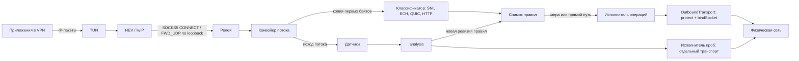

# Архитектура adaptive-dpi-android

Этот документ описывает целевую архитектуру приложения целиком и отмечает, что из неё уже есть в коде. Подробности вынесены в отдельные документы:

- [TRANSPORT.md](TRANSPORT.md) - реализованный транспорт, жизненный цикл VPN и диагностика, с проверенными решениями;
- [ENGINE.md](ENGINE.md) - движок анализа: датчики, диагноз, анализ вариантов, синтез меры, слежение за изменениями, очередь;
- [OPERATIONS.md](OPERATIONS.md) - каталог операций обхода и их возможность без root;
- [TESTING.md](TESTING.md) - уровни проверки, критерии приёмки, подтверждённые результаты;
- [ROADMAP.md](ROADMAP.md) - этапы, задачи и то, что удаляется из кода;
- [DEPENDENCIES_AND_LICENSES.md](DEPENDENCIES_AND_LICENSES.md) - сторонние компоненты и лицензии;
- [PIXEL7_TESTING_RU.md](PIXEL7_TESTING_RU.md) - пошаговая проверка на телефоне.

Статусы в документах: **[есть]** - реализовано в `main`; **[не подключено]** - код есть в `main`, но в тракт не подключён; **[план]** - запланировано; **[гипотеза]** - требует эксперимента.

## Цель и обязательные ограничения

Приложение само обнаруживает, что ресурс недоступен из-за DPI, выясняет механизм блокировки, синтезирует меру обхода под этот ресурс (параметры меры вычисляются по каждому соединению), проверяет её по полученному содержимому и следит, не изменилось ли поведение DPI. Пользователь устанавливает приложение и включает его; ручных настроек стратегий нет.

Ограничения, которые не обсуждаются:

- без root, Magisk и внешнего VPN- или прокси-сервера;
- без MITM, подмены сертификатов, отключения проверки TLS и расшифровки пользовательского трафика;
- без отправки данных пользователя третьим лицам; диагностика и решения - на устройстве;
- обычный трафик работает корректно, остановка VPN предсказуема;
- активные проверки только по поводу: отказ живого трафика, действие пользователя, смена сети или истечение срока факта, к которому привязана действующая мера; всё - в пределах бюджета; без повода в спокойном состоянии проб нет;
- стратегии выбираются алгоритмически, без LLM.

Что приложение принципиально не может: обойти блокировку по IP-адресу и региональное ограничение (нужен другой внешний адрес), отправлять произвольные сырые пакеты и видеть входящие пакеты сети целиком (нужен root). Об этом приложение сообщает пользователю прямо.

## Как это работает для пользователя

1. Включение: системное согласие Android на VPN, затем работа в фоне с постоянным уведомлением.
2. По умолчанию через локальный движок идёт **весь трафик устройства** (кроме самого приложения) и уходит в сеть напрямую. Соединения, которые получают нормальный ответ, движок не трогает: для них всегда прямой путь без изменений.
3. Пока всё работает, движок только считает исходы соединений. Проб нет, кроме ограниченных бюджетом перепроверок при смене сети или истечении срока действующей меры.
4. Когда соединения к ресурсу начинают ломаться характерным образом, движок в фоне выясняет механизм, синтезирует меру и проверяет её. Работающие соединения при этом не трогаются.
5. Новые соединения к ресурсу получают подтверждённую меру. Пользователь видит короткое объяснение.
6. Если мера перестаёт работать, движок перепроверяет тот факт о DPI, на котором она держалась, и перестраивает меру.

## Модули

| Модуль | Ответственность | Состояние |
| --- | --- | --- |
| `:app` | Экраны, состояние интерфейса, экспорт диагностики | **[есть]** технический интерфейс |
| `:designsystem` | Тема, общие компоненты | **[есть]** |
| `:vpn` | Android-адаптеры: `VpnService`, согласие, уведомление, наблюдение за сетью, политика сокетов (`protect`, `bindSocket`), нативная библиотека (HEV, JNI, операции над сокетом), исполнитель проб на Android, хранилище профилей | **[есть]** транспорт и диагностика; остальное **[план]** |
| `:engine` | Платформенно-независимый тракт потока: релей SOCKS5, `OutboundTransport`, конвейер потока (захват префикса, классификатор, применение меры), исполнитель операций уровня Kotlin | **[есть]** релей и транспорт; **[не подключено]** классификатор; остальное **[план]** |
| `:analysis` | Чистый Kotlin без Android: агрегаты датчиков, профиль DPI, диагноз, пробы-вопросы, анализ вариантов, синтез меры, слежение за изменениями, очередь проб, бюджеты | **[план]** новый JVM-модуль |

### Реализация модулей [план]

Существующие файлы не переносятся и не переименовываются (п. 24 AGENTS.md). Новый код - в новых пакетах и классах. Если класс ниже назван «есть», его расширяют, а не пишут заново.

| Модуль, пакет | Классы | Что делают | Опора на существующее |
| --- | --- | --- | --- |
| `:engine`, `org.adaptivedpi.android.engine` | `HevLoopbackRelay` (есть) | Точка встраивания конвейера - функция `tcp()`: после `reply(output, 0)` первое чтение клиента идёт в `FlowPipeline` (сейчас там обычное копирование) | Релей, `OutboundTransport`, `TransportFailure` |
| `:engine`, `...engine.flow` | `FlowPipeline`, `FlowClassifier`, `MeasureExecutor`, `FlowOutcomeRecorder` | Захват префикса, ключ DPI, применение меры, сбор исхода | `ClientHelloInspector` (расширить результат: смещение и длина SNI, число записей, размер, ALPN) |
| `:engine`, `...engine.ops` | `SocketOps` (интерфейс), операции Kotlin | Операции каталога; всё платформенное - через `SocketOps` | Шаблон `OutboundSocketPolicy`: интерфейс в `:engine`, реализация в `:vpn` |
| `:analysis` (новый JVM-модуль), `org.adaptivedpi.android.analysis` | `AnalysisActor`, `HypothesisSpace`, `ProbePlanner`, `MeasureSynthesizer`, `KeyLifecycle`, `Budgets`, `ProfileStore`, `ReasoningJournal` | Всё из [ENGINE.md](ENGINE.md); раздел 28 - алгоритмы | Только `kotlinx-coroutines-core` (уже в проекте) |
| `:vpn`, `...vpn.analysis` | `AndroidSocketOps`, `ProbeTransport`, `NetworkStateMonitor`, `CapabilitySelfTest`, `UidResolver` | Android-реализации интерфейсов `:analysis` и `:engine` | `VpnOutboundSocketPolicy` (`protect`, `bindSocket`, `ParcelFileDescriptor` + `Os`), `ResourceProbe` (стадии DNS-TCP-TLS-HTTP-CONTENT для П3) |
| `:vpn`, нативная часть | `adaptive_ops.c` рядом с `bridge.c` в `vpn/src/main/hev/` | Узкие функции над дескриптором ([OPERATIONS.md](OPERATIONS.md), «Реализация операций») | Сборка `ndk-build`, `Android.mk` |
| `:vpn`, `...vpn.diagnostics` | `ExitReasonReader` | Причины прошлых завершений процесса в журнал ошибок | `DiagnosticCenter.captureCrash`, `DiagnosticJournal` |
| `:app` | `BackupCodec`, экраны из «Интерфейса» | Экспорт и импорт, интерфейс | `DiagnosticExports` (поделиться, сохранить) |
| `:designsystem` | Компоненты из «Интерфейса» | Тема | `AdaptiveDpiTheme`, `AdaptivePanel` |

**Интерфейсы между модулями** (сигнатуры - целевые; точные типы уточняются при реализации, но направление зависимостей фиксировано: `:app` → `:vpn` → `:engine`, `:analysis`; `:engine` и `:analysis` друг от друга не зависят. Типы потока (`FlowKey`, `FlowMeasure`, `FlowRecord`) - простые данные в `:engine`, типы анализа (`DpiKey`, `Measure`, `FlowOutcome`) - в `:analysis`; `:vpn` переводит одни в другие):

```kotlin
// :engine - что нужно релею. Реализует :vpn, связывая с :analysis.
interface FlowPolicy {
    /** Неизменяемый снимок; читается один раз на соединение, без блокировок. */
    fun measureFor(key: FlowKey, uid: Int?): FlowMeasure?
}
interface FlowObserver {
    /** Не блокирует: кладёт исход в очередь; при переполнении исход отбрасывается и считается. */
    fun onOutcome(outcome: FlowRecord)
}
interface SocketOps {
    fun notSentBytes(socket: Socket): Int?          // TCP_INFO.tcpi_notsent_bytes; null - недоступно
    fun setTtl(socket: Socket, ttl: Int): Boolean
    fun sendUrgent(socket: Socket, data: ByteArray): Boolean
    fun capabilities(): Set<String>                  // имена операций, прошедших самотест
}

// :analysis - вход и выход актора.
sealed interface AnalysisEvent { /* FlowOutcome, NetworkChanged, NetworkState, UserAction, ProbeDone, Tick */ }
interface ProbePort { suspend fun run(probe: ProbeSpec): ProbeOutcome }   // реализует :vpn
interface RulePublisher { fun publish(revision: RuleRevision) }           // атомарная замена снимка
interface Clock { fun nowMillis(): Long }                                 // виртуальное время в тестах
```

**Потоки:**

| Что | Где выполняется |
| --- | --- |
| Живые соединения | Существующие пулы релея; конвейер выполняется в потоке соединения и ничего не ждёт от `:analysis` |
| `AnalysisActor` | Одна корутина на `Dispatchers.Default.limitedParallelism(1)`, два входа: управляющие события (команды, смена эпохи и состояния сети, завершение пробы, Stop) - канал без потерь, их мало; пассивные наблюдения живого трафика - `Channel(1024)` с вытеснением старейших и счётчиком вытесненных в диагностике. Граница сбоя не перехватывает `CancellationException` |
| Пробы | `Dispatchers.IO.limitedParallelism(слоты)`, свой экземпляр `OutboundTransport` (инвариант 3) |
| Запись на диск | Одна корутина на `Dispatchers.IO`, не чаще раза в 5 с, плюс при остановке VPN |

Процесс один, как сейчас: отдельный процесс для движка не нужен, отказоустойчивость даёт инвариант 13 - `try`/`catch` на границах `FlowPolicy.measureFor`, `MeasureExecutor` и актора с переходом на прямой путь.

**Формат хранения** - JSON через `kotlinx.serialization`. Зависимость одобрена пользователем и добавлена в каталог версий (`gradle/libs.versions.toml`: библиотека `libs.serialization.json` 1.11.0, собранная на Kotlin 2.3.20; плагин `libs.plugins.kotlin.serialization` версии Kotlin проекта; лицензия Apache 2.0). Модуль, который её использует (`:analysis`, `:app` для экспорта), подключает плагин и библиотеку в своём `build.gradle.kts`. Файлы в `noBackupFilesDir/analysis/`: `profiles.json`, `keys.json`, `overrides.json`, `budgets.json`, `capabilities.json`; каждый с полем `schema` (целое) и записью через временный файл и атомарное переименование (`Files.move(..., ATOMIC_MOVE)`).

Почему `:analysis` - отдельный JVM-модуль: решения должны проверяться детерминированными тестами с виртуальным временем и моделями DPI без Android и без сети. Android-зависимые действия (сокеты, `Network`, хранилище) передаются ему интерфейсами.

## Поток трафика



Транспортная часть (TUN → HEV → релей → `OutboundTransport` → сеть) **[есть]** и проверена на эмуляторе. Та же форма тракта используется приложением ByeByeDPI (HEV → SOCKS5 → byedpi), что подтверждает её пригодность на Android.

### Конвейер потока [план]

Для каждого нового TCP-соединения после CONNECT:

1. **Исходящее соединение открывается сразу по CONNECT**, параллельно с захватом префикса: иначе каждое TLS-соединение получило бы лишний RTT. Следствие: опции сокета, которые ставятся до `connect()`, доступны только мерам по адресу, а не по имени ([OPERATIONS.md](OPERATIONS.md), «Уровень TCP-сегментов»).
2. **Захват префикса.** Релей читает первые байты клиента в ограниченный буфер: не больше 20 КБ (`ClientHelloInspector.MAX_PREFIX`) и не дольше 250 мс (начальное значение, уточняется телеметрией). Ожидание идёт, только пока `ClientHelloInspector.inspect()` возвращает `NeedMore`; ответ сервера в это время уже идёт клиенту, потому что исходящее соединение открыто.
3. **Немедленный прямой путь**, если первый байт не `0x16` (не TLS handshake) и не начало HTTP-запроса, или если клиент ничего не прислал за порог (протоколы, где сервер говорит первым). Задержки для обычного трафика нет.
4. **Классификация** выполняется один раз, когда собрана полная TLS-запись по полю длины, а не на каждом куске.
5. **Выбор меры** по неизменяемому снимку правил и ключу DPI (см. [ENGINE.md](ENGINE.md), «Ключи»). Ревизия правил закрепляется за соединением на всё время его жизни.
6. **Исполнение.** Исполнитель получает исходящее соединение и буфер префикса, выполняет операции меры, затем поток идёт обычным копированием.
7. **Исход потока** (стадия завершения, `errno`, время до отказа, объёмы, повторные передачи при наличии `TCP_INFO`) передаётся датчикам.

Для UDP: классификация QUIC Initial (SNI извлекается по RFC 9001, раздел 5.2), политика UDP/443 для ресурса, счётчики датаграмм ассоциации.

Для DNS (UDP/53 через релей): наблюдение ответов для корреляции адресов с именами; при проблеме с ресурсом - анализ ответов нескольких публичных резолверов и ответ приложению проверенными адресами (см. «DNS» ниже).

## Языки

Язык выбирается под задачу, а не по привычке. Решение на сейчас:

| Язык | Где | Почему |
| --- | --- | --- |
| Kotlin | Всё приложение: VPN, жизненный цикл, релей, конвейер потока, классификаторы, движок анализа, очередь, хранение, интерфейс | Родной язык Android, безопасная работа с памятью, корутины, существующий проверенный код и тесты |
| C | HEV/lwIP (сторонний код) и узкие обёртки системных вызовов (`TCP_INFO`, `vmsplice`, BPF-фильтр) | Обёртка из десятков строк над одним системным вызовом; другой язык добавил бы набор инструментов сборки без выигрыша |
| Rust | **Резерв**: если измерения покажут, что конвейер потока или релей нужно перенести из JVM в нативный код ради производительности или батареи | Для большого нативного кода, разбирающего недоверенные данные, безопасность памяти Rust важнее простоты C. Цена: `cargo` и кросс-сборка под Android ABI, рост APK - оправдана только для крупного модуля |
| Python | DPI-стенд (обработчик NFQUEUE, модели DPI), скрипты CI | Уже используется; в APK не входит |

Отвергнуты: Go (`tun2socks` на gVisor) - отдельная среда выполнения со сборщиком мусора и рост APK при уже работающем HEV; C++ - нет задачи, где RAII или библиотека C++ дали бы выигрыш; встроенный язык сценариев для стратегий (как Lua в zapret2) - см. «Представление мер» ниже.

## Представление мер

Мера - это **данные, а не код**: упорядоченный список операций из [каталога](OPERATIONS.md) с параметрами-правилами («разрез внутри SNI, на середине»), версия схемы и ссылка на факт профиля, из которого она выведена. Формат хранения и обмена - JSON со схемой.

Почему не язык сценариев (Lua в zapret2) и не командная строка (аргументы byedpi):

- меры генерирует движок, а не человек: данные проще порождать, сравнивать, приводить к канонической форме и проверять на допустимость;
- данные нельзя исполнить: нет интерпретатора, нет риска выполнить чужой код из импортированной стратегии;
- каждая операция имеет типизированные параметры и проверяется до применения;
- изменение схемы - явная миграция версии, а не несовместимость сценариев.

Пресеты byedpi не применяются как меры. Их можно импортировать только как начальные веса гипотез: например, если на сети широко используется пресет с разбиением записей, гипотеза «записи не собирает» получает больший начальный вес.

## Граница Kotlin и C

| Где | Что | Почему |
| --- | --- | --- |
| Kotlin | Жизненный цикл VPN, владение всеми сокетами, `protect`/`bindSocket`, отмена, конвейер потока, классификация, решения, анализ, очередь, хранение, интерфейс | Тестируемость на JVM, безопасная работа с памятью, существующий проверенный код |
| Kotlin | Операции уровня приложения: разбиение на TLS-записи, изменение HTTP-заголовков, DoH/DoT, политика UDP/443, TTL сокета через `Os.setsockoptInt` | Достаточно публичного API Android |
| C, существующий | HEV/lwIP, JNI-мост транспорта | **[есть]** |
| C, узкая библиотека операций | Чтение `TCP_INFO` (неотправленные и неподтверждённые байты, повторные передачи), ожидание фактической отправки, OOB произвольной длины, fake через `vmsplice` с восстановлением страниц, BPF-фильтр на свой сокет | В `android.system.Os` нет чтения `TCP_INFO` (из `getsockopt*` есть только `getsockoptTimeval`) и нет `splice`/`vmsplice` |

Правила нативной библиотеки:

- она никогда не владеет сокетом: работает с дескриптором, арендованным через `ParcelFileDescriptor.fromSocket()` на время одного вызова, и закрывает только дубликат;
- она не хранит номера дескрипторов между вызовами и не имеет глобального состояния;
- каждый вызов неблокирующий или ограничен по времени; отмена - через закрытие сокета владельцем после возврата вызова;
- каждая функция появляется только после эксперимента, доказывающего, что без неё нельзя.

Широкий нативный движок (весь прокси на C, как byedpi в ByeByeDPI) отвергнут: его конфигурация действует на весь процесс, а движку нужна мера для каждого соединения без перезапуска.

## Инварианты

Эти правила нельзя нарушать при любой реализации.

1. **Мера применяется только к новым соединениям.** Новая ревизия правил действует для новых соединений сразу после публикации, без перезапуска VPN и приложения. Действующие соединения сохраняют ревизию, с которой созданы.
2. **Анализ никогда не задерживает обычный поток** дольше порога захвата префикса.
3. **Пробы идут через отдельный экземпляр транспорта** со своими лимитами и не занимают слоты релея живого трафика.
4. **Ключ меры - то, что видит DPI** (открытый SNI, внешний SNI при ECH, SNI из QUIC Initial, адрес), а не настоящее имя ресурса.
5. **Знание о DPI относится к сети, а не к приложению.** Профиль DPI общий для всех приложений; параметры меры вычисляются по каждому потоку.
6. **Успех подтверждается подлинным ответом сервера** (полное TLS-рукопожатие с действительным сертификатом на имя) или ожидаемым содержимым, а не установлением TCP или получением каких-то байтов. Уровни - [ENGINE.md](ENGINE.md), раздел 15.
7. **Сетевая ошибка не равна DPI.** Диагноз «вмешательство» требует признаков, отличных от общей потери связи.
8. **Владение сокетом всегда у Kotlin.** Нативный код работает только с арендованным дескриптором.
9. **Ничего из пользовательского трафика не сохраняется**: ни содержимого, ни путей, ни cookies. Имена ресурсов хранятся только в профиле DPI на устройстве и не попадают в экспортируемую диагностику.
10. **Принудительное освобождение ресурсов по тайм-ауту запрещено.** Владелец ждёт подтверждения; см. [TRANSPORT.md](TRANSPORT.md).
11. **Каждая проба обоснована своим типом** ([ENGINE.md](ENGINE.md), раздел 22): различающая - разными предсказаниями живых гипотез, параметрическая - разными предсказаниями значений параметра, подтверждающая - единственной живой гипотезой и мерой. Перебор готовых мер запрещён.
12. **Нормально работающие соединения не меняются.** Пока по ключу не было ни одного отказа, его соединения идут прямым путём без операций.
13. **Отказ движка не ломает связь.** Любой сбой классификатора, снимка правил, исполнителя меры или `:analysis` переводит новые соединения на прямой путь; релей продолжает работу.
14. **Меры живого трафика не меняют байты handshake-сообщений** TLS ([OPERATIONS.md](OPERATIONS.md), «Два класса изменений»).

## DNS [план]

DNS, который выдаёт сеть оператора, - один из источников, а не единственный. Запись на одном резолвере может быть подменена, удалена или указывать на неработающий адрес, поэтому для проблемного ресурса движок сравнивает ответы нескольких крупных бесплатных публичных резолверов через зашифрованные протоколы.

Используются только варианты **без фильтрации** - иначе блокировка рекламы или «опасных» доменов самим резолвером выглядела бы как подмена. Все резолверы - разных владельцев, поэтому их ответы независимы.

| Резолвер | IPv4 | DoH | DoT | Источник |
| --- | --- | --- | --- | --- |
| Cloudflare | `1.1.1.1`, `1.0.0.1` | `https://cloudflare-dns.com/dns-query` | `one.one.one.one` | Документация Cloudflare |
| Google Public DNS | `8.8.8.8`, `8.8.4.4` | `https://dns.google/dns-query` | `dns.google` | Документация Google |
| Quad9 без блокировки | `9.9.9.10`, `149.112.112.10` | `https://dns10.quad9.net/dns-query` | `dns10.quad9.net` | Документация Quad9 |
| AdGuard DNS без фильтрации | `94.140.14.140`, `94.140.14.141` | `https://unfiltered.adguard-dns.com/dns-query` | `unfiltered.adguard-dns.com` | База знаний AdGuard |
| Cisco OpenDNS Sandbox (без фильтрации) | `208.67.222.2`, `208.67.220.2` | `https://doh.sandbox.opendns.com/dns-query` | `sandbox.opendns.com` | Список провайдеров AdGuard; сверить со страницей Cisco при реализации |
| Control D без фильтрации | `76.76.2.0`, `76.76.10.0` | `https://freedns.controld.com/p0` | `p0.freedns.controld.com` | Список провайдеров AdGuard; страница Control D отдаёт значения только скриптом - сверить при реализации |
| Яндекс DNS «Базовый» | `77.88.8.8`, `77.88.8.1` | Хост `common.dot.dns.yandex.net`, порт 443; путь на странице не указан; без проверенного URI DoH Яндекса не используется | `common.dot.dns.yandex.net` | Страница Яндекс DNS |

Роли резолверов:

- **Иностранные** (первые шесть) - источник ответов для сравнения, меры «DNS» и перенаправления. Расхождение ответов само по себе не подмена: авторитетный сервер выдаёт разные адреса CDN по местоположению резолвера и ECS (RFC 7871). Результаты разделяются: «расхождение DNS» (разные адреса), «сбой разрешения» (сетевой отказ, `SERVFAIL`), отдельно `NXDOMAIN` и «нет записи этого типа». «Подтверждённая подмена» - только когда адрес системного DNS не проходит одинаковую проверку доступности с исходным именем (TLS с действительным сертификатом на имя), а адреса резолверов проходят (раздел 27 [ENGINE.md](ENGINE.md)).
- **Яндекс** - российский резолвер: только для сравнения, никогда как единственный источник адреса для меры. Совпадение его ответа с системным DNS - только наблюдение: причину и масштаб ограничения оно не устанавливает; учитывать, подчиняется ли он реестру блокировок, нельзя заранее - это не проверено.
- **Контрольные точки «общей проблемы сети»** - адреса из таблицы, по одному на владельца (раздел 3 [ENGINE.md](ENGINE.md)).
- По умолчанию для меры используется Cloudflare; пользователь выбирает основной резолвер и может отключать любые. Резолвер, который на этой сети блокируется, получает пометку в профиле сети и временно не используется.
- Mullvad DNS не включён: по странице Mullvad публичный зашифрованный DNS прекращён 2 ноября 2026 года.

Как это работает:

1. **Только по поводу.** Пока ресурс работает, используется обычный DNS сети. Сравнение запускается, когда датчики отмечают проблему с ресурсом, или как вопрос В1 при диагнозе.
2. **Сравнение ответов:** системный DNS против ответов резолверов из таблицы. Признаки: подменённый адрес, NXDOMAIN или пустой ответ только у одного источника, адреса, недоступные по TCP.
3. **Проверка адресов:** из объединения ответов отбираются адреса, на которых ресурс действительно отвечает (установление TCP и, где можно, получение содержимого). Это решает и случай «адрес удалён или не работает у одного резолвера».
4. **Мера «DNS»:** для ключа ресурса приложению отвечают проверенными адресами через релей (UDP/53 уже проходит через релей).
5. **Резолверы сами могут блокироваться.** Соединения к DoH и DoT - такие же ресурсы для движка: к ним применяются диагноз и меры. Если все зашифрованные резолверы недоступны, остаётся DNS сети.
6. **Прозрачность.** Имена проблемных ресурсов уходят выбранному публичному резолверу. Это явная настройка с объяснением при первом запуске, а не скрытая отправка; список резолверов редактируется. Согласия раздельные: DNS-запросы к публичным резолверам и отправка имени ресурса на контрольный адрес в вопросе В3 ([ENGINE.md](ENGINE.md), раздел 16) - две разные настройки.

Если на устройстве включён строгий режим «Частный DNS», система сама шифрует DNS (DoT на порт 853), и релей не видит запросы; тогда движок наблюдает только адреса соединений.

**Приложения со своим DoH** (Chrome с «Защищённым DNS», Firefox и др.) тоже не дают релею видеть их запросы. Решение - не бороться с их DNS, а работать с тем, что видно:

| Проблема | Что делаем |
| --- | --- |
| Подмена DNS | Не возникает: зашифрованный ответ DPI не подменяет. Ничего не делаем |
| Заблокирован сам DoH-сервер приложения | Это обычный TLS-ключ (`dns.google`, `cloudflare-dns.com` и т. п.): диагноз и мера как для любого ресурса. Если меры нет, приложение обычно само переходит на системный DNS, а его обслуживает релей |
| Блок по адресу | Мера **«перенаправление»** в релее ([OPERATIONS.md](OPERATIONS.md)): соединение к заблокированному адресу X получает SNI из префикса, и релей подключается к проверенному рабочему адресу того же имени из ответов наших резолверов. Сертификат проверяет само приложение, поэтому подменить сервер так нельзя |

Перенаправление - общая мера блока по адресу для всех приложений, а мера «DNS» (п. 4) - дополнительная, там, где приложение спрашивает системный DNS: она избавляет от лишнего ожидания префикса. Отключать DoH в приложениях пользователю не предлагается.

## Сеть и жизненный цикл

Реализованный жизненный цикл, состояния и правила очистки описаны в [TRANSPORT.md](TRANSPORT.md).

Целевая модель смены сети **[план]**:

| Событие | Действие |
| --- | --- |
| Новая сеть по умолчанию (Wi-Fi ↔ мобильная) | `OutboundTransport.updateNetwork()` с политикой новой сети, `setUnderlyingNetworks([новая])`; сеанс продолжается; эпоха сети в `:analysis` меняется, незавершённые пробы отменяются |
| Изменились DNS текущей сети | Пересоздать TUN с новыми DNS (`establish()` повторно) |
| Пропали все физические сети | Состояние ожидания сети: новые соединения отклоняются, VPN не выключается |
| Сеть вернулась | `updateNetwork()` |
| Смена сети во время Stop | Stop имеет приоритет; события сети старого сеанса отбрасываются по ID |

Существующие TCP-соединения при смене сети рвутся неизбежно: их адрес принадлежит старой сети. Приложения переподключаются сами.

Сейчас **[есть]** более простая модель: смена или потеря сети останавливает сеанс, повторный запуск - вручную.

## Состояние сети [план]

Перед любым подбором движок проверяет, что проблема не в самой сети. Без этого авторизация в Wi-Fi гостиницы или плохая связь выглядят как блокировка всего подряд, и подбор шёл бы впустую.

Источники, от дешёвых к дорогим:

1. **Система, бесплатно** - по физической сети (не по VPN): `NetworkCapabilities` - `NET_CAPABILITY_VALIDATED` и `NET_CAPABILITY_CAPTIVE_PORTAL` (API 23), `getSignalStrength()` (API 29), `getLinkDownstreamBandwidthKbps()` (API 21); `LinkProperties` - `getDnsServers()` (API 21), `isPrivateDnsActive()` и `getPrivateDnsServerName()` (API 28), `getHttpProxy()` (API 21), `getMtu()` (API 29). Уровни API сверены с документацией Android.
2. **Живой трафик, бесплатно** - датчики [ENGINE.md](ENGINE.md), раздел 3: RTT установления, повторные передачи, отказы по ключам разных провайдеров.
3. **Активная проверка - только при проблеме** и не чаще раза в минуту: время TCP-подключения к адресам публичных резолверов (это «пинг» без root), DNS-запрос к DNS сети и к одному DoH. ICMP-пинг без root через ping-сокет (`SOCK_DGRAM`, `IPPROTO_ICMP`) - **[гипотеза]**, проверяется самотестом; TCP-подключение работает всегда.

| Состояние | Признак | Что делает движок |
| --- | --- | --- |
| Норма | `VALIDATED`, RTT обычный, нет отказов по разным провайдерам | Подбор разрешён |
| Авторизация в сети | `CAPTIVE_PORTAL` или нет `VALIDATED` при живой связи | Подбор приостановлен; уведомление «Войдите в сеть Wi-Fi»; VPN не мешает: открытие страницы входа - системное |
| Нет интернета | Нет `VALIDATED`, TCP-подключение ни к одной контрольной точке не проходит | Подбор приостановлен |
| Плохая связь | RTT больше 1 с или потери (повторные передачи) на ключах разных провайдеров | Подбор приостановлен, пробы не запускаются: их исходы были бы шумом |
| Свой DNS сети не работает | DNS сети не отвечает, DoH отвечает | Не DPI ресурса: всем ключам - мера «DNS» через DoH, отметка в профиле сети |

**Реализация.** `NetworkStateMonitor` в `:vpn` регистрирует `ConnectivityManager.NetworkCallback` на запрос с `NET_CAPABILITY_NOT_VPN` и `NET_CAPABILITY_INTERNET` - так же, как сейчас `AdaptiveVpnService.watchPhysicalNetwork` следит за физической сетью, - и читает признаки в `onCapabilitiesChanged` и `onLinkPropertiesChanged` текущей физической сети по умолчанию. Изменения сглаживаются: состояние публикуется, если держится 2 с. Активная проверка (п. 3) запускается актором `:analysis` как проба класса P0 и учитывается в бюджете сети. Результат - событие `NetworkState` для актора и поле состояния сети в `AnalysisUiState`.

Данные о сети (DNS-серверы, Private DNS, прокси, MTU) входят в подпись сети и отчёт о диагнозе ([ENGINE.md](ENGINE.md), разделы 2, 27).

## Автозапуск и постоянная работа [план]

Чтобы приложение «работало само», VPN должен включаться без участия пользователя:

- **Always-on VPN** - системная настройка Android, которая сама запускает VPN-службу после загрузки и держит её включённой. Для этого в манифесте нужен `android.net.VpnService.SUPPORTS_ALWAYS_ON = true`; сейчас там `false` (`vpn/src/main/AndroidManifest.xml`). Это изменение манифеста, его нужно назвать отдельно (п. 27 AGENTS.md) и проверить запуск службы системой без Activity.
- **Без Always-on** приложение после перезагрузки само VPN не включает: разрешения на автозапуск VPN без системной настройки у приложения нет. Интерфейс предлагает включить Always-on и объясняет, как.
- **Другой VPN.** На устройстве одновременно активен только один VPN. При включении нашего система сама отключает предыдущий: приложение показывает системный запрос разрешения и ничего не делает с чужим VPN. Если пользователь включает другой VPN, система вызывает `onRevoke()`: сеанс останавливается штатно (это уже есть в коде, `AdaptiveVpnService.onRevoke`, состояние `SystemConsentRevoked`), уведомление «VPN отключён: включён другой VPN» с действием «Включить снова». Автоматически обратно не включаемся - иначе два VPN бесконечно отключали бы друг друга.
- **Сетевые настройки не меняются.** VPN не трогает настройки Android (DNS, прокси, APN, Wi-Fi). Всё действие ограничено TUN-интерфейсом: когда процесс завершается или падает, система закрывает TUN и возвращает обычную сеть сама.
- **Устойчивость к падениям.** Сбой движка не ломает связь (инвариант 13). Если упал весь процесс VPN, с Always-on его перезапустит система; без Always-on при следующем открытии приложения показывается «VPN был остановлен из-за сбоя» и кнопка «Включить», а сбой уже сейчас попадает в журнал ошибок («Журнал сбоев»). Переход на перезапуск службы без Always-on (`START_STICKY` и запуск foreground-службы из фона) - **[гипотеза]**: ограничения фонового запуска нужно проверить на Android 17.
- Режим «Блокировать подключения без VPN» остаётся выбором пользователя; при нём сбой движка оставляет устройство без сети, поэтому стабильность транспорта - условие включения автозапуска.

## Ограничение ресурсов [план]

Главное ограничение - процессор: проверки не должны заметно нагревать телефон и тормозить работу.

| Ресурс | Ограничение | Как обеспечивается |
| --- | --- | --- |
| Процессор движка | Средняя загрузка `:analysis` не больше 2 % одного ядра за 10 минут; не больше 25 % в пике | Один поток-актор; пробы ждут сеть, а не считают; при превышении следующая проба откладывается до снижения |
| Процессор релея | Накладные расходы на 1 МБ/с трафика измеряются на этапе 4.0 и записываются в [TRANSPORT.md](TRANSPORT.md) | Без копирования данных между буферами без необходимости |
| Трафик проб | Бюджеты ключа и сети ([ENGINE.md](ENGINE.md), раздел 21); на мобильной сети - половина бюджета | Учёт байтов каждой пробы |
| Батарея | Ни одной активной проверки без проблемного ключа; при выключенном экране - только P0 и задачи переднего плана | Правила раздела 19 [ENGINE.md](ENGINE.md) |
| Время до помощи | От первого отказа до меры - не больше 30 с для ресурса с известным фактом сети и не больше 3 минут для нового механизма | Начальные цели; проверяются на стенде и Pixel 7 |
| Задержка VPN | Добавочная задержка установления соединения - не больше 10 мс на устройстве | Измерение на Pixel 7 |

Загрузка процессора измеряется по времени процессора своего процесса (`android.os.Process.getElapsedCpuTime()`, чтение `/proc/self/stat`) - без разрешений. Числа - стартовые, уточняются измерением.

## Журнал сбоев

**[есть]** Обработчик необработанных исключений `VpnDiagnostics.installCrashHandler` пишет событие `DiagnosticCode.AppCrash` через `DiagnosticCenter.captureCrash` в отдельный слот журнала ошибок (`DiagnosticJournal.writeCrash`) и передаёт исключение прежнему обработчику. При следующем запуске `DiagnosticCenter.recover` поднимает это событие и событие прерванного активного сеанса VPN. Хранение и срок - как у журнала ошибок ([TRANSPORT.md](TRANSPORT.md)).

**[план]** Добавляется, без нового хранилища - событиями того же журнала:

- На API 30+ (проверка `Build.VERSION.SDK_INT`) при запуске читаются причины прошлых завершений процесса (`ApplicationExitInfo`, класс есть с API 30, через `ActivityManager.getHistoricalProcessExitReasons`; сигнатура сверяется с документацией при реализации). Записываются только причины, которые обработчик исключений не ловит: `REASON_CRASH_NATIVE`, `REASON_ANR`, `REASON_LOW_MEMORY`, `REASON_EXCESSIVE_RESOURCE_USAGE`, `REASON_SIGNALED`. Уже записанные помечаются по времени, чтобы не дублировать.
- Плашка на главном экране «Приложение завершилось с ошибкой» с `SendButton`, пока пользователь её не закрыл.
- Содержимое трафика и имена ресурсов в событие не попадают - как сейчас.

## Режимы захвата

| Режим | Как | Состояние |
| --- | --- | --- |
| Проверочный TUN | Только своё приложение, без маршрутов и DNS | **[есть]**, служебный |
| Стенд | Своё приложение, маршрут `/32` к частному адресу | **[есть]**, служебный |
| Одно приложение | `addAllowedApplication(пакет)`, IPv4 `0.0.0.0/0`, IPv6 заблокирован | **[есть]**, служебный для первых этапов |
| **Все приложения, кроме исключений - режим по умолчанию** | `addDisallowedApplication`, всегда включая само приложение | **[план]** |
| Выбранные приложения | Список `addAllowedApplication` | **[план]** |

**Режим «весь трафик» зависит от производительности транспорта.** Текущие лимиты (32 сеанса, модель «поток на соединение», пулы до 96 рабочих потоков (`2 × maxSessions` запросов и `maxSessions` ответов) плюс поток приёма и таймер - это предел конфигурации, а не измерение, [TRANSPORT.md](TRANSPORT.md)) рассчитаны на одно приложение. Для всего трафика устройства нужна другая модель конкурентности релея (неблокирующий ввод-вывод на Kotlin или, по измерениям, нативный конвейер - см. «Языки»). Это обязательное условие этапа 4 в [ROADMAP.md](ROADMAP.md).

**Простой TCP.** 60 секунд простоя ([TRANSPORT.md](TRANSPORT.md)) несовместимы с режимом «весь трафик»: соединения push-уведомлений и мессенджеров держатся без данных минутами, и их обрыв каждые 60 с даст переподключения, пробуждения радиомодуля и задержки уведомлений. Условие этапа 4 - тайм-аут простоя порядка часов, обоснованный измерением.

**Локальная сеть.** Маршрут `0.0.0.0/0` захватил бы и локальную сеть: принтеры, трансляцию на ТВ, mDNS и SSDP через SOCKS не работают. Частные и link-local диапазоны исключаются из маршрутов TUN: на API 33+ через `excludeRoute(IpPrefix)`, на API 29-32 - набором маршрутов-дополнений, покрывающих публичное пространство адресов.

**IPv6.** Сейчас IPv6 для захваченных приложений блокируется. Для режима «весь трафик» блокировка IPv6 для всех приложений может ломать сети, где ресурсы доступны только по IPv6, поэтому поддержка IPv6 в тракте (маршрут `::/0`, адрес TUN, DNS) - тоже условие этапа 4.

Своё приложение всегда исключается из пользовательских режимов, чтобы пробы и резолвер не попадали в собственный TUN. Для режимов с несколькими приложениями нужна атрибуция UID: исходный адрес и порт со стороны TUN передаются из HEV в релей по аутентифицированному каналу, затем `ConnectivityManager.getConnectionOwnerUid()` (API 29, только активному VPN) **[план]**. В режиме одного приложения UID известен заранее.

## Требования и покрытие

| Требование | Где спроектировано | Этап |
| --- | --- | --- |
| Без root, без внешнего сервера, без MITM | «Цель и обязательные ограничения» | Постоянно |
| Весь трафик через VPN, нормальные соединения не трогаются | «Режимы захвата», инвариант 12 | 4 |
| Анализ механизма, а не перебор шаблонов | [ENGINE.md](ENGINE.md), разделы 1, 5, 22, 23; инвариант 11 | 2-3 |
| Мера под конкретный ресурс и соединение | [ENGINE.md](ENGINE.md), разделы 7, 17 | 2-3 |
| Подбор в фоне, работающие соединения не рвутся | Инварианты 1-3; [ENGINE.md](ENGINE.md), раздел 10 | 2 |
| Новые проблемные ресурсы помогаются сразу | [ENGINE.md](ENGINE.md), раздел 14 | 3 |
| Приоритеты приложений и очередь по слотам | [ENGINE.md](ENGINE.md), раздел 10 | 4 (нужна атрибуция UID) |
| Не тратить ресурсы, где обход не поможет (регион, сервер, блок по адресу, авторизация в сети, плохая связь) | [ENGINE.md](ENGINE.md), разделы 3, 19; «Состояние сети» | 2 |
| Приложения со своим DoH | «DNS» | 2 |
| Другой VPN, устойчивость к падениям | «Автозапуск и постоянная работа» | 1, 5 |
| Ограничение процессора и время до помощи | «Ограничение ресурсов» | 2-4 |
| Журнал сбоев: причины завершений, которые не ловит обработчик исключений | «Журнал сбоев» | 1 |
| Экспорт, импорт, обмен знаниями без дублей | «Хранение» | 3 |
| Единая тема, отправка журналов «поделиться» и «сохранить» | «Интерфейс» | 2-4 |
| Слежение за изменениями DPI | [ENGINE.md](ENGINE.md), раздел 9 | 3 |
| DNS через несколько публичных резолверов | «DNS» | 2 |
| Успех по подлинному серверу или содержимому | Инвариант 6; [ENGINE.md](ENGINE.md), раздел 15 | 2 |
| Сохранение знаний между перезапусками | [ENGINE.md](ENGINE.md), раздел 20 | 3 |
| Белые и чёрные списки, профили качества | «Режимы захвата»; [ENGINE.md](ENGINE.md), разделы 6, 21, 26 | Профили качества - 2; списки - 4 |
| Отказ движка не ломает связь | Инвариант 13 | 2 |
| Мера только для проблемных эндпоинтов приложения | [ENGINE.md](ENGINE.md), раздел 2 | 2 |
| Диагноз доказан экспериментом, а не предположен | [ENGINE.md](ENGINE.md), раздел 27 | 2 |
| Сброс правил приложения и отдельного эндпоинта, откат сломавшей меры | [ENGINE.md](ENGINE.md), раздел 26 | 2 |
| Приёмы byedpi и zapret покрыты или названы недоступными | [OPERATIONS.md](OPERATIONS.md), «Покрытие приёмов других проектов» | 2-3 |
| Локальная сеть работает | «Режимы захвата» | 4 |
| Восстановление после ошибок | [TRANSPORT.md](TRANSPORT.md); [ENGINE.md](ENGINE.md), раздел 19 | Есть / 3 |
| Батарея и фоновый трафик | [ENGINE.md](ENGINE.md), разделы 10, 21 | 2-5 |
| Смена сети без остановки | «Сеть и жизненный цикл» | 4 |
| Автозапуск | «Автозапуск и постоянная работа» | 5 |
| IPv6 | «Режимы захвата» | 4 |
| Объяснения пользователю и инструменты понимания | [ENGINE.md](ENGINE.md), разделы 13, 24 | 3-5 |
| Автоматизированное тестирование, включая реальный телефон | [TESTING.md](TESTING.md) | 1-2 |

## Хранение

| Что | Где | Формат | Состояние |
| --- | --- | --- | --- |
| История VPN, журнал ошибок, журнал транспорта | Внутренний каталог без резервного копирования | Ограниченные файлы с ротацией | **[есть]**, см. [TRANSPORT.md](TRANSPORT.md) |
| Профили DPI сетей, правила, ревизии, журнал изменений DPI, бюджеты проб | Внутренний каталог | Версионированный JSON с атомарной заменой файла; Room - только если понадобятся связанные запросы | **[план]** |
| Настройки пользователя | `SharedPreferences` (уже используются в `MainActivity`) | - | **[план]** |

### Форматы файлов анализа [план]

Все файлы - `noBackupFilesDir/analysis/*.json`, корень - объект с полями `schema` (целое, сейчас 1) и `savedAt` (ISO 8601). Запись через временный файл и `Files.move(..., ATOMIC_MOVE)`; не чаще раза в 5 с и при остановке VPN. Нечитаемый файл переименовывается в `*.broken` (одна копия), состояние начинается пустым, событие - в журнал ошибок. Имена ресурсов хранятся только здесь и не попадают в экспорт диагностики (инвариант 9).

| Файл | Содержимое |
| --- | --- |
| `profiles.json` | `profiles[]`: `signature` (хеш и признаки Т8), `lastSeen`, `facts[]` (`id`, `mechanism`, `scope` - `{kind: key|class|network, value}`, `params`, `for`, `against`, `state` - `established|unstable|hypothesis`, `confirmedAt`, `epoch`, `expiresAt`, `imported`), `changes[]` (`DpiChange`, последние 100) |
| `keys.json` | `keys[]` по подписи сети: `key` (`DpiKey`), `state`, `since`, `measure`, `reserve[]`, `reason`, `retryAt` |
| `overrides.json` | `overrides[]`: `AppKeyOverride` |
| `budgets.json` | `entries[]`: `scope` (`key:<хеш>` или `network:<хеш>`), `at`, `bytes` - только за последние 60 минут |
| `capabilities.json` | `fingerprint` (`Build.FINGERPRINT`), `checkedAt`, `ops` - `{имя операции: "ok" | "errno:N"}` |

Миграция: класс `AnalysisMigrations` - функция на каждую пару «схема N → N+1» над `JsonObject`; файл новее поддерживаемой схемы не читается, состояние начинается пустым, событие - в журнал.

### Экспорт, импорт и обмен знаниями [план]

Сервера для обмена нет: знания передаются файлом, как журналы. Один формат на всё - JSON с номером схемы, `adaptive-dpi-<вид>-<дата>.json`.

| Вид | Что внутри | Для чего |
| --- | --- | --- |
| **Резервная копия** | Настройки, приоритеты и списки приложений, списки ресурсов, `AppKeyOverride`, профили сетей с фактами и мерами | Перенос на новый телефон, восстановление после переустановки |
| **Знания о сети** | Только профили сетей: факты уровня сети и класса, меры по ключам DPI, подпись сети без внешнего адреса. Без списка приложений, настроек, журналов и сбросов | Передать другу на том же операторе |

**Импорт:**

1. Файл - недоверенные данные: лимит 5 МБ, проверка схемы, разбор как в [TESTING.md](TESTING.md) («Разборщики недоверенных данных»). Неизвестные операции и поля отклоняются целиком для записи, остальное импортируется.
2. **Дубли.** Факт сравнивается по тройке «подпись сети - механизм - область». Совпал - объединяются свидетельства, остаётся более новая дата. Мера сравнивается по паре «ключ DPI - набор операций». Настройки и списки - по ключу записи; при расхождении остаётся локальное значение, импортированное показывается в отчёте импорта.
3. **Импортированное знание - не подтверждение.** Факт из чужого файла получает пометку «импортировано» и работает как начальный вес гипотезы и предсказание меры (раздел 14 [ENGINE.md](ENGINE.md)); подтверждённым он становится только после П1 на этом устройстве. Противоречащий локальному факт не заменяет его, а становится конкурирующей гипотезой.
4. Меры проверяются по возможностям этого устройства (`DeviceCapabilities`): недоступные операции не применяются.
5. После импорта - отчёт: сколько добавлено, объединено, отклонено и почему.

Резервная копия Android сейчас **включена** (в манифесте нет `allowBackup`, по умолчанию `true`), и `filesDir` в неё попадает. Поэтому файлы анализа с именами ресурсов лежат в `noBackupFilesDir`, как уже лежат журналы. Отключение `allowBackup` - изменение манифеста, решается в 3.4 отдельным пунктом (п. 27 AGENTS.md). Перенос - только этим файлом, по явному действию.

Импорт публикуется одним снимком: файлы нового поколения пишутся в `analysis/gen-<n>/`, затем атомарно заменяется маленький файл-указатель текущего поколения; поэтому сбой между заменами не даёт смеси поколений. Повторный импорт идемпотентен: наблюдения несут идентификатор источника и не суммируются повторно; локальные и импортированные наблюдения хранятся раздельно; импортированные меры автоматически не активируются.

Структура файла (`BackupCodec` в `:app`, тот же `kotlinx.serialization`, что и хранение):

```json
{
  "format": "adaptive-dpi-export",
  "schema": 1,
  "kind": "backup",
  "createdAt": "2026-11-24T16:45:00Z",
  "app": { "versionName": "0.1.1", "versionCode": 25 },
  "settings": { },
  "appRules": [ { "package": "org.example", "priority": "HIGH", "inVpn": true } ],
  "resourceLists": { "neverTouch": [ ], "alwaysSelect": [ ] },
  "overrides": [ ],
  "profiles": [ { "signature": { }, "facts": [ ], "measures": [ ] } ]
}
```

`kind` - `backup` или `network-knowledge`; во втором случае разделы `settings`, `appRules`, `resourceLists`, `overrides` отсутствуют. Файл новее поддерживаемой схемы не импортируется («обновите приложение»); старее - переводится явной миграцией по номеру схемы. Импорт - транзакция: сначала разбор и проверка всего файла, затем одна запись в хранилище; при ошибке ничего не меняется.

## Интерфейс [план]

Цель - человек без технических знаний включает приложение одной кнопкой и видит, что всё работает. Технические подробности - в отдельных разделах, а не на главном экране.

### Единая тема

Вся тема - модуль `:designsystem`; экраны не задают цвета, размеры и формы сами. Основа уже есть: `AdaptiveDpiTheme` (светлая, тёмная, как в системе) и `AdaptivePanel`.

| Элемент | Правило |
| --- | --- |
| Цвета | Только `MaterialTheme.colorScheme` из `AdaptiveDpiTheme`. Добавляются три смысловых цвета состояния в обеих темах: «работает» (зелёный), «чиню» (жёлтый), «не помочь» (серый); ошибка - `error` из схемы |
| Формы | `shapes` темы: 10, 16, 24 dp |
| Отступы | Шкала 4, 8, 12, 16, 20, 24 dp - константы в `:designsystem` |
| Шрифты | `MaterialTheme.typography` по умолчанию; свои размеры не задаются |
| Значки | Material Symbols одного стиля (Outlined), векторные ресурсы в `:designsystem/res/drawable`; библиотека значков не подключается |
| Язык | Русский по умолчанию, английский вторым; все строки в ресурсах |

Компоненты `:designsystem` - экраны собираются только из них:

| Компонент | Назначение |
| --- | --- |
| `AdaptivePanel` (есть) | Карточка-секция |
| `StatusBadge` | Значок и подпись состояния ресурса или приложения в одном из трёх смысловых цветов |
| `PowerButton` | Большая круглая кнопка запуска на главном экране |
| `StatRow` | Подпись и число («Чиню: 2») |
| `UsageBar` | Горизонтальная полоса доли без библиотек графиков (например, доля бюджета проб) |
| `ListRowItem` | Строка списка: значок, заголовок, подзаголовок, `StatusBadge`, переход |
| `SendButton` | Кнопка «Отправить» для журналов и отчётов: открывает выбор «Поделиться» или «Сохранить на устройстве» |
| `ConfirmDialog` | Подтверждение сбросов и импорта |

Графики - только `UsageBar` и `StatRow`; библиотеки графиков не подключаются.

### Экраны

Навигация - нижняя панель (`NavigationBar` Material 3) из четырёх пунктов; «О приложении» и раздел разработчика - из «Настроек». Переходы - через состояние экрана в `AdaptiveDpiApp` (`enum class Screen` и стек в `rememberSaveable`), без библиотеки навигации. Настройки и Журналы открываются из верхней панели главного экрана, если пунктов навигации станет больше четырёх.

Источник данных экранов - `StateFlow` из `:vpn` (как сейчас `VpnController.state`): `AnalysisUiState` с полями «включено», состояние сети, счётчики эндпоинтов, список ключей с состоянием и диагнозом, список приложений. Экраны только читают его и вызывают команды (`UserAction`).

| Экран | Что на нём |
| --- | --- |
| **Главный** | `PowerButton`; под ней одна строка состояния: «Выключено», «Всё работает», «Чиню 2 ресурса», «Войдите в сеть Wi-Fi», «Нет интернета»; три `StatRow`: работает, чиню, не помочь (по эндпоинтам за сеанс); плашка о сбое, если был |
| **Приложения** | Список приложений с поиском, у каждого `StatusBadge` по худшему эндпоинту. Карточка приложения: приоритет подбора, «В VPN / вне VPN», список эндпоинтов со статусом, «Сбросить для эндпоинта», «Сбросить все правила приложения», «Вернуть» ([ENGINE.md](ENGINE.md), раздел 26) |
| **Ресурсы** | Список ключей, где движок что-то сделал или выяснил. Карточка ресурса: диагноз простыми словами, уровень доказанности и эксперименты ([ENGINE.md](ENGINE.md), раздел 27), мера, «Сбросить меру», «Не трогать», «Проверить ресурс». Сверху - кнопка «Проверить ресурс» с полем ввода адреса |
| **Журналы** | Существующие журналы (VPN, ошибки вместе со сбоями, транспорт), журнал рассуждения; у каждого `SendButton` |
| **Настройки** | Тема, профиль качества, режим захвата, резолверы DoH и согласие на них, Always-on (переход в системные настройки), экспорт и импорт («Резервная копия», «Знания о сети»), «О приложении», раздел разработчика |
| **Раздел разработчика** | Профиль DPI сети, лаборатория, экспорт протокола, проверочный TUN, бюджеты проб (`UsageBar`) |

### Отправка журналов и файлов

Одна функция для всего: журналов, отчёта о диагнозе, отчёта о сбое, экспорта протокола, резервной копии. `SendButton` открывает выбор из двух действий:

- **Поделиться** - системный выбор приложения (`Intent.ACTION_SEND` через `FileProvider`); это уже есть в `DiagnosticExports.shareChooser`.
- **Сохранить на устройстве** - системный выбор места (`ActivityResultContracts.CreateDocument`); это уже есть в `MainActivity`.

Новые экраны используют эти функции, а не пишут свои.

### Первый запуск

Три коротких экрана, каждый с одной кнопкой: что делает приложение; что весь трафик идёт через локальный VPN на телефоне, без внешнего сервера, и Android спросит разрешение; что для проблемных ресурсов имена отправляются публичному DoH-резолверу (выбор: согласен - по умолчанию Cloudflare, или «не использовать»). Затем главный экран.

### Чего не делать

Без отдельного запроса пользователя не добавляются: анимации сверх стандартных Material, собственные шрифты, библиотеки графиков, виджеты рабочего стола, плитка быстрых настроек, настройки отдельных операций обхода для пользователя, свой экран входа в Wi-Fi.

## Технические решения [план]

Решения, которые исполнитель не выбирает сам. Каждое проверено по указанному источнику; где проверить заранее нельзя, это сказано и задана проверка. Новые зависимости - только из таблицы [DEPENDENCIES_AND_LICENSES.md](DEPENDENCIES_AND_LICENSES.md), «Запланированные зависимости».

### Т1. Встраивание конвейера и меры в релей (задачи 1.5, 2.4)

Релей - блокирующий, «поток на соединение»: в `HevLoopbackRelay.tcp()` поток запросов копирует клиент → сервер, ответы идут отдельной задачей `submit(TCP_SCHEDULE)`. Решение сохраняет эту модель до 4.0.

1. Исходящее соединение `transport.connectTcp()` открывается до `reply(output, 0)` (так уже сделано) - захват префикса не добавляет RTT.
2. Захват префикса - в потоке запросов, до цикла копирования, с ограничением времени через `peer.socket.soTimeout` (сокет loopback от HEV; `soTimeout` на нём уже используется в `handle()`). После захвата `soTimeout = 0`. Правило «без Java-тайм-аутов на чтении» относится к исходящим сокетам сети и к пробам, а не к loopback-сокету HEV.
3. Ответная задача запускается **до** захвата, чтобы ответ сервера шёл клиенту во время ожидания.
4. `MeasureExecutor.execute(connection, prefix, measure)` вызывается в потоке запросов вместо первой `connection.write(prefix)`; затем обычный цикл копирования без изменений.
5. Доступ к сокету для операций (`TCP_NODELAY`, `IP_TTL`, `TCP_INFO`) - через новое внутреннее свойство `TcpConnection.socket` (`internal`, модуль `:engine`) и интерфейс `SocketOps`, реализованный в `:vpn`. Это изменение внутреннего интерфейса `:engine` - назвать в отчёте.
6. Ошибка внутри конвейера или исполнителя **до первой записи** изменённых байтов - запись `TransportFailure`, отправка префикса как есть, обычное копирование. Ошибка **после первой записи** - прогресс в исходном потоке неизвестен: `OutputStream.write` не сообщает, сколько байтов принято ядром, а разбиение на TLS-записи меняет границы относительно исходного префикса. Дослать «остаток» нельзя - это продублирует или потеряет байты. Поэтому закрывается только этот поток, новые соединения идут обычным путём (инвариант 13). Операция, которой нужен частичный прогресс, должна сама определить границы, с которых передача может продолжиться. Тесты: отказ до записи и после частичной записи, сверка содержимого у получателя, параллельный поток не затронут.

### Т2. DNS-клиент: системный, DoH, DoT (задачи 1.3, 2.0, 2.0a, 2.2, 2.4)

Библиотек не добавляем: протоколы простые, а движку нужен свой сокет с политикой `protect`/`bindSocket` и возможностью применить к резолверу меру (резолвер тоже ресурс).

| Что | Реализация | Источник |
| --- | --- | --- |
| Разбор и сборка DNS-сообщения | Свой `DnsMessage` в `:engine` (чистый Kotlin): заголовок, вопрос, ответы A, AAAA, CNAME, сжатие имён с защитой от циклов; property-тесты как для всех разборщиков | RFC 1035, разделы 4.1, 4.1.4 |
| Системный DNS сети | `android.net.DnsResolver.rawQuery(Network, String domain, int nsClass, int nsType, int flags, Executor, CancellationSignal, Callback<? super byte[]>)` - сырой ответ разбирается `DnsMessage`. `query(...)` возвращает только список адресов и для сравнения кодов ответа не годится | API 29, документация `DnsResolver` |
| DoH | HTTP/1.1 `POST` с `Content-Type: application/dns-message` поверх `SSLSocket`, созданного на защищённом `Socket` из `OutboundTransport` (отдельный экземпляр для проб, инвариант 3); проверка сертификата - платформенный `TrustManager` и имя; тело ответа по `Content-Length` или `Transfer-Encoding: chunked` (HTTP/1.1 обязан принимать оба), не больше 64 КБ; endpoint - полный URI, проверенный на странице провайдера: RFC 8484 не задаёт общий путь | RFC 8484 |
| DoT | `SSLSocket` на порт 853, сообщения с двухбайтовым префиксом длины | RFC 7858 |
| Наблюдение DNS живого трафика | Релей разбирает ответы UDP/53 в `udp()` копией датаграммы, не задерживая её | Т3 |

`HttpsURLConnection` не используется: он не даёт управлять сокетом и применять меру к соединению с резолвером.

### Т3. Связь «адрес ↔ имя» (уровень B ключа DPI, задачи 2.4, 2.4e)

- `NameCache` в `:engine`: ответы DNS, увиденные релеем (UDP/53), и ответы собственных резолверов; запись - адрес, имя, TTL ответа (не больше 1 ч), эпоха сети.
- Ограничение 4096 записей, вытеснение по давности использования; очищается при смене эпохи.
- Уровень ключа по [ENGINE.md](ENGINE.md), раздел 2: одно имя у адреса в эпохе - B; несколько - C.
- Кэш «проверенные рабочие адреса имени» для `redirect` - отдельная таблица в том же классе: адрес попадает в неё только после П2 пробы.

### Т4. `:analysis` и жизненный цикл VPN (задача 2.1)

- Актор создаётся в `ExperimentalTransport` при старте сеанса и останавливается при его остановке вместе с релеем: сеанс VPN - владелец. Вне сеанса VPN актор не работает (п. 7 AGENTS.md: нет фона без повода).
- Связь: `FlowObserver` (`:engine`) → адаптер в `:vpn` → `AnalysisEvent.FlowOutcome` в канал актора; `RulePublisher` (`:analysis`) → адаптер в `:vpn` → `FlowPolicy` (`:engine`).
- Состояние для интерфейса - `StateFlow<AnalysisUiState>` в `VpnController`, рядом с существующим `state`.
- Остановка: актор получает отмену, ждёт завершения текущей записи на диск, пробы отменяются через закрытие их сокетов (инвариант 10).

### Т5. QUIC Initial (задачи 2.4b, 3.2)

- Ключи Initial: HKDF-Extract и HKDF-Expand-Label на `javax.crypto.Mac` `HmacSHA256` - **своя реализация HKDF** по RFC 5869 (в JCA нет HKDF), соли версий 1 и 2 - RFC 9001 раздел 5.2 и RFC 9369.
- Снятие защиты заголовка - `AES/ECB/NoPadding`, расшифровка пакета - `AES/GCM/NoPadding`. Обе схемы зарегистрированы в Conscrypt (`OpenSSLProvider`, `putSymmetricCipherImplClass`). Уровень API в таблице `Cipher` документации Android не перепроверен: обязательный instrumented-тест на AVD API 29 вызывает обе схемы.
- Проверка - тестовые векторы RFC 9001, приложение A (и RFC 9369 для v2).

### Т6. Атрибуция UID (задача 4.3)

Проверено по исходникам HEV `fc3f900`: TCP- и UDP-сессия берут для SOCKS5 только адрес назначения (`pcb->local_ip`, `pcb->local_port`); исходный адрес приложения (`pcb->remote_ip`, `remote_port`) в релей не передаётся. Логин и пароль SOCKS5 выставляются для каждой сессии в `hev-socks5-session.c` (`hev_socks5_client_set_auth`).

Решение: патч HEV в `scripts/prepare-hev.py` тем же механизмом `replace_at`, которым уже правится HEV: в имени пользователя SOCKS5 каждой сессии передаётся исходный кортеж `s=<ip>:<port>`; пароль остаётся секретом сеанса. Релей проверяет пароль как сейчас и разбирает имя пользователя (до 255 байт, RFC 1929). Затем `ConnectivityManager.getConnectionOwnerUid(protocol, local, remote)` - API 29, только активному VPN. Изменение протокола между HEV и релеем и правка стороннего кода (MIT, уведомление сохраняется) - назвать в отчёте.

### Т7. Модель конкурентности для всего трафика (задача 4.0)

Решение откладывается до измерений 4.6 - это крупное архитектурное изменение (п. 16), и выбор без данных был бы догадкой. Кандидаты и критерий выбора записаны заранее:

| Кандидат | Суть | Плюсы | Минусы |
| --- | --- | --- | --- |
| `java.nio` `Selector` | Неблокирующие `SocketChannel`, один-два потока на все соединения | Число потоков не растёт с соединениями; стандартный JDK | Переписывание копирования; `protect(Socket)` и `bindSocket(Socket)` работают с `SocketChannel.socket()` - проверить на AVD |
| Корутины на блокирующем вводе-выводе | Текущий код в `Dispatchers.IO.limitedParallelism(n)` | Малое изменение | Потоки всё равно блокируются; при сотнях соединений не решает проблему |
| Нативный конвейер (Rust) | Перенос копирования в нативный код | Меньше накладных расходов | Новый набор инструментов; только если JVM не укладывается в цель |

Критерий: при пике соединений из 4.6 число потоков релея не растёт с числом соединений, ни одного отказа по лимиту, добавочная задержка не больше 10 мс, CPU релея на 1 МБ/с - по цели [«Ограничение ресурсов»](#ограничение-ресурсов-план). Перед началом 4.0 исполнитель приносит пользователю измерения и выбор.

### Т8. Подпись сети (задачи 3.4, 4.1)

Только данные без дополнительных разрешений:

| Признак | Источник | Проверка |
| --- | --- | --- |
| Тип транспорта | `NetworkCapabilities.hasTransport` | API 21 |
| Оператор мобильной сети | `TelephonyManager.getNetworkOperator()` (MCC-MNC) | Нужно ли разрешение - сверить с документацией при реализации; если нужно - признак не используется |
| Шлюз и DNS-серверы сети | `LinkProperties.getRoutes()` (шлюз маршрута по умолчанию), `getDnsServers()` | API 21; частные адреса Wi-Fi хранятся только хешем |
| Внешняя сеть | Не определяется: способ без внешнего сервиса не проверен | SSID и BSSID требуют разрешения местоположения - не используются |

Подпись - хеш признаков; совпадение по типу и оператору (или шлюзу и DNS для Wi-Fi) выбирает кандидатный профиль, а факты профиля подтверждаются при первой проблеме ([ENGINE.md](ENGINE.md), раздел 2). Это расходится с текущим текстом раздела 2 («сеть внешнего адреса из ответов DoH»): DoH внешний адрес клиента не возвращает. Раздел 2 приводится к этой таблице.

### Т9. DPI-стенд (задача 2.3)

- NFQUEUE в Python - `NetfilterQueue` (`oremanj/python-netfilterqueue`, MIT, проверено по `LICENSE.txt`). Разбор TCP/IP и TLS в обработчике - своим кодом на `struct`; scapy (GPLv2) не используется, чтобы не вносить GPL в репозиторий.
- Пакеты на стенде: `nftables`, `iproute2`, `tcpdump`, `python3-netfilterqueue` из репозитория Ubuntu раннера или `pip`.
- Модель исполняется по `catalog/models.json` ([TESTING.md](TESTING.md), «Схема каталога моделей»).
- Отчёт - JSON: `model`, `scenario`, `flows[]` (решение фильтра, сегменты, повторные передачи), `content` (SHA-256 получен / нет), `engine` (диагноз, число проб по типам, мера).

### Т10. Значки (задача 2.4g)

Material Symbols Outlined из `google/material-design-icons` (Apache 2.0, проверено по `LICENSE`): нужные SVG переводятся в векторные ресурсы Android (`res/drawable/*.xml`) и кладутся в `:designsystem`; библиотека значков не подключается; уведомление Apache 2.0 - в «О приложении».

### Т11. Public Suffix List (задачи 2.1, 3.1, 2.4)

`public_suffix_list.dat` (MPL 2.0, проверено по заголовку файла; около 340 КБ) - ресурс `:analysis` и `:engine` не дублируется: файл лежит в `:analysis`, функция «зарегистрированный домен» - там же. Применение: повод «общей проблемы сети» (разные зарегистрированные домены), маркеры `sld` грамматики позиций, области фактов «класс ключей». Ключи DPI и меры от него не зависят: блокировка считается по каждому видимому имени. Обновление - копией файла с ревизией при подготовке релиза.

### Т12. Выпуск (этап 5)

- Release-ключ: `keystore` в секрете GitHub (base64) и пароли в секретах; workflow восстанавливает файл во временный каталог и удаляет после сборки (как уже делается с временным CI debug keystore в `android-build.yml`).
- Workflow `release.yml`: только `workflow_dispatch` с тегом; сборка `assembleRelease`, `apksigner verify`, SHA-256, список изменений `git log <пред. тег>..<тег> --format`; черновик релиза через `gh release create --draft`; публикацию черновика выполняет пользователь (п. 15).
- Лицензия проекта - **MIT** (решение пользователя, 24 ноября 2026). Состав: HEV и подмодули MIT/BSD, перенесённый код byedpi и zapret2 - MIT, PSL - MPL 2.0 (файл данных), значки - Apache 2.0, kotlinx - Apache 2.0; перед релизом сводка и уведомления - задача 5.6.
- `versionCode` release-сборки: монотонно растёт, не меньше 25 и уникален для каждого опубликованного APK; иначе Android не обновит приложение. Схему (по номеру запуска `release.yml` или иначе) выбирает исполнитель 5.7 и записывает здесь; правка `app/build.gradle.kts` - отдельным пунктом отчёта (п. 27 AGENTS.md).
- Подпись: CI debug и release подписаны разными ключами при одном `applicationId`, поэтому release не установится поверх установленной CI debug-сборки (Android требует тот же сертификат). До первого релиза выбрать: debug получает `applicationIdSuffix ".debug"` и ставится рядом, или описывается однократная миграция с экспортом и импортом. Решение - в 5.7 с согласия пользователя. Перед черновиком релиза workflow сверяет сертификат с последним опубликованным релизом и упакованные уведомления лицензий с фактическим содержимым APK. PSL: точная ревизия файла без изменений и указание, где получить исходную форму (MPL 2.0).

## Технологии

- Kotlin, корутины, Jetpack Compose, Material 3; JDK 17; Gradle 8.13, AGP 8.13.2, Kotlin 2.3.21, Compose BOM 2024.06.00; `minSdk 29`, `targetSdk`/`compileSdk 36` - зафиксированы в `gradle/libs.versions.toml` и `app/build.gradle.kts`.
- C, Android NDK `28.2.13676358`, сборка нативной части через **ndk-build** (`vpn/src/main/hev/Android.mk`); ABI `arm64-v8a` и `x86_64`; страницы 16 КБ (`-Wl,-z,max-page-size=16384`).
- Тесты: JUnit 4, Android instrumented-тесты, Compose UI Test; Python для стендов; GitHub Actions.
- Новые зависимости добавляются только с обоснованием (п. 26 AGENTS.md). Для виртуального времени в тестах `:analysis` понадобится `kotlinx-coroutines-test`.

## Источники

- [VpnService - Android Developers](https://developer.android.com/reference/android/net/VpnService)
- [VpnService.Builder - Android Developers](https://developer.android.com/reference/android/net/VpnService.Builder)
- [ConnectivityManager.getConnectionOwnerUid - Android Developers](https://developer.android.com/reference/android/net/ConnectivityManager#getConnectionOwnerUid(int,%20java.net.InetSocketAddress,%20java.net.InetSocketAddress))
- [android.system.Os - Android Developers](https://developer.android.com/reference/android/system/Os)
- [ParcelFileDescriptor.fromSocket - Android Developers](https://developer.android.com/reference/android/os/ParcelFileDescriptor#fromSocket(java.net.Socket))
- [RFC 9001, раздел 5.2](https://www.rfc-editor.org/rfc/rfc9001.html#section-5.2)
- [Cloudflare 1.1.1.1: адреса и эндпоинты](https://developers.cloudflare.com/1.1.1.1/network-operators/)
- [Google Public DNS: Secure transports](https://developers.google.com/speed/public-dns/docs/secure-transports)
- [Quad9: Services](https://docs.quad9.net/services/)
- [AdGuard DNS: известные DNS-провайдеры](https://adguard-dns.io/kb/general/dns-providers/)
- [Яндекс DNS](https://dns.yandex.ru/)
- [Mullvad: DNS over HTTPS and DNS over TLS](https://mullvad.net/en/help/dns-over-https-and-dns-over-tls)
