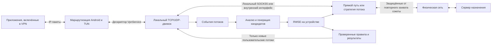

# Архитектура adaptive-dpi-android

Предлагаемая основа — локальный TUN-интерфейс Android, пользовательский движок TCP/UDP и прямые исходящие сокеты к серверам приложений. Диагностика, генерация стратегий, эксперименты, сравнение и сохранение решений выполняются на устройстве. Путь без преобразований служит штатным режимом и эталоном. Для работы достаточно Android-устройства и обычного доступа к сети. Поддержку конкретных сетей, устройств и стратегий предстоит проверить по [плану разработки](IMPLEMENTATION_PLAN.md).

Каркас этапа 1 содержит интерфейс, проверочный сеанс VPN и контракты движка. Тестовый TUN ограничен пакетом приложения, таблица маршрутов и DNS для него не задаются. Описанный ниже тракт относится к следующим этапам.

Эксперимент этапа 2.2 добавляет маршрут /32 к выбранному частному IPv4-адресу и ограничивает VPN пакетом приложения. HEV/lwIP читает и пишет TUN. Kotlin-релей на IPv4 loopback аутентифицирует каждый сеанс случайным секретом и пропускает назначения только на этот адрес. Для TCP используется CONNECT, для UDP — расширение HEV FWD_UDP с кадрами в том же аутентифицированном канале. За пределами приложения UDP передаётся через UDP-сокет. Единственный владелец внешних TCP/UDP-сокетов — `OutboundTransport` с политикой `VpnOutboundSocketPolicy`. [Протокол HEV](https://github.com/heiher/hev-socks5-core/tree/f8c08a64482c22c48a971bde22ce47c113b4d7af)

В экспериментальном режиме Android блокирует IPv6 для выбранного пакета, поскольку VPN не настраивает маршруты, адреса, DNS или `allowFamily(AF_INET6)`. DNS-фикстура использует явный UDP-запрос на выбранный адрес. Системный DNS и Private DNS следуют конфигурации Android. Сеанс привязан к одной физической сети. Потеря этой сети или наблюдаемая смена физического подключения останавливает эксперимент, после чего его можно запустить заново вручную. [Маршруты и семейства Android VPN](https://developer.android.com/reference/android/net/VpnService.Builder)

В режиме 2.3 пользователь указывает один установленный пакет. Android направляет его IPv4-трафик в TUN маршрутом `0.0.0.0/0` и получает DNS-серверы IPv4 от текущего физического подключения. Сеанс требует физический адрес и DNS по IPv4. IPv6 для выбранного пакета заблокирован. Другие пакеты остаются вне этого VPN. `OutboundTransport` по-прежнему вызывает `protect()` через Android-адаптер перед привязкой и подключением каждого сокета. HEV, релей и пул исходящих сокетов ограничены 32 соединениями. Журнал хранит события конфигурации и остановки, Android logcat и отчёт показывают счётчики открытий и закрытий TCP/UDP. Адреса назначения, адреса DNS и содержимое трафика в эти сведения не входят. [Проверка на Pixel 7](PIXEL7_TESTING_RU.md#проверить-chrome-через-транспорт-приложений)

Подробная диагностика этапа 2.3.1 учитывает отказ в точке ввода-вывода или управления, где доступен его тип. Исключение исходящего сокета классифицирует `OutboundTransport`. Локальный релей учитывает свои операции. Точки наблюдения HEV снимают результат и `errno` при отказе TUN и отмечают этап отказа инициализации. При ожидаемом прерывании блокирующего ввода-вывода используется категория отмены. Системные причины извлекаются из типизированных исключений и числовых кодов. Сообщения исключений и полезная нагрузка в журнал транспорта не попадают. Связь с DNS определяется по стандартному порту 53 или типу ошибки разрешения имени. Содержимое DNS, DoH и результаты удалённых резолверов на уровне приложения транспорт не разбирает.

Для каждого сеанса атомарные счётчики ведутся отдельно от хранилища. Писатель объединяет однотипные отказы по коду, категории, месту и состоянию сеанса в пределах окна около секунды. В памяти ограничены последние 340 записей, по 64 группы приёма и записи Kotlin, по 16 групп приёма и выгрузки нативного буфера. Kotlin читает буфер HEV через JNI со своего стека. На диске хранятся пять сегментов чуть меньше 1 МиБ каждый и компактная сводка последнего завершённого сеанса. Общий лимит 5 МиБ включает временную копию сводки. Строки до 4 КиБ защищены контрольной суммой. После заполнения сегмента переиспользуется самый старый. При обрыве записи неполная строка пропускается. При перегрузке количество отброшенных событий растёт отдельно, суммарная статистика сохраняется. TXT экспортируется потоком в выбранный документ под той же блокировкой, что и ротация. Сетевые потоки и UI с диском журнала не работают.

Состояние проверочного сеанса принадлежит процессу службы и привязано к идентификатору операции. Пересозданная Activity наблюдает тот же источник состояния. При гибели процесса Android закрывает дескрипторы, а новый процесс начинает с выключенного VPN. Восстанавливается только идентификатор ожидавшего системного согласия, если Android доставил его результат. Успех системного диалога сам по себе не означает, что TUN создан.

Журнал событий VPN отделён от журнала ошибок. Он получает принятые переходы состояния, фактические результаты запроса согласия, первую команду остановки с её источником и подтверждённое восстановление сохранённого состояния Activity. Успех запуска фиксируется после создания TUN. При следующем запуске приложение может обнаружить аварийное завершение по сохранённой записи об исключении или прерванный сеанс по оставшейся отметке. В последнем случае известен факт обнаружения, а причина завершения процесса может быть неизвестна. [Системный жизненный цикл VPN](https://developer.android.com/develop/connectivity/vpn#stopping)

События хранятся во внутреннем каталоге без резервного копирования. Один фоновый обработчик последовательно сохраняет записи и выполняет очистку. Атомарная замена файла ограничивает журнал 128 записями и 64 КиБ. В записи входят время со смещением часового пояса, случайный идентификатор сеанса и безопасные сведения из ограниченного набора полей. Общий отчёт доступен для предварительного просмотра. Сохранение пишет UTF-8 в документ, выбранный через SAF, а отправка использует временный файл в закрытом кэше и разрешение FileProvider на чтение. [Приёмка журнала и экспорта](TESTING_STRATEGY.md#журнал-событий-и-экспорт-на-pixel-7)

## Компоненты

| Компонент | Ответственность |
| --- | --- |
| `app`, `designsystem` | Kotlin, Jetpack Compose, Material 3, единая тема и русскоязычные ресурсы. Экраны подключения, приложений, профилей и диагностики. ViewModel публикует состояние интерфейса через `StateFlow`. |
| `vpn` | Согласие Android, службы и уведомление, конфигурация TUN, наблюдение за физическими сетями, управление исходящими сокетами и временем жизни сессии. |
| `engine` | Kotlin-контракты движка. После выбора нативного кандидата C-компонент отвечает за чтение и запись IP-пакетов, TCP-потоки, UDP-ассоциации и события об их исходах. Узкий JNI-адаптер передаёт снимок правил новым потокам. |
| `diagnostics` | Проверки отдельных ресурсов и классификация сбоев по стадиям DNS, TCP/UDP, TLS и прикладного протокола. Принимает только доступные движку признаки и результаты собственных проб. |
| `strategy` | Типизированные стратегии, реестр возможностей, синтез и ранжирование кандидатов, критерии подтверждения и отката. Детерминированная логика Kotlin без LLM. |
| `experiments` | RWSE на Android управляет очередью, отдельными пробами, лимитами и сверкой содержимого. Shadow Optimization задаёт область, причину запуска и режим применения. Пробный поток проходит тот же обработчик с явно выбранной стратегией и собственными сокетами. |
| `storage` | Локальные настройки, контексты сети и сводки кандидатов и рабочих ревизий по приложению, ресурсу, протоколу и сети. Предлагаемые средства — DataStore для простых настроек и Room для связанных данных. |

Предлагаемый модуль `:adaptive-core` содержит платформенно независимые модели, классификатор, генератор и правила сравнения, бюджетов, отмены и восстановления. Единое ядро вызывают Android-сервис и тестовый модуль `:adaptive-simulator`. Сервис владеет сессией независимо от экранов. Движок получает неизменяемый снимок правил и выдаёт агрегируемые события в ограниченную очередь. Переполнение очереди наблюдений учитывается счётчиком и не блокирует обработку пакетов.

## Границы Kotlin, C и испытательного стенда

- **Kotlin.** Android API, интерфейс, жизненный цикл, диагностика, генерация стратегий, расписание экспериментов и хранение остаются в Kotlin. Ядро принимает события и результаты эффектов. Android-адаптеры дают ему сетевой контекст, часы, транспорт проб и локальное хранилище. Симулятор подаёт фиксированную последовательность событий, управляет временем и использует своё хранилище. Он выполняет тот же код решений и записывает результаты в тестовые отчёты. [Симулятор адаптивного алгоритма](TESTING_STRATEGY.md#симулятор-адаптивного-алгоритма)
- **C и JNI.** При подтверждении нативного пути версия Android собирается с NDK/CMake. JNI передаёт дескрипторы, ограниченные пакеты событий и команды управления сессией. Для TUN сохраняется явный контракт владения: при успешном запуске его принимает сессия, при ошибке закрывает вызывающая сторона. Для штатной остановки, отмены и сбоя защищённого сокета предусматриваем проверку освобождения ресурсов и завершения рабочих потоков. Android-зависимые операции, включая защиту исходящего сокета, остаются на стороне `vpn`. Переносимую часть C можно собирать из той же ревизии на Linux с отдельным адаптером стенда. Host-тесты проверяют логику C, а ABI, JNI и системные операции проверяются Android-сборкой и инструментальными тестами. [Рекомендации Android по JNI](https://developer.android.com/training/articles/perf-jni)
- **Испытательный стенд.** Python и pytest готовят фикстуры, запускают клиенты и серверы, меняют условия в изолированной Linux-сети и сравнивают результаты. Контейнеры, сетевые пространства имён и `tc/netem` принадлежат стенду. В Android проверяем тот же контракт результата через эмулятор и физическое устройство. Стенд подключается через тестовые адаптеры и не требуется для запуска APK.

Для каждого потока, пробы и тестового прогона связываем исход с версией движка и политики, поколением сети, протоколом и семейством IP. В стендовом отчёте дополнительно храним сценарий, известную причину сбоя и результат проверки содержимого. Известная причина находится у проверяющей стороны и не передаётся анализатору как входной признак. [Матрица и устройство стенда](TESTING_STRATEGY.md) · [Технологии и условия внедрения](TECH_STACK.md)

## Прохождение трафика

### Исходящие сокеты этапа 2.1

`OutboundTransport` в JVM-модуле `:engine` открывает прямые TCP и подключённые UDP-сокеты по числовым IP-адресам. Сокет регистрируется до подготовки и подключения. Android-адаптер `VpnOutboundSocketPolicy` проверяет `NET_CAPABILITY_NOT_VPN`, вызывает `VpnService.protect()` и привязывает сокет к переданной сети через `Network.bindSocket()`. Отказ на любом шаге закрывает сокет. TCP открывается с `Proxy.NO_PROXY`. DNS-датаграммы передаются как байты, выбор DNS-сервера остаётся за слоем маршрутизации. [VpnService.protect](https://developer.android.com/reference/android/net/VpnService#protect(java.net.Socket)) · [Network.bindSocket](https://developer.android.com/reference/android/net/Network#bindSocket(java.net.Socket))

Один экземпляр транспорта обслуживает один будущий сеанс VPN. Изменение политики физической сети закрывает старые сокеты, в том числе открываемые. При исчезновении сети транспорт отклоняет открытие новых сокетов до получения новой политики. Он ограничивает число открываемых и активных сокетов общим лимитом в 64 по умолчанию и использует буферы вызывающей стороны. Снимок статистики содержит только количество сокетов, операций с ошибками, переданных и полученных байтов и UDP-датаграмм. Счётчики сокетов не отражают количество IP-пакетов TUN.

Служба передаёт HEV уже открытый TUN и фиксирует выбранную сеть в `setUnderlyingNetworks`. При остановке нативный рабочий цикл получает сигнал, релей закрывает сокеты, а его сессия закрывает TUN после выхода из HEV. Новый сеанс допускается после освобождения владельца JNI. HEV считает пакеты TUN, Kotlin считает байты и соединения. Экран различает создание TUN, готовность HEV и подтверждённое движение полезной нагрузки в обе стороны. [Разбивка этапа 2](IMPLEMENTATION_PLAN.md#этапы-и-критерии-завершения)

1. После `VpnService.prepare()` служба запускается в foreground, поднимает локальные компоненты и вызывает `Builder.establish()`. TUN получает адреса, маршруты, DNS и MTU в соответствии с проверенным профилем. Для полного двухстекового захвата нужны маршруты `0.0.0.0/0` и `::/0`. [Android VPN](https://developer.android.com/develop/connectivity/vpn) · [VpnService.Builder](https://developer.android.com/reference/android/net/VpnService.Builder)
2. Движок читает L3-пакеты, восстанавливает локальную сторону TCP либо ведёт UDP-ассоциацию, затем передаёт данные локальному прокси или внутреннему обработчику. Ответный поток преобразуется обратно в IP-пакеты и записывается в TUN. У направления TCP есть два независимых соединения: локальная TCP-сессия со стороны приложения и сокет Android до сервера. UDP сохраняет границы датаграмм.
3. Фабрика исходящих сокетов вызывает `VpnService.protect()` до соединения или первой отправки, включая сетевые сокеты нативного прокси, резолвера и проб. Если нужна фиксированная физическая сеть, привязка сокета к `Network` выполняется до подключения. При ошибке защиты или обязательной привязки сокет закрывается. Сервис сообщает Android об изменениях набора явно используемых сетей через `setUnderlyingNetworks()`. [VpnService](https://developer.android.com/reference/android/net/VpnService#protect(int)) · [Network.bindSocket](https://developer.android.com/reference/android/net/Network#bindSocket(java.io.FileDescriptor))
4. Для прямого тракта сначала проверяем HEV и локальный исходящий обработчик проекта через SOCKS5 CONNECT для TCP и UDP ASSOCIATE с UDP-релеем. Для поставки нужна изоляция TCP и UDP от других приложений, включая проверку подмены UDP на общей петлевой сети. Альтернатива — внутрипроцессный интерфейс. Конфигурация SOCKS5 сама по себе не переносит UID, наблюдаемое имя назначения и версию стратегии. Для адаптации нужен выбор пути до подключения к прокси и привязка политики к потоку либо внутренний вызов с этими данными. Вариант, требующий глобального перезапуска прокси для смены политики, пригоден для транспортного прототипа. [Сравнение кандидатов](DEPENDENCIES_AND_LICENSES.md) · [RFC 1928](https://www.rfc-editor.org/rfc/rfc1928.html)

## Границы на Android без root

| Область | Граница проектирования |
| --- | --- |
| Доступ к сети | TUN обслуживает маршрутизируемый Android трафик выбранных приложений текущего пользователя или профиля. `VpnService` не даёт прав на системные правила `iptables`/`NFQUEUE`, не является точкой перехвата трафика точки доступа и не даёт контроль над пакетами на физическом интерфейсе. Приложение использует стандартные сокеты и доступные непривилегированному процессу параметры. [Android VPN](https://developer.android.com/develop/connectivity/vpn) |
| VPN и жизненный цикл | Android поддерживает один активный VPN на пользователя или профиль. Каркас использует системное согласие, `startForegroundService()`, постоянное уведомление и обработку `onRevoke()` на главном потоке. Тип foreground-службы задаётся явно: `NONE` на API 29–33 и `systemExempted` на API 34–36 для допущенного системой VPN. Отказ в уведомлениях на API 33+ влияет на их показ в шторке, а служба по-прежнему передаёт уведомление Android. Проверочный VPN отключает always-on. [Android VPN](https://developer.android.com/develop/connectivity/vpn) · [Типы foreground-служб](https://developer.android.com/develop/background-work/services/fgs/service-types) · [Разрешение уведомлений](https://developer.android.com/develop/ui/views/notifications/notification-permission) |
| TCP | Записи в сокет могут быть объединены и повторно сегментированы ядром или сетевым оборудованием. Изменение размера записи не гарантирует границы TCP-сегмента на линии. Точность проверяется отдельно для каждой техники и среды. |
| UDP, QUIC и семейства IP | Прозрачная доставка UDP не подтверждает возможность изменения QUIC-трафика. Поддержка проверяется для каждой пары TCP/UDP × IPv4/IPv6, включая IPv6-only с DNS64/NAT64 и переходы между сетями. Версию IP внутри TUN и семейство исходящего сокета учитываем раздельно. Фильтрация UDP/443 способна нарушить QUIC, а переход на TCP зависит от клиента. Глобальное отключение QUIC не входит в базовый режим. |
| Маршруты, DNS и прочие IP-протоколы | Для неподдержанного семейства задаём явное поведение. Без адреса, маршрута и DNS этого семейства Android блокирует его, а `allowFamily()` может пропустить трафик мимо VPN. Системный DNS учитывает настройки Android, а собственные DoH/DoT клиентов и ECH ограничивают видимость имён. Для неизвестного имени действует политика по умолчанию, совпадение по общему CDN-IP не закрепляет правило за доменом. Сквозные ICMP, multicast, LAN-доступ и произвольные IP-протоколы не входят в подтверждённую матрицу. [VpnService.Builder](https://developer.android.com/reference/android/net/VpnService.Builder) |
| Приложения | Системный режим использует либо `addAllowedApplication()`, либо `addDisallowedApplication()`. Изменение системного списка требует нового TUN и может прервать соединения. Для внутренних правил `getConnectionOwnerUid()` доступен активному VPN с API 29 для TCP/UDP. Возможен неизвестный UID, а один UID может соответствовать нескольким пакетам. Видимость установленных приложений ограничена Android. [Android VPN](https://developer.android.com/develop/connectivity/vpn#per-app) · [ConnectivityManager](https://developer.android.com/reference/android/net/ConnectivityManager#getConnectionOwnerUid(int,java.net.InetSocketAddress,java.net.InetSocketAddress)) · [Видимость пакетов](https://developer.android.com/training/package-visibility) |
| Конфиденциальность и внешний IP | TLS приложений остаётся сквозным. Дополнительного шифрования всего трафика и смены внешнего IP нет. Локальный VPN не снимает ограничения, основанные на регионе внешнего IP, аккаунта или лицензии на контент. |

## Анализ, синтез и контроль

1. **Наблюдения и гипотезы.** Повторения группируются по достоверно определённому ресурсу, протоколу, семейству IP и поколению сети. Для пользовательских TLS-потоков доступны только наблюдаемые метаданные. Общий сбой, прикладной отказ, вероятная фильтрация и вероятное региональное ограничение учитываются отдельно. Неоднозначный результат отображается как «Причина не определена».
2. **Кандидаты.** Ядро генерирует типизированные комбинации и параметры на основе вида сбоя и проверенных возможностей движка. Оно проверяет несовместимости, убирает канонические дубликаты и ранжирует варианты по подтверждённой истории и стоимости проб.
3. **Проверка на устройстве.** RWSE строит самостоятельные ограниченные запросы по контракту ресурса. Он сравнивает прямой путь, текущее правило и кандидата повторяемыми контрольными парами A/B и B/A в одном сетевом контексте. Если безопасная проба недоступна, остаётся пассивная диагностика. При непроверяемом содержимом результатов доступных стадий недостаточно для автоматической публикации правила.
4. **Решение.** Содержимое и стабильность имеют приоритет над задержкой и расходом ресурсов. Для автоматической публикации нужно подтверждение на устройстве по контракту ресурса. Локальное решение связано с его областью, сетью, версией движка и сроком действия. Новая ревизия и откат применяются только к новым потокам. [Модели и критерии RWSE](RWSE_DESIGN.md)

## Shadow Optimization

Поиск запускается вручную либо автоматически после подтверждённого отказа действующей стратегии при включённой настройке. При ручном запуске первым действием предлагаем выбрать приложение. Доступны области «Все приложения VPN», выбранное приложение и конкретный ресурс выбранного приложения. Даже в общей области результаты и правила привязаны к отдельному приложению, ресурсу, протоколу и сетевому контексту.

Режим «Только анализ» сохраняет кандидатов и доказательства в локальной истории. Режим «Анализ с автоулучшением» допускает применение только при подтверждённом преимуществе в соответствующей области. Пользователь может вручную применить прошедшую проверку стратегию и откатить рабочую версию. До подтверждения преимущества действует текущая стратегия. При недостаточности данных правило сохраняется.

Пробные соединения используют собственные сокеты, бюджеты и выбранного кандидата. Основные потоки продолжают использовать закреплённые подтверждённые версии. В адресный анализ допускаем только потоки с достоверной атрибуцией UID и `packageName` в профиле Android. Другие приложения и неоднозначные владельцы исключаются из выбранной области. Ухудшение метрик живого трафика приостанавливает пробы, а ручная остановка отменяет запуск и отклоняет его поздние результаты. Поиск, оценка и публикация выполняются на устройстве. [Детали Shadow Optimization](RWSE_DESIGN.md#shadow-optimization)

## Отказы VPN и локальная диагностика

При контролируемой критической ошибке служба сразу освобождает TUN и foreground-состояние. Фоновая запись фиксирует точную причину, а вызов `stopSelf()` ожидает завершения попытки не дольше 250 мс. Ручная команда завершает остановку без ожидания журнала. До подтверждения записи сохраняется отметка сеанса для восстановления причины или признака прерывания при следующем запуске. Повторный запуск начинается по действию пользователя. На экране диагностики доступна инструкция и ссылка на системные настройки VPN.

Будущий движок предоставляет неблокирующий снимок работоспособности, обновляемый из рабочего цикла даже без трафика, и контракт аварийного закрытия TUN без ожидания этого цикла. Служба опрашивает снимок отдельно, учитывая состояние выбранной физической сети. Свежий сигнал при недоступной сети означает временную сетевую проблему. Явный отказ или истечение срока сигнала означает внутреннюю ошибку движка. Для первых испытаний предусмотрены опрос раз в секунду и срок 15 секунд в шкале времени без глубокого сна. Подтверждение свежего сигнала при валидированной сети переводит будущий сеанс в отдельное состояние `EngineRunning`. Каркас работает в состоянии проверочного TUN. Без подключённого движка опрос не запускается.

После гибели процесса закрытие дескрипторов и освобождение интерфейса остаются за Android. При Always-on VPN с включённой блокировкой подключений без VPN интернет может остаться недоступным. Настройки пользователь меняет в Android самостоятельно. Журнал отличает необработанное исключение процесса от обнаруженного при следующем запуске незавершённого сеанса, когда точная причина неизвестна. [Жизненный цикл Android VPN](https://developer.android.com/develop/connectivity/vpn) · [Сетевые настройки VpnService](https://developer.android.com/reference/android/net/VpnService)

Локальный журнал ограничен 32 записями и 32 КиБ во внутреннем каталоге Android без резервного копирования. При открытии приложения и обновлении журнала удаляются события старше семи дней. Для аварийного исключения и отметки активного сеанса используются два отдельных слота ограниченного размера. К аварийному событию применён тот же срок, отметка активной сессии удаляется при завершении или восстановлении. При нехватке места или остановке процесса до записи диагностика может быть неполной. Отчёт UTF-8 содержит типизированные поля и разрешённые кадры стека. Тексты исключений, полные адреса, идентификаторы приложений, содержимое трафика и данные авторизации в отчёт не входят.

Критическая ошибка использует отдельный канал уведомлений с высокой важностью и открывает конкретную запись диагностики. Для одного события используется стабильный идентификатор уведомления. Повтор того же кода и типа исключения в течение минуты сохраняется в журнале без нового уведомления. Видимость канала зависит от системного разрешения и настроек. Непрочитанная запись доступна при следующем открытии приложения. Экспорт начинается после просмотра отчёта и действия пользователя. SAF сохраняет файл в выбранное место, а Sharesheet получает ограниченный URI файла отчёта через FileProvider. [Каналы Android](https://developer.android.com/develop/ui/views/notifications/channels) · [SAF](https://developer.android.com/training/data-storage/shared/documents-files) · [FileProvider](https://developer.android.com/reference/androidx/core/content/FileProvider)

## Асинхронность, бюджеты и состояние

- У сервиса есть область корутин со своим временем жизни. Нативный ввод-вывод, аналитика и очередь экспериментов работают независимо от UI. Одну проблему объединяем в одну задачу. Очередь проб ограничена по сети и ресурсу, учитывает приоритеты и закрывает пробные сокеты при отмене. В экспериментах захватываем поколение сети и версию правил. Устаревшие результаты не меняют текущую политику.
- Активные проверки запускаются после повторов ошибки или по действию пользователя. Используем тайм-ауты по стадиям, верхнюю границу числа и суммарного объёма проб, нарастающую паузу после неудач. Учитываем тарифицируемость, энергосбережение, потерю сети и нагрузку живого трафика. В спокойном состоянии остаются события потоков и системные сетевые callbacks. Постоянных опросов, экспериментальных keepalive и постоянного wake lock не требуется.
- Храним настройки и приоритеты, версии стратегий и движка, ограниченную историю наблюдений, подтверждения, срок годности и последнюю успешную версию. Контекст включает тип транспорта, параметры DNS и доступность семейств IP. Системный `Network` служит только идентификатором текущей сессии. Для повторного распознавания используем доступные устойчивые признаки либо явно выбранный профиль. Совпадение только по типу транспорта недостаточно для автоматического переноса правил. При слабом совпадении начинаем с базового пути и назначаем повторную проверку по триггеру. Постоянных идентификаторов устройства, истории URL и полезной нагрузки в диагностической схеме нет.
- Результат, версия стратегии и ссылка на активное правило сохраняются одной транзакцией. После записи текущая сессия публикует неизменяемый снимок для новых потоков. При восстановлении повторно проверяем совместимость, область и свежесть записи. Незавершённый опыт допускается заново поставить в очередь только при действующем триггере и наличии бюджета. При отзыве разрешения служба закрывает дескрипторы и сокеты, а при потере физической сети отменяет её пробы. Пережившие переключение потоки сохраняют свою политику. Обычному TCP на исчезнувшем маршруте может потребоваться переподключение со стороны приложения.
- Для испытаний считаем диагностические байты, время и число начатых, текущих и отменённых проб по сети и ресурсу. Счётчики отделены от пользовательского трафика, чтобы тест мог проверить лимиты и подтвердить, что отмена возвращает занятую квоту. Длительные контрольные соединения измеряются независимым клиентом во время проб, смены правил и отката. [Критерии изоляции и ресурсных бюджетов](TESTING_STRATEGY.md)

## Приложения и профили

Системный список определяет захват. Для захваченных потоков явные исключения ресурса или приложения имеют первый приоритет: трафик остаётся прямым через защищённый сокет без адаптации. Допустимые внутренние правила выбираются по точному ключу приложения, ресурса, протокола и сети. Одно приложение может иметь разные правила для разных ресурсов. Неизвестный или неоднозначный UID использует консервативный профиль без адресных проб и специфичных правил. Пользовательский приоритет определяет очерёдность диагностических задач внутри бюджета. Профили «Экономный», «Сбалансированный» и «Качество» задают пределы проб, задержки и требования к доказательствам. Изменения внутренних правил вступают в силу для новых потоков. UI предупреждает о влиянии правок системного списка на соединения.
