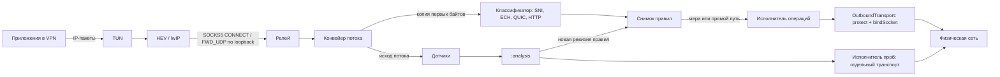

# Архитектура adaptive-dpi-android

Этот документ описывает целевую архитектуру приложения целиком и отмечает, что из неё уже есть в коде. Подробности вынесены в отдельные документы:

- [TRANSPORT.md](TRANSPORT.md) - реализованный транспорт, жизненный цикл VPN и диагностика, с проверенными решениями;
- [ENGINE.md](ENGINE.md) - движок анализа: датчики, диагноз, анализ вариантов, синтез меры, слежение за изменениями, очередь;
- [OPERATIONS.md](OPERATIONS.md) - каталог операций обхода и их возможность без root;
- [TESTING.md](TESTING.md) - уровни проверки, критерии приёмки, подтверждённые результаты;
- [ROADMAP.md](ROADMAP.md) - этапы, задачи и то, что удаляется из кода;
- [DEPENDENCIES_AND_LICENSES.md](DEPENDENCIES_AND_LICENSES.md) - сторонние компоненты и лицензии;
- [PIXEL7_TESTING_RU.md](PIXEL7_TESTING_RU.md) - пошаговая проверка на телефоне.

Статусы в документах: **[есть]** - реализовано в `main`; **[эксперимент]** - есть в ветке `stage3-experimental`, в тракт не подключено; **[план]** - запланировано; **[гипотеза]** - требует эксперимента.

## Цель и обязательные ограничения

Приложение само обнаруживает, что ресурс недоступен из-за DPI, выясняет механизм блокировки, синтезирует меру обхода под этот ресурс и приложение, проверяет её по полученному содержимому и следит, не изменилось ли поведение DPI. Пользователь устанавливает приложение и включает его; ручных настроек стратегий нет.

Ограничения, которые не обсуждаются:

- без root, Magisk и внешнего VPN- или прокси-сервера;
- без MITM, подмены сертификатов, отключения проверки TLS и расшифровки пользовательского трафика;
- без отправки данных пользователя третьим лицам; диагностика и решения - на устройстве;
- обычный трафик работает корректно, остановка VPN предсказуема;
- активные проверки только по поводу: отказ живого трафика, действие пользователя, смена сети или истечение срока факта, к которому привязана действующая мера; всё - в пределах бюджета; без повода в спокойном состоянии проб нет;
- стратегии выбираются алгоритмически, без LLM.

Что приложение принципиально не может: обойти блокировку по IP-адресу и региональное ограничение (нужен другой внешний адрес), отправлять произвольные сырые пакеты и видеть входящие пакеты сети целиком (нужен root). Об этом приложение сообщает пользователю прямо.

## Как это работает для пользователя

1. Включение: системное согласие Android на VPN, затем работа в фоне с постоянным уведомлением.
2. Весь трафик выбранных приложений проходит через локальный движок внутри телефона и уходит в сеть напрямую.
3. Пока всё работает, движок только считает исходы соединений. Проб нет, кроме ограниченных бюджетом перепроверок при смене сети или истечении срока действующей меры.
4. Когда соединения к ресурсу начинают ломаться характерным образом, движок в фоне выясняет механизм, синтезирует меру и проверяет её. Работающие соединения при этом не трогаются.
5. Новые соединения к ресурсу получают подтверждённую меру. Пользователь видит короткое объяснение.
6. Если мера перестаёт работать, движок перепроверяет тот факт о DPI, на котором она держалась, и перестраивает меру.

## Модули

| Модуль | Ответственность | Состояние |
| --- | --- | --- |
| `:app` | Экраны, состояние интерфейса, экспорт диагностики | **[есть]** технический интерфейс |
| `:designsystem` | Тема, общие компоненты | **[есть]** |
| `:vpn` | Android-адаптеры: `VpnService`, согласие, уведомление, наблюдение за сетью, политика сокетов (`protect`, `bindSocket`), нативная библиотека (HEV, JNI, операции над сокетом), исполнитель проб на Android, хранилище профилей | **[есть]** транспорт и диагностика; остальное **[план]** |
| `:engine` | Платформенно-независимый тракт потока: релей SOCKS5, `OutboundTransport`, конвейер потока (захват префикса, классификатор, применение меры), исполнитель операций уровня Kotlin | **[есть]** релей и транспорт; **[эксперимент]** классификатор; остальное **[план]** |
| `:analysis` | Чистый Kotlin без Android: агрегаты датчиков, профиль DPI, диагноз, пробы-вопросы, анализ вариантов, синтез меры, слежение за изменениями, очередь проб, бюджеты | **[план]** новый JVM-модуль |

Почему `:analysis` - отдельный JVM-модуль: решения должны проверяться детерминированными тестами с виртуальным временем и моделями DPI без Android и без сети. Android-зависимые действия (сокеты, `Network`, хранилище) передаются ему интерфейсами.

## Поток трафика

Транспортная часть (TUN → HEV → релей → `OutboundTransport` → сеть) **[есть]** и проверена на эмуляторе. Та же форма тракта используется приложением ByeByeDPI (HEV → SOCKS5 → byedpi), что подтверждает её пригодность на Android.

### Конвейер потока [план]

Для каждого нового TCP-соединения после CONNECT:

1. **Захват префикса.** Релей читает первые байты клиента в ограниченный буфер: не больше 20 КБ (одна TLS-запись с запасом) и не дольше короткого порога. Порог подбирается по телеметрии; начальное значение - сотни миллисекунд.
2. **Немедленный прямой путь**, если первый байт не `0x16` (не TLS handshake) и не начало HTTP-запроса, или если клиент ничего не прислал за порог (протоколы, где сервер говорит первым). Задержки для обычного трафика нет.
3. **Классификация** выполняется один раз, когда собрана полная TLS-запись по полю длины, а не на каждом куске.
4. **Выбор меры** по неизменяемому снимку правил и ключу DPI (см. [ENGINE.md](ENGINE.md), «Ключи»). Ревизия правил закрепляется за соединением на всё время его жизни.
5. **Исполнение.** Исполнитель получает открытое исходящее соединение и буфер префикса, выполняет операции меры, затем поток идёт обычным копированием.
6. **Исход потока** (стадия завершения, `errno`, время до отказа, объёмы, повторные передачи при наличии `TCP_INFO`) передаётся датчикам.

Для UDP: классификация QUIC Initial (SNI извлекается по RFC 9001, раздел 5.2), политика UDP/443 для ресурса, счётчики датаграмм ассоциации.

Для DNS (UDP/53 через релей): наблюдение ответов для корреляции адресов с именами; по диагнозу «подмена DNS» - собственный резолв через DoH/DoT защищённым сокетом и ответ приложению.

## Граница Kotlin и C

| Где | Что | Почему |
| --- | --- | --- |
| Kotlin | Жизненный цикл VPN, владение всеми сокетами, `protect`/`bindSocket`, отмена, конвейер потока, классификация, решения, анализ, очередь, хранение, интерфейс | Тестируемость на JVM, безопасная работа с памятью, существующий проверенный код |
| Kotlin | Операции уровня приложения: разбиение на TLS-записи, изменение HTTP-заголовков, DoH/DoT, политика UDP/443, TTL сокета через `Os.setsockoptInt` | Достаточно публичного API Android |
| C, существующий | HEV/lwIP, JNI-мост транспорта | **[есть]** |
| C, узкая библиотека операций | Чтение `TCP_INFO` (неотправленные и неподтверждённые байты, повторные передачи), ожидание фактической отправки, OOB произвольной длины, fake через `vmsplice` с восстановлением страниц, BPF-фильтр на свой сокет | В `android.system.Os` нет чтения `TCP_INFO` (из `getsockopt*` есть только `getsockoptTimeval`) и нет `splice`/`vmsplice` |

Правила нативной библиотеки:

- она никогда не владеет сокетом: работает с дескриптором, арендованным через `ParcelFileDescriptor.fromSocket()` на время одного вызова, и закрывает только дубликат;
- она не хранит номера дескрипторов между вызовами и не имеет глобального состояния;
- каждый вызов неблокирующий или ограничен по времени; отмена - через закрытие сокета владельцем после возврата вызова;
- каждая функция появляется только после эксперимента, доказывающего, что без неё нельзя.

Широкий нативный движок (весь прокси на C, как byedpi в ByeByeDPI) отвергнут: его конфигурация действует на весь процесс, а движку нужна мера для каждого соединения без перезапуска.

## Инварианты

Эти правила нельзя нарушать при любой реализации.

1. **Мера применяется только к новым соединениям.** Действующие соединения сохраняют ревизию, с которой созданы.
2. **Анализ никогда не задерживает обычный поток** дольше порога захвата префикса.
3. **Пробы идут через отдельный экземпляр транспорта** со своими лимитами и не занимают слоты релея живого трафика.
4. **Ключ меры - то, что видит DPI** (открытый SNI, внешний SNI при ECH, SNI из QUIC Initial, адрес), а не настоящее имя ресурса.
5. **Знание о DPI относится к сети, а не к приложению.** Профиль DPI общий для всех приложений; параметры меры вычисляются по каждому потоку.
6. **Успех подтверждается содержимым**, а не установлением TCP или TLS.
7. **Сетевая ошибка не равна DPI.** Диагноз «вмешательство» требует признаков, отличных от общей потери связи.
8. **Владение сокетом всегда у Kotlin.** Нативный код работает только с арендованным дескриптором.
9. **Ничего из пользовательского трафика не сохраняется**: ни содержимого, ни путей, ни cookies. Имена ресурсов хранятся только в профиле DPI на устройстве и не попадают в экспортируемую диагностику.
10. **Принудительное освобождение ресурсов по тайм-ауту запрещено.** Владелец ждёт подтверждения; см. [TRANSPORT.md](TRANSPORT.md).

## Сеть и жизненный цикл

Реализованный жизненный цикл, состояния и правила очистки описаны в [TRANSPORT.md](TRANSPORT.md).

Целевая модель смены сети **[план]**:

| Событие | Действие |
| --- | --- |
| Новая сеть по умолчанию (Wi-Fi ↔ мобильная) | `OutboundTransport.updateNetwork()` с политикой новой сети, `setUnderlyingNetworks([новая])`; сеанс продолжается; эпоха сети в `:analysis` меняется, незавершённые пробы отменяются |
| Изменились DNS текущей сети | Пересоздать TUN с новыми DNS (`establish()` повторно) |
| Пропали все физические сети | Состояние ожидания сети: новые соединения отклоняются, VPN не выключается |
| Сеть вернулась | `updateNetwork()` |
| Смена сети во время Stop | Stop имеет приоритет; события сети старого сеанса отбрасываются по ID |

Существующие TCP-соединения при смене сети рвутся неизбежно: их адрес принадлежит старой сети. Приложения переподключаются сами.

Сейчас **[есть]** более простая модель: смена или потеря сети останавливает сеанс, повторный запуск - вручную.

## Режимы захвата

| Режим | Как | Состояние |
| --- | --- | --- |
| Проверочный TUN | Только своё приложение, без маршрутов и DNS | **[есть]**, служебный |
| Стенд | Своё приложение, маршрут `/32` к частному адресу | **[есть]**, служебный |
| Одно приложение | `addAllowedApplication(пакет)`, IPv4 `0.0.0.0/0`, IPv6 заблокирован | **[есть]** |
| Выбранные приложения | Список `addAllowedApplication` | **[план]** |
| Все приложения, кроме исключений | `addDisallowedApplication`, всегда включая само приложение | **[план]** |

Своё приложение всегда исключается из пользовательских режимов, чтобы пробы и резолвер не попадали в собственный TUN. Для режимов с несколькими приложениями нужна атрибуция UID: исходный адрес и порт со стороны TUN передаются из HEV в релей по аутентифицированному каналу, затем `ConnectivityManager.getConnectionOwnerUid()` (API 29, только активному VPN) **[план]**. В режиме одного приложения UID известен заранее.

## Хранение

| Что | Где | Формат | Состояние |
| --- | --- | --- | --- |
| История VPN, журнал ошибок, журнал транспорта | Внутренний каталог без резервного копирования | Ограниченные файлы с ротацией | **[есть]**, см. [TRANSPORT.md](TRANSPORT.md) |
| Профили DPI сетей, правила, ревизии, журнал изменений DPI, бюджеты проб | Внутренний каталог | Версионированный JSON с атомарной заменой файла; Room - только если понадобятся связанные запросы | **[план]** |
| Настройки пользователя | DataStore | - | **[план]** |

## Интерфейс [план]

- **Главный экран:** включение, состояние, список ресурсов, по которым движок что-то сделал, с объяснением простыми словами.
- **Приложения:** выбор из списка установленных с поиском; режимы «выбранные» и «все, кроме».
- **Проверить ресурс:** ручной запуск анализа для адреса; показывает стадии и вывод.
- **Диагностика:** журналы и экспорт (существующие экраны).
- **Раздел разработчика:** проверочный TUN, стенд, телеметрия, профиль DPI.

## Технологии

- Kotlin, корутины, Jetpack Compose, Material 3; JDK 17; Gradle 8.13, AGP 8.13.2, Kotlin 2.3.21, Compose BOM 2024.06.00; `minSdk 29`, `targetSdk`/`compileSdk 36` - зафиксированы в `gradle/libs.versions.toml` и `app/build.gradle.kts`.
- C, Android NDK `28.2.13676358`, сборка нативной части через **ndk-build** (`vpn/src/main/hev/Android.mk`); ABI `arm64-v8a` и `x86_64`; страницы 16 КБ (`-Wl,-z,max-page-size=16384`).
- Тесты: JUnit 4, Android instrumented-тесты, Compose UI Test; Python для стендов; GitHub Actions.
- Новые зависимости добавляются только с обоснованием (п. 26 AGENTS.md). Для виртуального времени в тестах `:analysis` понадобится `kotlinx-coroutines-test`.

## Источники

- [VpnService - Android Developers](https://developer.android.com/reference/android/net/VpnService)
- [VpnService.Builder - Android Developers](https://developer.android.com/reference/android/net/VpnService.Builder)
- [ConnectivityManager.getConnectionOwnerUid - Android Developers](https://developer.android.com/reference/android/net/ConnectivityManager#getConnectionOwnerUid(int,%20java.net.InetSocketAddress,%20java.net.InetSocketAddress))
- [android.system.Os - Android Developers](https://developer.android.com/reference/android/system/Os)
- [ParcelFileDescriptor.fromSocket - Android Developers](https://developer.android.com/reference/android/os/ParcelFileDescriptor#fromSocket(java.net.Socket))
- [RFC 9001, раздел 5.2](https://www.rfc-editor.org/rfc/rfc9001.html#section-5.2)
