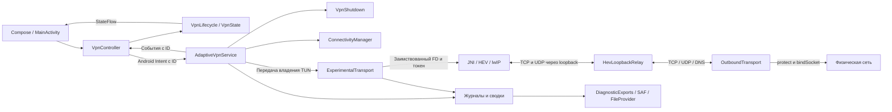

# Архитектурная ревизия ядра 2.4.2

Контрольная точка A. База опубликованного APK `0.1.1 (23)` — `9c8ade15199c656dc78d6bacc30b73002fb6c7b3`. Ревизия охватывает локальный этап 2.4.1 поверх этой базы. Его поведение описано отдельно от предложений ниже. [Аудит версии 23](AUDIT_0.1.1_23_RU.md) · [Локальный этап 2.4.1](VPN_LIFECYCLE_2.4.1_RU.md)

## Синхронизация

`git fetch origin main` получил `780a602` и `b070dc1`. Входящие коммиты меняли только `AGENTS.md`, локальной правки этого файла не было. `git merge --ff-only origin/main` обновил указатель `main`. Локальный `HEAD` и `origin/main` совпадают на `b070dc1c0d7af70a94884c5086564c1656719099`. В рабочей копии прочитаны `AGENTS.md` с пунктами 1–39 и `CLAUDE.md`, который подключает его через `@AGENTS.md`. Проверка дерева и рабочей папки обнаружила только эти два файла инструкций.

До ревизии в рабочей копии было 29 изменённых и 6 новых файлов. Они включают асинхронную остановку, проверку закрытия сокетов, удержание владельца сеанса, финальный снимок JNI, критические события, интерфейс диагностики, тесты, сценарий CI и два локальных документа. Список изменений сохранился после fast-forward. Контрольная точка A добавляет только этот отчёт.

## Карта существующего ядра

| Компонент | Ответственность, состояние и завершение | Независимая проверка |
|---|---|---|
| `:app`, Compose, `MainActivity`, `PendingDiagnosticExport` | UI наблюдает состояние контроллера. Activity владеет разрешением в ожидании Android, выбором приложения и запросами экспорта. `Bundle` сохраняет идентификаторы действий. `PendingDiagnosticExport` держит только текст общей диагностики при пересоздании Activity. `SharedPreferences("settings")` хранит тему и отметку запроса уведомлений. Стратегии и выбор экспериментального сеанса здесь постоянно не хранятся. | Compose и `ActivityScenario`. Восстановление после гибели процесса и возврат из системного выбора требуют Android. [MainActivity.kt:43](../app/src/main/kotlin/org/adaptivedpi/android/MainActivity.kt#L43) · [MainActivity.kt:173](../app/src/main/kotlin/org/adaptivedpi/android/MainActivity.kt#L173) |
| `VpnController`, `VpnLifecycle`, `VpnState` | Контроллер связывает Activity, `VpnService.prepare()` и команды службы. Машина состояний владеет идентификатором операции, callback остановки и допуском запуска. Состояние изменяется на `Main`, старые идентификаторы отбрасываются. При смене Activity тот же процесс сохраняет активный сеанс. | JVM для переходов, дубликатов и старых событий. Инструментальные тесты для `prepare()`, разрешения и уведомления. [VpnController.kt:31](../vpn/src/main/kotlin/org/adaptivedpi/android/vpn/VpnController.kt#L31) · [VpnLifecycle.kt:11](../vpn/src/main/kotlin/org/adaptivedpi/android/vpn/VpnLifecycle.kt#L11) |
| `AdaptiveVpnService`, `VpnShutdown` | Служба владеет Android-ресурсами, задачей запуска, наблюдением за сетью, foreground-уведомлением и TUN до передачи транспорту. Stop запускает одну фоновую очистку. Итог публикуется при наличии результата и `onDestroy()` в любом порядке. `onRevoke()` переводит callback на `Main`. `ConnectivityManager` сообщает об утрате или смене сети, после которой текущий сеанс завершается и новый требует действия пользователя. | `VpnShutdown` проверяется без Android. Проверки `establish()`, `onDestroy()`, `onRevoke()` и физической сети требуют Android. [AdaptiveVpnService.kt:280](../vpn/src/main/kotlin/org/adaptivedpi/android/vpn/AdaptiveVpnService.kt#L280) · [AdaptiveVpnService.kt:320](../vpn/src/main/kotlin/org/adaptivedpi/android/vpn/AdaptiveVpnService.kt#L320) · [VpnShutdown.kt:9](../vpn/src/main/kotlin/org/adaptivedpi/android/vpn/VpnShutdown.kt#L9) · [Android VpnService](https://developer.android.com/reference/android/net/VpnService#onRevoke()) |
| `ExperimentalTransport`, JNI, HEV/lwIP | Транспорт получает `ParcelFileDescriptor`, выделенный поток и токен нативного владельца. JNI заимствует FD на время `run`, фиксирует `running` под mutex и запрещает `release` при работающем цикле. После выхода HEV Java-владелец дочитывает события и закрывает FD. Рабочие задачи HEV кладут типизированные события в ограниченный буфер, Java опрашивает JNI. | JVM для декодирования нативных событий. Сборка обеих ABI проверяет компиляцию моста, работа с настоящим TUN проверяется на Android. [ExperimentalTransport.kt:81](../vpn/src/main/kotlin/org/adaptivedpi/android/vpn/ExperimentalTransport.kt#L81) · [bridge.c:162](../vpn/src/main/hev/bridge.c#L162) · [bridge.c:243](../vpn/src/main/hev/bridge.c#L243) |
| `HevLoopbackRelay`, `OutboundTransport`, `VpnOutboundSocketPolicy` | Релей владеет слушателем, локальными сокетами, приёмником и двумя ограниченными пулами. `OutboundTransport` владеет исходящими TCP/UDP-сокетами и учитывает закрытия. DNS/53 проходит тем же трактом. Политика вызывает `protect()` и связывает сокет с физической сетью до `connect()`. Stop закрывает допуск новых исходящих соединений, отдельная проверка подтверждает завершение задач. | JVM с реальными loopback-сокетами и подставной политикой. На Android проверяются маршруты, отдельный UID и отсутствие повторного захвата. [HevLoopbackRelay.kt:45](../engine/src/main/kotlin/org/adaptivedpi/android/engine/HevLoopbackRelay.kt#L45) · [OutboundTransport.kt:69](../engine/src/main/kotlin/org/adaptivedpi/android/engine/OutboundTransport.kt#L69) · [VpnOutboundSocketPolicy.kt:24](../vpn/src/main/kotlin/org/adaptivedpi/android/vpn/VpnOutboundSocketPolicy.kt#L24) |
| История VPN, журнал ошибок, журнал транспорта | У каждого журнала свой владелец записи. История VPN резервирует 32 из 288 мест для критических событий и считает пропуски. Транспорт собирает ограниченные записи по ID сеанса, владеет сводкой и сохраняет последнюю завершённую. Счётчики TUN фиксируются до `fini` HEV, итог публикуется после выхода потока и релея. | JVM для ротации, переполнения, ошибки диска, поздних событий, параллельного экспорта. [VpnEventHistory.kt:70](../vpn/src/main/kotlin/org/adaptivedpi/android/vpn/diagnostics/VpnEventHistory.kt#L70) · [TransportDiagnostics.kt:198](../vpn/src/main/kotlin/org/adaptivedpi/android/vpn/diagnostics/TransportDiagnostics.kt#L198) · [AdaptiveVpnService.kt:514](../vpn/src/main/kotlin/org/adaptivedpi/android/vpn/AdaptiveVpnService.kt#L514) |
| `DiagnosticExports` | SAF пишет TXT в выбранный `content://`. Sharesheet получает отдельный UTF-8 файл в кэше с временным чтением через закрытый `FileProvider`. Экспорт выполняет файловые операции в фоне. Отказ и отмена обрабатываются на уровне Activity. | JVM для формирования отчёта, Android для URI, трёх действий экспорта и чтения получателем. [DiagnosticExports.kt:23](../app/src/main/kotlin/org/adaptivedpi/android/DiagnosticExports.kt#L23) · [MainActivity.kt:65](../app/src/main/kotlin/org/adaptivedpi/android/MainActivity.kt#L65) |

Тестовый маршрут охватывает один IPv4-адрес. Режим выбранного приложения ограничивает захват системным allowlist, добавляет IPv4-маршрут по умолчанию и берёт IPv4 DNS физической сети. Проверочный TUN создаётся без маршрутов по умолчанию. Экспериментальный сеанс обходится без root и внешнего сервера. Подтверждение готовности HEV и подтверждение двустороннего обмена публикуются раздельно. [AdaptiveVpnService.kt:203](../vpn/src/main/kotlin/org/adaptivedpi/android/vpn/AdaptiveVpnService.kt#L203) · [AdaptiveVpnService.kt:354](../vpn/src/main/kotlin/org/adaptivedpi/android/vpn/AdaptiveVpnService.kt#L354)

## Подтверждённые проблемы

### A1. Нормальная очистка после четырёх секунд оставляет ложный `Failed`

`VpnShutdown.start()` вызывает наблюдатель времени. `AdaptiveVpnService.cleanupTimedOut()` вызывает `VpnLifecycle.cleanupTimedOut()`, который без проверки результата переводит состояние в `Failed`. При позднем `serviceEnded(..., ServiceDestroyed, released = true)` снимается блокировка, но редьюсер сохраняет `Failed`. Это воспроизведено временным JVM-тестом с часами `VpnShutdown`. При 100 мс и 3 с итог `Idle`. При 6 с и подтверждённой очистке итог `Failed`, хотя немедленный ручной перезапуск уже разрешён. Существующий `VpnLifecycleAuditTest` закрепляет то же поведение. Переход в `Failed` должен зависеть от результата, а факт ожидания должен оставаться отдельным диагностическим сообщением. [VpnShutdown.kt:20](../vpn/src/main/kotlin/org/adaptivedpi/android/vpn/VpnShutdown.kt#L20) · [AdaptiveVpnService.kt:466](../vpn/src/main/kotlin/org/adaptivedpi/android/vpn/AdaptiveVpnService.kt#L466) · [VpnLifecycle.kt:88](../vpn/src/main/kotlin/org/adaptivedpi/android/vpn/VpnLifecycle.kt#L88) · [VpnState.kt:68](../vpn/src/main/kotlin/org/adaptivedpi/android/vpn/VpnState.kt#L68) · [Тест модели](../vpn/src/test/kotlin/org/adaptivedpi/android/vpn/VpnLifecycleAuditTest.kt#L14)

### A2. Промежуточный замер релея создаёт `CLEANUP / RELAY_STOP` до результата

`ExperimentalTransport.finish()` передаёт остаток общего бюджета в `HevLoopbackRelay.awaitShutdownResult()`. По истечении ожидания этот метод записывает `RELAY_STOP` категории `CLEANUP`, если поток или пул ещё жив. `AdaptiveVpnService` затем продолжает ждать `awaitRelayRelease()`. Существующий тест удерживает пул управляемой защёлкой, получает этот отказ и после снятия защёлки подтверждает, что релей полностью завершился. В этот момент достоверно известна задержка. Для реальной ошибки остаются исключение закрытия, неподтверждённое закрытие либо явный отказ владельца ресурса. [ExperimentalTransport.kt:247](../vpn/src/main/kotlin/org/adaptivedpi/android/vpn/ExperimentalTransport.kt#L247) · [HevLoopbackRelay.kt:344](../engine/src/main/kotlin/org/adaptivedpi/android/engine/HevLoopbackRelay.kt#L344) · [AdaptiveVpnService.kt:625](../vpn/src/main/kotlin/org/adaptivedpi/android/vpn/AdaptiveVpnService.kt#L625) · [Тест релея](../engine/src/test/kotlin/org/adaptivedpi/android/engine/HevLoopbackRelayTest.kt#L499)

### A3. Восстановление журнала ошибок выполняет дисковый ввод-вывод на `Main`

`Application.onCreate()` синхронно вызывает `VpnDiagnostics.install()`. Конструктор `DiagnosticCenter` читает историю и аварийные слоты. При восстановлении найденной записи выполняются запись, `fd.sync()` и атомарная замена. Это подтверждено по цепочке вызовов. Длительность и ANR на Android не измерены. Фоновую запись обычных событий этапа 2.4.1 этот вывод не отменяет. Вынести восстановление в имеющийся последовательный IO-контекст с сохранением ранних событий и уведомлений, если этот отдельный шаг согласован. За пределами обычной работы обработчик необработанного исключения сохраняет отдельный аварийный слот как последнюю попытку перед остановкой процесса. [AdaptiveDpiApplication.kt:9](../app/src/main/kotlin/org/adaptivedpi/android/AdaptiveDpiApplication.kt#L9) · [VpnDiagnostics.kt:41](../vpn/src/main/kotlin/org/adaptivedpi/android/vpn/diagnostics/VpnDiagnostics.kt#L41) · [DiagnosticCenter.kt:15](../vpn/src/main/kotlin/org/adaptivedpi/android/vpn/diagnostics/DiagnosticCenter.kt#L15) · [DiagnosticCenter.kt:85](../vpn/src/main/kotlin/org/adaptivedpi/android/vpn/diagnostics/DiagnosticCenter.kt#L85) · [DiagnosticJournal.kt:101](../vpn/src/main/kotlin/org/adaptivedpi/android/vpn/diagnostics/DiagnosticJournal.kt#L101) · [Потоки Android](https://developer.android.com/guide/components/processes-and-threads)

## Риски и пределы доказательств

- `releaseResources()` ждёт завершения опроса JNI на том же последовательном контексте до сигнала остановки. При заблокированном опросе watchdog остаётся независимым, сигнал HEV ждёт. Прямое зависание JNI на Android не воспроизводилось. Разделять нативные контексты имеет смысл только после воспроизведения и проверки mutex. [AdaptiveVpnService.kt:572](../vpn/src/main/kotlin/org/adaptivedpi/android/vpn/AdaptiveVpnService.kt#L572) · [bridge.c:136](../vpn/src/main/hev/bridge.c#L136)
- Создание JVM-релея открывает слушающий сокет до завершения конструктора. Если последующая операция конструктора упадёт до передачи объекта владельцу, у вызывающего кода нет ссылки на релей. Реальный отказ в этом промежутке и утечка не воспроизводились. Сначала нужен управляемый тест отказа инициализации. [HevLoopbackRelay.kt:45](../engine/src/main/kotlin/org/adaptivedpi/android/engine/HevLoopbackRelay.kt#L45) · [ExperimentalTransport.kt:110](../vpn/src/main/kotlin/org/adaptivedpi/android/vpn/ExperimentalTransport.kt#L110)
- `TransportJournal.export()` удерживает mutex писателя при выводе в конечный `Writer`. Медленный поставщик SAF может увеличить ожидающую очередь и число потерь. Лимиты остаются действующими. Задержка конкретного поставщика на Android не измерялась. `PendingDiagnosticExport` сохраняет снимок общего отчёта при повороте, после гибели процесса Activity сообщает о недоступности снимка. Файл Sharesheet удаляется по возрасту 24 часа или системой как кэш. Поведение при чтении спустя сутки сторонним приложением не проверено. [TransportDiagnostics.kt:185](../vpn/src/main/kotlin/org/adaptivedpi/android/vpn/diagnostics/TransportDiagnostics.kt#L185) · [MainActivity.kt:65](../app/src/main/kotlin/org/adaptivedpi/android/MainActivity.kt#L65) · [DiagnosticExports.kt:47](../app/src/main/kotlin/org/adaptivedpi/android/DiagnosticExports.kt#L47)
- Ошибка `close()` с неподтверждённым владением закономерно блокирует Start. `isClosed()` и отсутствие элементов в реестре не подтверждают закрытие всех связанных ресурсов. Для восстановления внутри процесса нужен явный способ повторно подтвердить владение конкретным ресурсом. При таких отказах допустимо сохранить действующую инструкцию отключения VPN в системных настройках и перезапуска процесса. [SocketClosures.kt:32](../engine/src/main/kotlin/org/adaptivedpi/android/engine/SocketClosures.kt#L32) · [VpnCleanupDetails.kt:30](../vpn/src/main/kotlin/org/adaptivedpi/android/vpn/diagnostics/VpnCleanupDetails.kt#L30)

## Предлагаемая архитектура

Сохранить разделение `VpnLifecycle` → `AdaptiveVpnService` / `VpnShutdown` → владельцы ресурсов. Машина состояний принимает команды с ID и определяет возможность запуска. Служба собирает подтверждения Android и транспорта. `VpnShutdown` запускает одну очистку и один наблюдатель задержки. Результат очистки приходит от уже существующих владельцев. `VpnLifecycle` применяет его для этого ID только после итоговой проверки.

| Наблюдение | Состояние и действие |
|---|---|
| Stop принят. Есть работа по очистке | `Stopping`. Повторный Stop идемпотентен, Start отклоняется. Задача запуска передаёт частично созданные ресурсы прежнему владельцу. |
| Прошло четыре секунды. Результат ожидается | `Stopping` сохраняется. Показать текст о задержке, записать `VpnCleanupDelayed` с этапом и ID. У существующего текста `VpnCleanupDelayed` убрать утверждение о завершённом освобождении, если отчёт сохраняется до подтверждения. Предусмотреть переход к системным настройкам VPN при длительном ожидании. |
| Рабочий цикл, TUN, релей и Android подтвердили завершение | При ручной остановке `Idle`. Если первым пришёл системный отзыв, сохранить `ConsentRevoked`. Причина начала очистки сохраняется. Позднее подтверждение разрешает явный запуск. |
| Владелец вернул ошибку освобождения или результат неизвестен после завершившейся попытки | `Failed` и `VpnCleanupFailed` с кодом этапа. Сохранить блокировку, пока освобождение не подтверждено. Повторное безопасное закрытие уже освобождённого ресурса допускается по существующему правилу. |
| HEV/JNI продолжает работать | Сохранить ID, владение и диагностику ожидаемого этапа. Ожидание остаётся у одной фоновой задачи. JNI может завершиться позднее. Пользователю доступна диагностика и инструкция восстановления через Android. |

Синхронизацию JNI, заимствование FD и последовательный IO-контекст сохранить. В таймерах использовать монотонные часы. Истечение четырёх секунд ограничивает задержку до сообщения, а подтверждение завершения приходит от задач и владельцев ресурсов. Принудительное освобождение FD и прерывание произвольного JNI по истечении Kotlin timeout небезопасны. [Отмена Kotlin Coroutines](https://kotlinlang.org/api/kotlinx.coroutines/kotlinx-coroutines-core/kotlinx.coroutines/with-timeout.html) · [Завершение пула Java](https://docs.oracle.com/en/java/javase/17/docs/api/java.base/java/util/concurrent/ThreadPoolExecutor.html#awaitTermination(long,java.util.concurrent.TimeUnit))

Текущих границ достаточно для исправлений. Новый координатор дублировал бы `VpnShutdown` и владение ID в `VpnLifecycle`. Сетевой наблюдатель можно оценить после воспроизведения гонки callback. Ответственность транспорта уже отделена от UI и системных разрешений. Точка будущих преобразований должна появиться с первым конкретным потребителем и проверками. Конфигурация маршрутов остаётся у `VpnService`, конфигурация HEV и состояние рабочих задач у транспорта, форматы диагностики у журналов. Текущий план сохраняет SDK, зависимости, публичные состояния, манифест, `applicationId` и форматы хранения.

## План контрольной точки B

1. **Разделить задержку и результат.** Использовать существующие `VpnShutdown`, `VpnLifecycle`, `AdaptiveVpnService` и `VpnCleanupDetails`. Оставить наблюдатель задержки при ожидании фоновых ресурсов или `onDestroy()`. Передавать факт отказа отдельной ветвью. Проверить, что диагностическое событие задержки записывается один раз и поздний `Idle` отражает подтверждённый результат. Обновить затронутые тексты UI и диагностики. Влияние на маршрутизацию низкое, риск относится к допуску нового сеанса.
2. **Подтверждать завершение релея и итоговые счётчики.** Использовать `shutdownStatus()` для наблюдения и существующий `awaitDrained()` для подтверждения. В вызывающем тракте убрать формирование ошибки по одному `pendingMask` на дедлайне, сохранив реальные ошибки закрытия. Проверить все ссылки на `awaitShutdownResult()` до решения о сигнатуре. Сохранить порядок выхода JNI, возврата токена и финализации счётчиков. Изменение повышает риск регрессии остановки под нагрузкой. Пулы, лимиты сокетов, TCP half-close, UDP/DNS-путь, настройки маршрутов и вызовы `protect()` правок не требуют.
3. **Отдельно, после согласования, перенести A3 в существующую IO-очередь.** Сохранить для UI один и тот же наблюдаемый поток до и после загрузки, провести ранние ошибки через ту же последовательность восстановления и записи. Доказать сохранение аварийного слота и дедупликацию уведомлений. Прямого влияния на TCP/UDP/DNS нет. Основной риск — порядок записи событий при холодном старте.
4. **Проверить на Android.** Собрать оба APK и прогнать существующие транспортные и Compose-тесты. При отсутствии Android продолжить проверку после появления эмулятора или устройства. Снять фактические измерения на Pixel 7 перед выводом о работе в реальной сети.

После каждого изменения запускать `testDebugUnitTest`, `:engine:test` и `assembleDebug`. Android-проверки дополняют JVM. Риски из предыдущего раздела остаются отдельными задачами до воспроизведения или согласования.

## Регрессионные проверки

| Сценарий | Проверка и ожидаемый результат после этапа B |
|---|---|
| Обычная остановка за 100 мс и 3 с | JVM с управляемыми часами и подтверждением ресурса. Один Stop, после подтверждения `Idle`, `VpnCleanupFailed` отсутствует. |
| Подтверждение через 6 с | JVM с управляемыми часами. Одно сообщение о задержке, Start отклонён во время ожидания, после подтверждения `Idle` и доступен явный Start. |
| Заблокированный JNI | JVM с защёлкой проверяет независимость наблюдателя и сохранение владельца. В инструментальном тесте нужен управляемый блок в тестовой сборке или воспроизводимое зависание нативного вызова. Проверить один сеанс, отзывчивый UI, ID и этап задержки, сохранение владения и выход после снятия блока. |
| Stop во время `Starting`, Start во время `Stopping`, два Stop, старый callback | JVM для переходов и ID. Android для немедленного Stop после запроса запуска, повторного запуска, пересоздания Activity и старого уведомления. [VpnLifecycleInstrumentedTest.kt:77](../app/src/androidTest/kotlin/org/adaptivedpi/android/VpnLifecycleInstrumentedTest.kt#L77) |
| Ошибка закрытия, повторное закрытие, отзыв и `onDestroy()` | JVM для статусов ресурсов. Android для согласия, отзыва, перестановки `onDestroy()` и результата очистки. `Failed` отражает подтверждённый сбой, ручной перезапуск допускается только после подтверждения освобождения. |
| Остановка при активной передаче | JVM loopback для TCP/UDP/DNS и удержания пула. На Android два сеанса ограниченного маршрута и выбранного приложения, ожидаемое HTTPS-содержимое, DNS, рост и итог счётчиков, отсутствие маршрута после Stop, ноль активных подключений. Проверки отдельного UID, IPv6 и `protect()` остаются обязательными. [TunTransportInstrumentedTest.kt](../app/src/androidTest/kotlin/org/adaptivedpi/android/TunTransportInstrumentedTest.kt) · [ApplicationTransportInstrumentedTest.kt](../app/src/androidTest/kotlin/org/adaptivedpi/android/ApplicationTransportInstrumentedTest.kt) |
| Поздние данные и экспорт | JVM для последних нативных событий, итогов с тем же ID, приоритета критических записей, лимитов 5 МиБ и 500 записей, экспорта на фоне, отказа и восстановления хранилища. Android для SAF, чтения из независимого приложения и холодного запуска. |

## Фактические проверки контрольной точки A

- `testDebugUnitTest`, `:engine:test` и `assembleDebug` прошли. В штатном прогоне 98 JVM-тестов, из них 31 в `:engine` и 67 в `:vpn`, без ошибок и пропусков. Также прошли `lintDebug`, `:app:assembleDebugAndroidTest` и `:app:assembleRelease`. На Windows использована временная копия по пути без кириллицы. Полный прогон Gradle занял 44 с.
- Временная проверка в копии сборки связала настоящий `VpnShutdown` с `VpnLifecycle`, удерживала результат через `CompletableDeferred` и продвигала часы до 100 мс, 3 с и 6 с. Три сценария подтвердили описанное в A1 поведение. Четвёртый проверил явный отказ в модели до дедлайна. В том же прогоне прошли четыре существующих теста `VpnShutdownTest`, в том числе задержка фоновой операции. Тестовый файл удалён из временной копии и в рабочую ветку не добавлялся.
- `:app:connectedDebugAndroidTest` завершился с `No connected devices!`. `adb devices -l` пуст, проверка ускорения эмулятора сообщила об отсутствии драйвера гипервизора. Инструментальных запусков и сквозного подтверждения Android VPN для текущей копии нет.

## Решения, рассмотренные в контрольной точке A

1. Сохранить `Stopping` при задержке, использовать четыре секунды как порог сообщения и завершать штатный Stop в `Idle` после фактической очистки. Ошибку подтверждает результат владельца. При бесконечном ожидании доступно системное отключение, второй сеанс заблокирован.
2. Согласовать общий объём B1–B2. В него входят машина состояний, отчёт задержки и сигнал релея. Нативный мост меняется только после воспроизводимого дефекта на его границе.
3. Решить, включать ли A3 отдельным шагом в 2.4.2. Остальные неподтверждённые риски рассматривать после воспроизведения.

## Реализация контрольной точки B

### Событийная остановка и релей

`VpnShutdown` создаёт одну задачу очистки и один диагностический таймер. Четыре секунды используются только для `VpnCleanupDelayed`. В UI сохраняется `Stopping` и выводится этап, наблюдавшийся на пороге. Идентификатор сеанса позволяет связать это предупреждение со штатным `Stopped` или последующей ошибкой. Предупреждение доступно в истории диагностики и не открывает диалог ошибки автоматически.

В `AdaptiveVpnService` освобождение ресурсов и `onDestroy()` подтверждаются отдельно. Служба ждёт оба события, включая случай, когда `onDestroy()` пришёл первым. Ошибка самого запроса `stopSelf()` фиксируется как сбой очистки и позволяет опубликовать `Failed` без ожидания callback, который мог уже не прийти. Реальная ошибка TUN, сокетов, JNI или релея остаётся видимой. Если владение не подтверждено, новый запуск заблокирован. Подтверждённая поздняя штатная остановка переводит VPN в `Idle`. `VpnLifecycle` применяет события только к текущему ID. [VpnShutdown.kt](../vpn/src/main/kotlin/org/adaptivedpi/android/vpn/VpnShutdown.kt) · [AdaptiveVpnService.kt](../vpn/src/main/kotlin/org/adaptivedpi/android/vpn/AdaptiveVpnService.kt) · [VpnLifecycle.kt](../vpn/src/main/kotlin/org/adaptivedpi/android/vpn/VpnLifecycle.kt)

`awaitShutdownResult()` сообщает текущее состояние приёмника, пулов и операции закрытия. Само время ожидания теперь не создаёт `RELAY_STOP`. `ExperimentalTransport` завершает нативный цикл и фиксирует последние счётчики. Служба дожидается рабочего потока и `awaitDrained()`, затем формирует итог из состояния пулов и закрытия сокетов. Реальные ошибки операции `stop` или освобождения HEV остаются в журнале. Поле `relayAtDeadline` сохранено для чтения старых отчётов. [HevLoopbackRelay.kt](../engine/src/main/kotlin/org/adaptivedpi/android/engine/HevLoopbackRelay.kt) · [ExperimentalTransport.kt](../vpn/src/main/kotlin/org/adaptivedpi/android/vpn/ExperimentalTransport.kt)

### Холодный старт

`VpnDiagnostics.install()` запускает восстановление в существующем последовательном IO-контексте. Ранние записи ждут завершения восстановления перед обращением к `DiagnosticCenter`. UI подписывается на стабильный `StateFlow`. `record()` и `acknowledge()` сохранили сигнатуры, результат теперь виден асинхронно через этот поток.

Ошибка чтения основной истории сохраняет её на диске. Перед первой дальнейшей записью чтение повторяется и найденные записи объединяются по ID. Аварийный слот удаляется после успешного переноса записи. Если перенос не удался, следующий запуск может повторить восстановление. Восстановление одного слота не удаляет другой, который прочитать не удалось. Если сначала восстановился `VpnInterrupted`, а после чтения аварийного слота найден `AppCrash` с тем же ID, в обоих журналах сохраняется более точное событие. Ёмкость, срок хранения и формат сохранённых отчётов сохранены. Последняя попытка записи при необработанном исключении остаётся отдельным аварийным путём. Обработчик устанавливается после восстановления, поэтому при сбое нового процесса до этого момента действует системный обработчик. [VpnDiagnostics.kt](../vpn/src/main/kotlin/org/adaptivedpi/android/vpn/diagnostics/VpnDiagnostics.kt) · [DiagnosticCenter.kt](../vpn/src/main/kotlin/org/adaptivedpi/android/vpn/diagnostics/DiagnosticCenter.kt) · [DiagnosticJournal.kt](../vpn/src/main/kotlin/org/adaptivedpi/android/vpn/diagnostics/DiagnosticJournal.kt) · [VpnEventHistory.kt](../vpn/src/main/kotlin/org/adaptivedpi/android/vpn/diagnostics/VpnEventHistory.kt)

### Проверка архитектурных рисков

| Сценарий | Подтверждение и изменение | Что остаётся проверить |
|---|---|---|
| Задержанный опрос JNI | Прежний порядок явно ждал `transportPoll.join()` перед командой Stop. Опрос получил отдельный ограниченный диспетчер на общем пуле IO. Защёлка в JVM-тесте удерживает опрос, пока Stop успевает отправить сигнал. Завершение всё равно ждёт возврата опроса. | Если сам нативный mutex удерживается неопределённо долго, JNI-сигнал тоже может ждать. Для этого случая показывается этап задержки, сохраняется единственный владелец и блокируется повторный запуск. Для восстановления пользователь может отключить VPN в Android, принудительно остановить приложение и открыть его снова. Нативный mutex и работа с FD требуют проверки Android. [VpnShutdownTest.kt](../vpn/src/test/kotlin/org/adaptivedpi/android/vpn/VpnShutdownTest.kt) |
| Частичная инициализация релея | Сокет раньше открывался до инициализации всех полей и запуска принимающего потока. Инициализация теперь открывает слушатель непосредственно перед запуском, а запуск с исключением закрывает его и передаёт ошибку наружу. JVM-тест внедряет отказ запуска и проверяет состояние настоящего `ServerSocket`. При ошибке конструктора транспорта освобождается зарезервированный нативный токен, ошибка освобождения сохраняется как подавленное исключение. | Сбой реального `Thread.start()` в Android и повторное подключение после сбоя JNI. [HevLoopbackRelayTest.kt](../engine/src/test/kotlin/org/adaptivedpi/android/engine/HevLoopbackRelayTest.kt) |
| Медленный получатель SAF | Прежде mutex журнала удерживался на всём пути до получателя. Теперь под ним формируется TXT-снимок в одном переиспользуемом внутреннем временном файле. Копирование в получатель идёт после освобождения mutex. Защёлка в JVM-тесте удерживает `Writer`, пока новые записи и итоговая сводка записываются на диск. Отчёт сохраняет исходный снимок и формат. | Реальный SAF-поставщик, Android Sharesheet и гибель процесса во время экспорта. Следующий экспорт переиспользует единственный файл кэша, оставшийся после гибели процесса. [TransportJournalTest.kt](../vpn/src/test/kotlin/org/adaptivedpi/android/vpn/diagnostics/TransportJournalTest.kt) |

### Изменённые файлы контрольной точки B

- VPN и HEV — `AdaptiveVpnService.kt`, `ExperimentalTransport.kt`, `VpnController.kt`, `VpnLifecycle.kt`, `VpnShutdown.kt`. Релей — `HevLoopbackRelay.kt`.
- Диагностика — `DiagnosticCenter.kt`, `DiagnosticEvent.kt`, `DiagnosticJournal.kt`, `TransportDiagnostics.kt`, `VpnCleanupDetails.kt`, `VpnDiagnostics.kt`, `VpnEventHistory.kt`.
- UI — `MainActivity.kt`, `AdaptiveDpiApp.kt`, `strings.xml`.
- Проверки — `HevLoopbackRelayTest.kt`, `VpnLifecycleAuditTest.kt`, `VpnShutdownTest.kt`, `DiagnosticCenterTest.kt`, `VpnEventHistoryTest.kt`, `TransportJournalTest.kt`, `BuildAndDiagnosticsUiTest.kt`, `DiagnosticsInstrumentedTest.kt`.
- Документы — `ARCHITECTURE_REVIEW_2.4.2_RU.md`, `VPN_LIFECYCLE_2.4.1_RU.md`.

### Итоговая проверка B

`testDebugUnitTest` и `:engine:test` прошли. Всего 105 JVM-тестов, из них 73 в `:vpn` и 32 в `:engine`, без ошибок и пропусков. В одной сборке прошли `assembleDebug`, `lintDebug`, `lintRelease`, `:app:assembleDebugAndroidTest` и `:app:assembleRelease`. Для AGP на Windows использована временная копия по пути без кириллицы. В каждом варианте lint сохранил 14 предупреждений в `app` и одно в `vpn`.

Стресс-набор из 55 тестов прошёл дважды. В каждом прогоне были 100 циклов модели жизненного цикла и loopback-сценарий с 1 000 TCP, 1 000 UDP и 500 DNS-обменами. `git diff --check` прошёл.

`connectedDebugAndroidTest` завершился с `No connected devices!`. Драйвер гипервизора Android Emulator отсутствует, ADB не обнаружил устройства. На Android остаётся проверить `onDestroy()` и `onRevoke()` в обеих очередностях, реальное зависание нативного mutex, перезапуск после позднего освобождения, холодное восстановление после завершения процесса, читаемость вложений через SAF и Sharesheet. На Pixel 7 дополнительно проверить сквозной TCP, UDP, DNS и HTTPS через TUN и остановку при активном трафике. JVM проверяет модель жизненного цикла и локальные сокеты.

## Финализация и Android CI

GitHub Actions использует Ubuntu 24.04, платформу SDK 36 и отдельный AVD `system-images;android-34;default;x86_64` с KVM. На чистом AVD сначала устанавливаются оба подписанных APK. Один тест получает согласие через реальный системный диалог, проверяет `RESULT_OK` и повторный `VpnService.prepare()`. Основной прогон Gradle ожидает 20 тестов. В нём есть Compose, запуск и остановка VPN, 100 циклов Android-службы, быстрые повторные команды, пересоздание Activity, `onDestroy()`, контролируемый отказ запуска с отсутствующим пакетом, SAF/Share и двусторонний обмен через TUN. TCP и UDP в ограниченном режиме удерживаются открытыми до Stop. Отдельный UID проверяет IPv4, DNS и ожидаемое HTTPS-содержимое. Успешный запуск требует 21 реально выполненного теста с учётом согласия, без ошибок и пропусков.

Стенд TCP, UDP, DNS и HTTPS запускается на loopback runner. Гостевой адрес `10.0.2.2` направляет запросы на этот стенд. Отсутствующий или неполный JUnit XML, любой пропуск, ненулевой код Gradle и неуспешное согласие останавливают публикацию APK. При успехе архив `android-test-results-…` содержит XML, протокол согласия и `results.json`. `build-info.json` в архиве APK содержит фактическое число выполненных тестов. При сбое публикуются доступные журналы и XML в `tun-test-diagnostics-…`.

Системный отзыв и принудительное завершение процесса остаются проверками Pixel 7. У текущего AVD один настроенный VPN. Смена разрешения проверяется через Android Settings или вторым VPN на телефоне. Управляемый блок в JVM проверяет порядок событий и сохранение владельца сеанса. Зависание нативного mutex, реальный операторский интернет, IPv6-only/NAT64, Private DNS и QUIC требуют отдельной проверки на Android. [Пошаговая инструкция для Pixel 7](PIXEL7_TESTING_RU.md#приёмка-242-на-pixel-7-с-android-17)

Проверены SHA‑256 файлов и сертификаты обоих APK из ранее успешных запусков. Версия 23 относится к `9c8ade1`, версия 24 уже занята сборкой `b070dc1`. Обе пары используют сертификат `fcc54b93089dbf3467ec6c6edc6cd03766cdae5a6cb98e104fdb30b6ab9675de`. Тестовая сборка 2.4.2 имеет `versionName 0.1.1` и минимальный `versionCode 25`. В CI код выбирается как `max(25, GITHUB_RUN_NUMBER + 1)`. Совместимость нового CI APK требует повторной проверки его сертификата и установки поверх версии 23 на телефоне. [Запуск версии 23](https://github.com/deadarhimag/adaptive-dpi-android/actions/runs/45110065079) · [Запуск версии 24](https://github.com/deadarhimag/adaptive-dpi-android/actions/runs/45121035501)

В первой попытке CI для `c57af40` прошли JVM-тесты, lint и сборка. На Android выполнен 21 тест, из них 18 прошли и 3 завершились ошибкой. Пропусков нет. Прошёл реальный системный диалог согласия и оба сценария TUN, включая HTTPS отдельного пакета и остановку с открытыми TCP и UDP. APK не опубликован. [Запуск 24.1](https://github.com/deadarhimag/adaptive-dpi-android/actions/runs/45129766321) · [Диагностика 24.1](https://github.com/deadarhimag/adaptive-dpi-android/actions/runs/45129766321/artifacts/14797697780)

В Android 14 `VpnService.Builder.addAllowedApplication()` может принять отсутствующий пакет. Перед добавлением пакета служба теперь проверяет его через `PackageManager` в фоновом контексте. Проверка использует действующую видимость пакетов. Системный `stopService()` снимает состояние запуска, но Android держит привязку до закрытия TUN. Тест проверяет сохранение привязки, штатный Stop, удаление старой службы и новый сеанс. Тест уведомления наблюдает Activity, которая получила диагностический `PendingIntent`, и закрывает именно её. Все 21 сценарий сохранены. [Исходник VpnService Android 14](https://github.com/aosp-mirror/platform_frameworks_base/blob/android-14.0.0_r1/core/java/android/net/VpnService.java) · [Исходник VPN-привязки Android 14](https://github.com/aosp-mirror/platform_frameworks_base/blob/android-14.0.0_r1/services/core/java/com/android/server/connectivity/Vpn.java)
