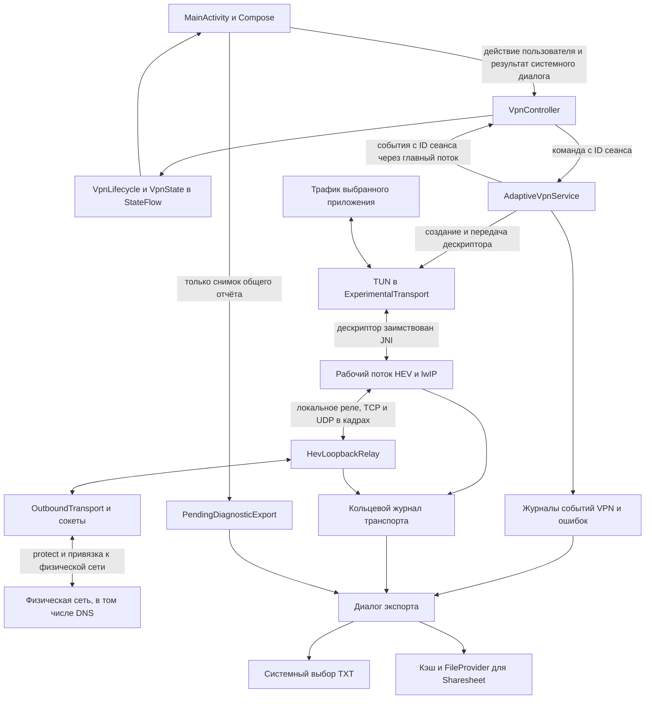

# Технический аудит Adaptive DPI Android 0.1.1 (23)

Базовый коммит — [`9c8ade15199c656dc78d6bacc30b73002fb6c7b3`](https://github.com/deadarhimag/adaptive-dpi-android/commit/9c8ade15199c656dc78d6bacc30b73002fb6c7b3). Изменения аудита ограничены тестами и этим отчётом. Номера строк в выводах относятся к базовому коммиту.

## Архитектура и владение ресурсами

- `VpnLifecycle` — источник истины для состояния VPN. Методы рассчитаны на вызов из главного потока. `operationId`, единственный callback сервиса и флаг `stopIssued` ограничивают область жизненного цикла. Транспортные счётчики публикуются отдельно, поэтому `EngineRunning` и двусторонний обмен имеют разные критерии. [VpnLifecycle.kt, строки 10–89](../vpn/src/main/kotlin/org/adaptivedpi/android/vpn/VpnLifecycle.kt#L10) · [AdaptiveVpnService.kt, строки 310–336](../vpn/src/main/kotlin/org/adaptivedpi/android/vpn/AdaptiveVpnService.kt#L310)
- Сервис владеет foreground-уведомлением, callback сети, задачей запуска и TUN до передачи `ExperimentalTransport`. HEV работает в выделенном потоке и использует переданный дескриптор. Реле владеет слушателем, локальными соединениями и двумя пулами. `OutboundTransport` владеет физическими сокетами. Смена наблюдаемой сети останавливает сеанс. Автоматического переноса сокетов и повторного запуска при возврате сети в этом режиме нет. [AdaptiveVpnService.kt, строки 201–231](../vpn/src/main/kotlin/org/adaptivedpi/android/vpn/AdaptiveVpnService.kt#L201) · [AdaptiveVpnService.kt, строки 273–308](../vpn/src/main/kotlin/org/adaptivedpi/android/vpn/AdaptiveVpnService.kt#L273)
- Зависимость `Controller → Service → Controller` образует цикл на уровне команд и событий. Сериализация состояния и проверка ID защищают от поздних команд. Арбитраж ресурсов повторно проверяется при запуске через `requirePreviousTransportReleased()`. Cancel джобы запуска, удаление таймера и снятие сетевых callback находятся у сервиса. Зависимость от незавершённого нативного рабочего потока остаётся отдельным риском. [AdaptiveVpnService.kt, строки 63–89](../vpn/src/main/kotlin/org/adaptivedpi/android/vpn/AdaptiveVpnService.kt#L63) · [ExperimentalTransport.kt, строки 260–276](../vpn/src/main/kotlin/org/adaptivedpi/android/vpn/ExperimentalTransport.kt#L260)

В версии 23 `finished` означает, что `ExperimentalTransport` завершил попытку очистки. Перед `TransportStopped` сервис отдельно проверяет освобождение нативного владельца и свежий `pendingMask` релея. Дескриптор TUN закрывается после выхода `HevBridge.run()` и до ожидания JVM-пулов. JVM-реле не использует этот дескриптор. `VpnCleanupDelayed` может появиться при сорванном дедлайне, если к моменту публикации итоговая проверка уже пройдена и ошибок этапов нет. Неполная очистка сохраняет `Failed`. Обнаруженное исключение из этой логики относится к ошибкам закрытия сокета ниже. [ExperimentalTransport.kt, строки 118–144](../vpn/src/main/kotlin/org/adaptivedpi/android/vpn/ExperimentalTransport.kt#L118) · [ExperimentalTransport.kt, строки 199–227](../vpn/src/main/kotlin/org/adaptivedpi/android/vpn/ExperimentalTransport.kt#L199) · [AdaptiveVpnService.kt, строки 413–447](../vpn/src/main/kotlin/org/adaptivedpi/android/vpn/AdaptiveVpnService.kt#L413)

## Подтверждённые дефекты

### High — синхронная очистка удерживает вызывающий поток

**Условие.** При остановке закрытие сокетов, нативный сигнал или конкурирующая операция под монитором задерживаются. **Факт.** Команда UI идёт через `VpnLifecycle.stop()` в callback службы. `VpnShutdown.releaseNow()` синхронно вызывает `releaseResources()`; в ней `runningTransport.stop()` вызывает JNI и закрывает реле. `OutboundTransport.close()` закрывает сокеты под монитором, который нужен и для снимка на главном потоке. Четырёхсекундный дедлайн начинается позднее, внутри `awaitShutdownResult()`. Детерминированный тест удерживает `release` защёлкой и подтверждает, что команда и остановка сервиса ждут открытия защёлки. ANR и его длительность на Android не измерялись. **Ожидание и исправление.** Принимать команду и менять состояние в главном потоке. Выполнять сигнал, закрытие и ожидания в одной управляемой фоновой задаче с явным результатом, а итог публиковать в главном потоке. [VpnLifecycle.kt:78](../vpn/src/main/kotlin/org/adaptivedpi/android/vpn/VpnLifecycle.kt#L78) · [VpnShutdown.kt:13](../vpn/src/main/kotlin/org/adaptivedpi/android/vpn/VpnShutdown.kt#L13) · [AdaptiveVpnService.kt:488](../vpn/src/main/kotlin/org/adaptivedpi/android/vpn/AdaptiveVpnService.kt#L488) · [OutboundTransport.kt:103](../engine/src/main/kotlin/org/adaptivedpi/android/engine/OutboundTransport.kt#L103) · [Тест](../vpn/src/test/kotlin/org/adaptivedpi/android/vpn/VpnLifecycleAuditTest.kt#L17)

### High — результат закрытия отдельных сокетов не влияет на итог очистки

**Условие.** `Closeable.close()` у исходящего или локального сокета выдаёт исключение, а рабочие задачи после этого завершаются. **Факт.** `OutboundTransport.closeSocket()` записывает исключение в транспортный журнал и поглощает его, после чего `closeAll()` очищает реестр. Реле аналогично обрабатывает исключение в `closeRelay()`. Сводка остановки учитывает состояние задач и очищенный реестр, а эти исключения не попадают в `cleanupIssues`. Поэтому возможны нулевые счётчики и `Idle` при неподтверждённом закрытии ресурса. Ветвь подтверждена чтением кода, фактическая утечка файлового дескриптора не воспроизводилась. **Ожидание и исправление.** Передавать результат закрытия из владельца ресурса в итог остановки. Учитывать явно подтверждённое закрытие дескриптора и отличать безопасное повторное закрытие от отказа очистки. [OutboundTransport.kt, строки 217–232](../engine/src/main/kotlin/org/adaptivedpi/android/engine/OutboundTransport.kt#L217) · [HevLoopbackRelay.kt, строки 310–337](../engine/src/main/kotlin/org/adaptivedpi/android/engine/HevLoopbackRelay.kt#L310) · [VpnCleanupDetails.kt:24](../vpn/src/main/kotlin/org/adaptivedpi/android/vpn/diagnostics/VpnCleanupDetails.kt#L24)

### Medium — событие остановки теряется без индикации переполнения

**Условие.** Запись истории задержана и все 256 мест канала заняты. **Факт.** `VpnEventWriter.record()` возвращает `false`, а фасад `VpnEventHistory.record()` игнорирует этот результат. В тесте остановлен диспетчер писателя, заняты 256 мест, затем отклонён `StopError / VpnCleanupFailed`. После дренирования событие отсутствует, `storageError=false`. Это потеря записи истории VPN. Отдельный отчёт об ошибке использует другой журнал. **Ожидание и исправление.** Зарезервировать доставку терминальных событий либо явно учитывать их потерю и показывать счётчик. [VpnEventHistory.kt, строки 48–87](../vpn/src/main/kotlin/org/adaptivedpi/android/vpn/diagnostics/VpnEventHistory.kt#L48) · [Тест](../vpn/src/test/kotlin/org/adaptivedpi/android/vpn/diagnostics/DiagnosticAuditTest.kt#L28)

### Medium — поздний отказ не обновляет сохранённую сводку сеанса

**Условие.** Транспорт отмечен завершённым, первая запись сводки прошла, затем от старой задачи приходит отказ. **Факт.** Текущая сводка и журнал показывают две операции, после открытия файлов сохранённая сводка показывает одну. Тест воспроизводит это вызовами `finish → flush → record → flush → reopen`. `finish()` публикует запись на диск один раз, а поздние `record()` добавляют детали. **Ожидание и исправление.** Финализировать до сохранения после прекращения производителей либо обновлять ограниченную итоговую сводку при поздней записи с тем же ID. [TransportDiagnostics.kt, строки 64–105](../vpn/src/main/kotlin/org/adaptivedpi/android/vpn/diagnostics/TransportDiagnostics.kt#L64) · [TransportDiagnostics.kt, строки 195–233](../vpn/src/main/kotlin/org/adaptivedpi/android/vpn/diagnostics/TransportDiagnostics.kt#L195) · [Тест](../vpn/src/test/kotlin/org/adaptivedpi/android/vpn/diagnostics/DiagnosticAuditTest.kt#L48)

### Medium — итоговые счётчики пакетов TUN могут отстать от фактических

**Условие.** Последние пакеты прошли после опроса, а нативный цикл завершился до получения снимка при остановке. **Факт.** JNI возвращает нули, когда сброшен `ready`. Итоговый снимок переносит предыдущие счётчики TUN, обычный опрос запланирован раз в 500 мс. Это вывод из кода, потери реального числа пакетов в аудите не измерялись. **Ожидание и исправление.** Зафиксировать последние нативные счётчики до сброса `ready` и освобождения владельца. Использовать этот снимок вместе с итогом исходящих соединений. [bridge.c, строки 175–192](../vpn/src/main/hev/bridge.c#L175) · [bridge.c, строки 237–249](../vpn/src/main/hev/bridge.c#L237) · [ExperimentalTransport.kt:182](../vpn/src/main/kotlin/org/adaptivedpi/android/vpn/ExperimentalTransport.kt#L182) · [AdaptiveVpnService.kt:499](../vpn/src/main/kotlin/org/adaptivedpi/android/vpn/AdaptiveVpnService.kt#L499)

## Потенциальные риски

| Критичность | Условие и фактический путь | Ожидаемое поведение и способ проверки |
|---|---|---|
| High | Если нативный цикл не выходит после сигнала, `finish()` не запускается. И `closing.finished.await()`, и отложенный `publishEnd()` зависят от его завершения. Четыре секунды ограничивают ожидание пулов после возврата JNI. Вызов `superviseEngine()` для HEV не найден. [ExperimentalTransport.kt:118](../vpn/src/main/kotlin/org/adaptivedpi/android/vpn/ExperimentalTransport.kt#L118) · [AdaptiveVpnService.kt:63](../vpn/src/main/kotlin/org/adaptivedpi/android/vpn/AdaptiveVpnService.kt#L63) · [AdaptiveVpnService.kt:400](../vpn/src/main/kotlin/org/adaptivedpi/android/vpn/AdaptiveVpnService.kt#L400) | Отдельный дедлайн для нативной остановки, подтверждение выхода и явное состояние зависания. Проверить с управляемой задержкой JNI. Защиту от нового TUN сохранить до подтверждения освобождения старого. Принудительное закрытие заимствованного FD из другого потока требует отдельного доказательства безопасности. |
| Medium | Последняя задача может завершиться сразу после снятия `pendingMask` в `publishEnd()`. Состояние `Failed` остаётся, хотя к моменту открытия экрана ресурсы могут быть свободны. Маска берётся раньше счётчиков отдельных пулов, поэтому один снимок может содержать ненулевую маску и уже нулевые счётчики. [HevLoopbackRelay.kt:359](../engine/src/main/kotlin/org/adaptivedpi/android/engine/HevLoopbackRelay.kt#L359) · [AdaptiveVpnService.kt:413](../vpn/src/main/kotlin/org/adaptivedpi/android/vpn/AdaptiveVpnService.kt#L413) | Различать состояние на дедлайне и позднее подтверждение освобождения. Проверить переход управляемой защёлкой непосредственно до и после публикации итога. |
| Medium | При отзыве, пришедшем после начала остановки, `onRevoke()` отбрасывает callback. Ресурсы освобождает уже запущенная остановка. История в этом порядке может сохранить только ручную остановку. [AdaptiveVpnService.kt:376](../vpn/src/main/kotlin/org/adaptivedpi/android/vpn/AdaptiveVpnService.kt#L376) | Один процесс очистки. Источник отмены и порядок двух Android-событий должны быть проверяемы отдельно. Проверить отзыв и ручную остановку в обоих порядках. |
| Medium | Решение о смене сети основано на callback потери выбранной сети и новой наблюдаемой сети по умолчанию. При переключении сеть по умолчанию и callback могут отставать друг от друга. [AdaptiveVpnService.kt:276](../vpn/src/main/kotlin/org/adaptivedpi/android/vpn/AdaptiveVpnService.kt#L276) | Проверить обе смены Wi-Fi и мобильной сети, затем ручной запуск после восстановления. Эмулированное событие и работа на операторе имеют разные границы подтверждения. |
| Medium | Истечение 24 часов удаляет файл из кэша, даже если Android ещё сохраняет действующий read grant принимающему приложению. Уничтожение процесса во время системного выбора теряет снимок общего отчёта из ViewModel и выдаёт сообщение о недоступности. [DiagnosticExports.kt:47](../app/src/main/kotlin/org/adaptivedpi/android/DiagnosticExports.kt#L47) · [MainActivity.kt:68](../app/src/main/kotlin/org/adaptivedpi/android/MainActivity.kt#L68) · [FileProvider](https://developer.android.com/reference/androidx/core/content/FileProvider) | Проверить чтение из независимого приложения до и после возврата Activity. При необходимости согласовать хранение снимка при уничтожении процесса и правила удаления длительно используемых вложений. |
| Low | На API 29 отсутствует `ownerUid`. Если после остановки Android ещё возвращает VPN как сеть по умолчанию, собственное соединение может оказаться помеченным как внешнее. Другой VPN, из которого исключено Adaptive DPI, может быть не виден. [VpnAvailability.kt, строки 13–40](../vpn/src/main/kotlin/org/adaptivedpi/android/vpn/VpnAvailability.kt#L13) | Показать условный статус при неоднозначных сведениях; проверить видимость до и после остановки. Окончательное решение принимает Android через `prepare()`. [Android VpnService](https://developer.android.com/reference/android/net/VpnService) |
| Low | Тест лимита 500 проверяет 340 видимых записей, два пакета Kotlin по 64 и два нативных пакета по 16. Внешний подписчик может удержать предыдущий снимок StateFlow во время обновления. Общий пик живых объектов процесса не измерен. [TransportDiagnostics.kt:229](../vpn/src/main/kotlin/org/adaptivedpi/android/vpn/diagnostics/TransportDiagnostics.kt#L229) | Уточнить, требуется ли лимит самих буферов или общий предел живых объектов при подписчиках. Для второго требуется измерение памяти при длительном экспорте. |

## Проверенные сценарии

| Сценарий | Уровень и границы |
|---|---|
| 100 циклов, дубликаты, смена сеанса и отложенные команды | JVM unit. Обычный путь `Starting → TransportStarting → EngineRunning → Stopping → Idle`, остановка до подключения сервиса, отказ запуска, отзыв и незавершённая очистка. Исключён второй владелец в модели, проверены 100 событий запуска. [VpnLifecycleAuditTest.kt](../vpn/src/test/kotlin/org/adaptivedpi/android/vpn/VpnLifecycleAuditTest.kt) |
| 1 000 TCP, 1 000 UDP и 500 DNS | JVM интеграционный. Реальный Java-релей и сокеты loopback. Параллельные потоки, проверка байтов, TCP half-close, синтетический DNS с проверенным ответом A, ноль ожидающих сокетов и завершённые пулы. DNS-стенд на случайном порту проверяет транспорт DNS-пакета, а не резолвер Android. [HevLoopbackRelayTest.kt](../engine/src/test/kotlin/org/adaptivedpi/android/engine/HevLoopbackRelayTest.kt) |
| Остановка при активном трафике, повторная остановка и дедлайн | JVM интеграционный. Открытые TCP и UDP, восемь активных UDP-ассоциаций без ответов, два конкурирующих вызова `close`, задержка управляемой защёлкой с подтверждением прерывания и отдельно с игнорированием прерывания. При незавершённом пуле маска ненулевая, `RELAY_STOP` фиксируется один раз. [HevLoopbackRelayTest.kt](../engine/src/test/kotlin/org/adaptivedpi/android/engine/HevLoopbackRelayTest.kt) |
| Отказы пакета и соединения | JVM интеграционный. Проверены неправильное согласование реле, адрес вне тестового маршрута, IPv6 для локального релея, превышение размера UDP, продолжение обмена после отброшенной датаграммы и отказ политики сокета до соединения. TCP проверен с раздельными вызовами записи, границы сегментов не предполагаются. TUN в этом тесте отсутствует. [OutboundTransportTest.kt](../engine/src/test/kotlin/org/adaptivedpi/android/engine/OutboundTransportTest.kt) · [HevLoopbackRelayTest.kt](../engine/src/test/kotlin/org/adaptivedpi/android/engine/HevLoopbackRelayTest.kt) |
| Потеря и восстановление физической сети | JVM интеграционный тест смены политики сокетов подтверждает завершение блокирующего чтения и новый обмен после восстановления. В сервисе потеря или смена сети заканчивает сеанс и требует ручного запуска. [OutboundTransportTest.kt](../engine/src/test/kotlin/org/adaptivedpi/android/engine/OutboundTransportTest.kt) |
| Журнал, ротация, многопоточный экспорт | JVM unit и интеграционные файловые тесты. Проверены 52 000 записей, ротация и лимит 5 МиБ, расчёт буферов на 500 записей, агрегация 10 000 отказов, точный результат при параллельной записи и экспорте, тестовая строка с URL, токеном и содержимым не попала в сохранённый отчёт. Сетевые журналы не печатают сырой текст исключения. Классификатор оставляет неизвестные ошибки в `UNKNOWN`, а отмену требует подтверждать причиной закрытия. [Тесты журнала](../vpn/src/test/kotlin/org/adaptivedpi/android/vpn/diagnostics) · [TransportFailureReporterTest.kt](../engine/src/test/kotlin/org/adaptivedpi/android/engine/TransportFailureReporterTest.kt) |
| TCP, UDP, DNS, HTTPS, IPv4, IPv6 и `protect()` через TUN | Историческое инструментальное доказательство именно для базового SHA. Прошли два сеанса ограниченного маршрута и два сеанса отдельного приложения, содержимое HTTPS и UDP-ответ 1400 байт, рост счётчиков, снятие маршрутов и ноль активных соединений. Тест выбранного приложения проверял отсутствие маршрута IPv6 и отдельный UID. Рабочий обмен и тест отказа политики подтверждают ожидаемое поведение, охват всех сетей и правил Android здесь не измерен. [CI версии 23](https://github.com/deadarhimag/adaptive-dpi-android/actions/runs/45110065079) |
| Экспорт, отмена и системное согласие | В историческом CI проверены три входа в экспорт, команды Android на сохранение и отправку, сравнение байтов журнала транспорта, чтение через FileProvider, отмена и диалоги переключения. Проверка файла выполнялась из процесса тестируемого приложения. В коде provider закрыт, доступ только на чтение для получателя передаётся через `content://`. Контроллер повторно вызывает `prepare()` после согласия. `Always-on` для собственного сервиса отключён в манифесте. Ограничения чужого профиля не угадываются по коду отмены. [CI версии 23](https://github.com/deadarhimag/adaptive-dpi-android/actions/runs/45110065079) · [FileProvider](https://developer.android.com/reference/androidx/core/content/FileProvider) · [Android VpnService](https://developer.android.com/reference/android/net/VpnService) |

Повторная остановка в модели и в реле проверена с управляемым порядком, без `Thread.sleep()` в новых тестах. Модель переходов не меняет состояние из фоновых потоков. При системном `onRevoke()` код переключается на главный поток, при ошибке `Builder.establish()` отрабатывает исключение либо `null`, а публикация финального состояния проверяет идентификатор сеанса.

## Непокрытые участки

- Нативное зависание, сбои JNI посередине очистки, отказ создания Android TUN с контролируемым исключением и физическая смена сети. Есть анализ кода и модельные тесты, измерений Android для этих отказов нет.
- Новые инструментальные сценарии 100 сеансов Android-службы и трёх параллельных вложений размером около 2 МиБ каждый собраны. Их выполнение требует Android. Параллельный экспорт во время остановки физического VPN, дочитывание сторонним получателем после возврата Activity и уничтожение процесса в системном диалоге требуют отдельных сценариев.
- Системные отказы и повторное согласие второго VPN, отзыв в обеих очередностях относительно stop, Always-on вместе с блокировкой, пересоздание Activity при активном VPN. Имеются тесты модели и интерфейса. Исторический CI использовал заранее выданное согласие и не исполнял весь класс `VpnLifecycleInstrumentedTest`.
- Блокировка IPv6 на реальном интерфейсе, сети IPv6-only/NAT64, Private DNS, QUIC и связь через сеть оператора. Отсутствие IPv6-маршрута в CI не заменяет проверку фактического трафика этих сценариев.

## Окружение и прогоны

Локально использованы Windows, JDK 17, установленный Android SDK и Gradle Wrapper. Для AGP использована временная ASCII-копия исходников. Ранее опубликованный APK подписан отдельным CI-ключом, локальные APK получены существующей конфигурацией проекта.

Результаты запусков приводятся отдельно от исторического CI. На локальном хосте аппаратный ускоритель Android Emulator недоступен. Попытка запуска в режиме TCG не дала устройства, готового для ADB. Pixel 7 в этом аудите не использовался.

| Прогон | Фактический результат |
|---|---|
| База, `:engine:test`, `:vpn:testDebugUnitTest`, lint debug и release, APK приложения и тестовый APK | Успех за 4 мин 32 с. Выполнены 87 исходных JVM-тестов. Собран `app-release-unsigned.apk`. |
| Полный прогон с тестами аудита | Успех за 41 с с прогретым кэшем. 28 тестов engine и 65 тестов VPN. Всего **93**, без ошибок и пропусков. Lint приложения для обоих вариантов завершился без ошибок, по 14 предупреждений. Собраны debug, Android test и unsigned release. |
| Три повторных прогона релея, журнала и модели жизненного цикла | 20 тестов за прогон, 10 с, 14 с и 10 с по Gradle. Все прошли. Суммарно с полным прогоном проверены 4 000 TCP, 4 000 UDP и 2 000 DNS-обменов в новом loopback-сценарии. |
| `:app:connectedDebugAndroidTest` | Шаг завершился за 7 с с `No connected devices!`. 18 текущих тестов входят в инструментальный APK. Локально выполнено 0. |
| Исторический Actions для точного SHA версии 23 | 9 тестов на Android 14, успешный инструментальный шаг за 2 мин 27 с. Этот запуск предшествовал аудиту. [GitHub Actions](https://github.com/deadarhimag/adaptive-dpi-android/actions/runs/45110065079) |

Тесты с префиксом `auditReproduces` фиксируют наблюдаемый дефект как ожидаемый результат именно аудита. Их успех подтверждает воспроизводимость потери записи и устаревшей сводки. При исправлении нужно заменить утверждения в этих тестах проверками желаемого поведения.

## Вердикт и следующий прогон

**READY WITH KNOWN RISKS** для контролируемого тестирования на Pixel 7. Успешный CI базового APK и стресс-тесты подтверждают обычный тракт. Синхронная часть остановки, неподтверждённое закрытие при исключении и вероятность бессрочного ожидания JNI ограничивают длительные и безнадзорные сеансы.

1. Используйте существующую сборку 0.1.1 (23). Начните с тестового маршрута. Проверьте отзыв разрешения, быстрые повторы запуска и остановки, снятие маршрута, активные подключения и отзывчивость экрана.
2. Проверьте Chrome в экспериментальном режиме, остановку на активной загрузке и обе смены Wi-Fi и мобильной сети. Убедитесь, что после возврата сети можно запустить новый сеанс вручную.
3. Проверьте переход с другого VPN, подтверждение, отказ и ограничения Always-on. Затем отправьте каждый из трёх отчётов в независимое приложение и откройте полученное вложение.
4. При зависании, `Failed` или неожиданном `Idle` сохраните общий отчёт и транспортный TXT по ID сеанса. Сопоставьте время команды, состояние TUN, пулы запросов и ответов и снимок после дедлайна.
