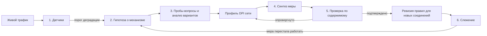
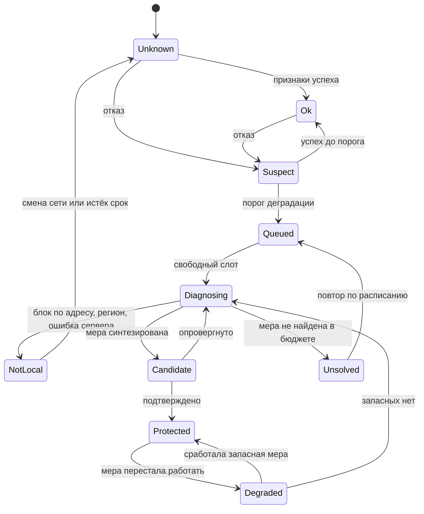

# Движок анализа и синтеза обхода

Весь документ - **[план]**, если не указано иное. Модуль - `:analysis` (чистый Kotlin), Android-действия выполняют адаптеры `:vpn` и `:engine`. Общая архитектура - [ARCHITECTURE.md](ARCHITECTURE.md), операции - [OPERATIONS.md](OPERATIONS.md), критерии приёмки - [TESTING.md](TESTING.md).

## 1. Принцип

DPI - чёрный ящик. Движок не перебирает готовые стратегии, а выясняет поведение DPI минимальным числом экспериментов и **выводит** меру из установленного механизма. Параметры меры вычисляются по конкретному соединению.

Почему не перебор:

- найденная перебором комбинация не объясняет, почему она работает, поэтому её нельзя перенести на соседний ресурс и нельзя понять, что сломалось, когда она перестанет работать;
- каждая проба может вызвать срабатывание DPI, а часть DPI «наказывает» адрес на время после срабатывания **[гипотеза]**; перебор максимизирует число срабатываний;
- перебор M операций × K параметров × повторы - десятки и сотни соединений на ресурс; дерево вопросов - единицы.

Перебор по упорядоченному списку подтверждённых мер остаётся только как запасной ход, когда диагноз неоднозначен.

Сквозная логика - жизненный цикл ключа DPI - описана в разделе 13; поведение новых соединений во время подбора - в разделе 14.

## 2. Ключи

| Ключ | Состав | Для чего |
| --- | --- | --- |
| **Ключ DPI** | То, что видит DPI: открытый SNI; при ECH - внешний SNI; SNI из QUIC Initial; адрес и порт; протокол | Выбор меры и профиль |
| Ключ пользователя | Настоящее имя ресурса, если известно | Только интерфейс |
| Эпоха сети | Поколение текущей физической сети и её существенных параметров | Отмена устаревших результатов |
| Подпись сети | Тип транспорта, доступные без разрешений признаки и результат нескольких дешёвых эталонных вопросов | Узнавание «той же сети» между запусками |

Почему ключ DPI, а не настоящее имя: DPI блокирует то, что видит. При ECH это внешнее имя фронта, и мера должна строиться для него. Почему подпись сети по поведению: важна не та же точка доступа, а тот же режим DPI; подпись по поведению проверяет ровно это и не требует дополнительных разрешений.

Уровни достоверности ключа:

| Уровень | Источник | Применение правил |
| --- | --- | --- |
| A | SNI из ClientHello или QUIC Initial этого соединения | Да |
| B | Адрес получен в этой эпохе ровно для одного имени этим приложением | Только меры уровня адреса и порта, не для TLS |
| C | Адрес соответствует нескольким именам (CDN) | Нет, только наблюдение |
| D | Только адрес | Только меры, не зависящие от имени |
| E | Протокол не распознан | Нет, прямой путь |

## 3. Датчики (пассивные, живой трафик)

Для каждого ключа DPI с мерой и без неё считаются исходы соединений. Активных проб на этом уровне нет.

| Признак отказа | Без root | Начальный порог |
| --- | --- | --- |
| Сброс в начале ответа | `ECONNRESET` при принятых ≤ 4096 байт | Взят из zapret2 (`inseq`) |
| Повторные передачи в начале потока | `TCP_INFO.tcpi_total_retrans` через нативную функцию (поле проверить по заголовкам ядра); без неё - отправлено ≤ 32 КБ и нет ответа до тайм-аута | 3 повторные передачи в первых 32 КБ (zapret2 `retrans`, `maxseq`) |
| Тишина после ClientHello | Нет данных от сервера дольше порога после отправки ClientHello | По телеметрии |
| Заглушка провайдера в HTTP | Ответ 302/307 с `Location` на другой домен второго уровня | Как `is_dpi_redirect` в zapret2 |
| UDP без ответа | ≥ 4 исходящих датаграммы при ≤ 1 входящей | zapret2 `udp_out`, `udp_in` |
| Обрыв на малом объёме | Обрыв или остановка после N байт при нормальном начале | Исследуется |

Признак успеха: принято > 4096 байт или отправлено > 32 КБ - счётчик отказов ключа сбрасывается.

Дополнительно у каждого исхода сохраняются: стадия, время до отказа относительно RTT установления TCP, принятые и отправленные байты, признак ECH, размер ClientHello и число TLS-записей в нём. Время до отказа различает вмешательство (сброс порядка одного RTT после ClientHello) и отбрасывание (тайм-аут).

**Порог деградации.** Ключ считается проблемным, если накоплено не меньше 3 отказов, и между соседними отказами прошло не больше 60 с (так устроен счётчик `automate_failure_counter` в zapret2: `time` - интервал от предыдущего отказа, а не фиксированное окно) и при этом нет признаков общей проблемы сети: отказов по всем ключам, смены эпохи, потери маршрута. Одиночный отказ ничего не запускает.

Пороги - начальные значения; уточняются по телеметрии с реальной сети (см. [ROADMAP.md](ROADMAP.md)).

### Когда подбор не запускается

Ресурсы и батарея тратятся только там, где локальный обход может помочь.

| Ситуация | Признак | Действие |
| --- | --- | --- |
| Ресурс работает | Признак успеха из этого раздела | Прямой путь, ничего не делается |
| Региональное ограничение | Настоящий сервер (TLS с действительным сертификатом на имя) отвечает отказом: HTTP 451, явный ответ о регионе, отказ сервиса для страны | Метка «ограничение на стороне сервера»; проб нет; повторная проверка только при смене сети |
| Ошибка сервера | Действительный TLS и ответ 5xx или сбой сервиса | Не DPI; проб нет |
| Блок по адресу (установлен) | Факт В2 в профиле | Проб нет до смены сети или истечения срока факта; объяснение пользователю |
| Общая проблема сети | Отказы по всем ключам, смена эпохи, потеря маршрута | Анализ не запускается |
| Приложение исключено пользователем | Приоритет «не подбирать» (раздел 10) | Только прямой путь |

Метки «на стороне сервера» и «блок по адресу» сами - результат, а не проблема: они сохраняются в профиле и показываются пользователю, чтобы он не ждал обхода.

## 4. Гипотеза о механизме

По признакам выбирается наиболее вероятный механизм и порядок вопросов:

| Признаки | Вероятный механизм | Первый вопрос |
| --- | --- | --- |
| Нет TCP-соединения или сброс сразу после него при любом содержимом | Блок по адресу | В2 |
| Сброс через ≈1 RTT после ClientHello, принято 0 байт | Срабатывание по содержимому первого пакета | В3 |
| Тишина после ClientHello | Отбрасывание по содержимому | В3 |
| Адрес из DNS отличается от адреса через DoH/DoT | Подмена DNS | В1 |
| Нормальное начало, обрыв на объёме | Ограничение по объёму | В6 |
| Только UDP/443 без ответа | Блок QUIC | В7 |
| Признаки на всех ключах | Общая проблема сети | Анализ не запускается |
| TLS-ответ получен, но сертификат не подходит к имени или не доверен | Подмена ответа на пути (заглушка по TLS) или captive portal | В3; сертификат **никогда** не принимается, это не «прошёл» |
| Открытый HTTP: редирект на чужой домен второго уровня | HTTP-заглушка провайдера | Меры уровня HTTP (форма `Host`) и перевод на HTTPS, если ресурс его поддерживает |
| Немедленный TLS alert от сервера при обычном ClientHello приложения | Отказ сервера, не DPI | Подбор не запускается |

## 5. Пробы-вопросы

Каждая проба отвечает ровно на один вопрос, меняя один фактор относительно контрольного соединения. Внешний сервер проекта не нужен.

| № | Вопрос | Проба | Различает |
| --- | --- | --- | --- |
| В1 | Подменяется ли DNS? | Системный резолв против DoH/DoT через защищённый сокет | Подмена или NXDOMAIN провайдера против настоящего ответа |
| В2 | Блокируется ли адрес? | TCP к адресу без данных; затем ClientHello с нейтральным SNI (раздел 16) на тот же адрес | Блок по адресу против блока по содержимому |
| В3 | Срабатывает ли DPI на имя? | ClientHello с целевым SNI на контрольный TLS-адрес (раздел 16); нейтральный SNI на целевой адрес | Срабатывание по имени независимо от адреса |
| В4 | Собирает ли DPI TLS-записи? | Тот же ClientHello, разбитый на две TLS-записи в одной отправке | Анализ только первой записи против сборки |
| В5 | Собирает ли DPI TCP-сегменты? | Одна TLS-запись в двух гарантированно разных сегментах, граница внутри SNI | Анализ одного пакета против сборки потока |
| В6 | Есть ли ограничение по объёму? | Чтение контрольного объёма до обрыва | Обрыв или остановка после N КБ |
| В7 | Проходит ли QUIC? | QUIC Initial с целевым SNI на UDP/443 | Отбрасывание UDP/443 для имени или для всех |
| В8 | Есть ли остаточная блокировка? | Нейтральная проба на тот же адрес сразу после срабатывания и через паузы | Наличие и длительность «наказания» |

Порядок - от дешёвых и безопасных к дорогим. Ответ на вопрос отменяет ненужные: при блоке по адресу (В2) вопросы В3-В5 не задаются.

### Инструмент: синтетический ClientHello

TLS-рукопожатие пробе завершать не нужно. Проба открывает защищённый TCP-сокет, отправляет байты ClientHello и классифицирует ответ:

| Ответ | Значение |
| --- | --- |
| ServerHello или любой TLS-ответ сервера | Вариант прошёл DPI |
| TLS alert от сервера | Прошёл DPI; сервер не принял вариант или имя. Для вывода о DPI - «прошёл» |
| Сброс через время порядка RTT | Вероятно вмешательство на пути |
| Тишина до тайм-аута | Отбрасывание на пути или потеря |

Исходный ClientHello формирует `SSLEngine` приложения; затем байты изменяются. Пользовательские данные не участвуют. Допустимые изменения, сохраняющие корректность для сервера: разбиение на записи (RFC 8446, раздел 5.1), расширение padding (RFC 7685), регистр букв имени.

### Анализ вариантов: что прошло и в каком виде

Вариант описывается признаками, а не названием стратегии:

- имя: точное, другой регистр, точка в конце, другой поддомен, другой домен на том же адресе;
- положение SNI: смещение в записи, изменённое padding перед SNI;
- границы TLS-записей; границы TCP-сегментов (с гарантией через `TCP_INFO`);
- размер ClientHello, набор и порядок расширений, ALPN;
- адрес назначения: основной или другой адрес того же CDN.

Поиск правила:

1. **Минимальная пара:** блокируемый вариант (исходный ClientHello приложения) и проходящий (тот же запрос с нейтральным именем на тот же адрес).
2. **Деление различий пополам:** признаки, которыми отличаются варианты, делятся пополам, промежуточный вариант проверяется. За log₂(N) шагов остаётся минимальный набор признаков, от которого зависит блокировка.
3. **Уточнение:** найденный признак исследуется точечно. Например, для имени: суффикс какого уровня, учёт регистра, положение в первом сегменте.
4. **Результат - правило DPI**, например: «срабатывает на суффикс `googlevideo.com` без учёта регистра, только в первом TCP-сегменте, вторую TLS-запись не разбирает».
5. **Проверка предсказанием:** для другого имени с тем же суффиксом исход должен совпасть без нового поиска. Несовпадение - правило неверно.

### Анализ живых проходов

Телеметрия реального тракта показывает, какие формы запросов приложений прошли, а какие закончились отказом. Сравнение по тем же признакам подтверждает или опровергает правило, найденное пробами. В постоянный журнал пишутся только признаки и исход, без имён.

## 6. Профиль DPI

Профиль - набор фактов о сети вида «механизм, ключ DPI или класс ключей, параметры правила, уверенность, число свидетельств за и против, дата и эпоха подтверждения, срок годности».

Модель уверенности - детерминированные счётчики, без статистических моделей на первом этапе:

- факт установлен при минимуме N согласующихся проб без противоречий; N задаёт профиль качества («Экономный», «Сбалансированный», «Качество»);
- противоречие при одинаковых условиях делает факт «нестабильным» и запрещает выводить из него меру;
- шумный результат (DPI срабатывает непостоянно): проба повторяется до K раз, вариант считается «прошёл» или «не прошёл» по большинству, иначе - «нестабилен»; деление пополам на нестабильном признаке останавливается;
- факт стареет: после срока годности становится гипотезой до повторной проверки.

Почему без статистики и обучения на первом этапе: решения должны быть объяснимыми, воспроизводимыми в тестах и не оптимизировать шум. Это соответствует п. 5 AGENTS.md.

## 7. Синтез меры

1. **Требуемое свойство.** Из правила выводится свойство потока, которое DPI не должен увидеть. Пример: «имя не должно целиком попасть в первый сегмент, который анализирует DPI».
2. **Подбор примитивов.** Из [каталога операций](OPERATIONS.md) берутся примитивы, обеспечивающие это свойство, в порядке стоимости и риска: операции уровня приложения → разрез сегмента → TTL-зависимые → fake.
3. **Вычисление параметров** по конкретному соединению: место разреза - по смещению и длине SNI из классификатора; TTL - по измерению на этой сети; размеры - по форме ClientHello приложения.
4. **Каноническая форма.** Мера хранится как упорядоченный список операций с параметрами-правилами («внутри SNI, на середине»), а не с абсолютными смещениями. Абсолютные значения вычисляются для каждого соединения.
5. **Связь с фактом.** Мера хранит ссылку на факт профиля, из которого выведена.

| Механизм | Мера |
| --- | --- |
| Подмена DNS | Собственный резолв через DoH/DoT и ответ приложению через релей |
| Срабатывание по имени, записи не собирает | Разбиение ClientHello на TLS-записи, граница внутри SNI |
| Записи собирает, сегменты нет | Гарантированный разрез TCP-сегмента внутри SNI |
| Собирает и записи, и сегменты | TTL-зависимые меры (disorder, fake), только после проверки на стенде |
| Блок по адресу | Локально не решается; сообщение пользователю |
| Блок QUIC | Отбрасывание UDP/443 для ключа, переход клиента на TCP проверяется |
| Ограничение по объёму | Определяется после исследования |

## 8. Проверка

- Пары «прямой путь - мера» в обоих порядках (A/B и B/A) на одном адресе, семействе и сети.
- Успех определяется по уровням подтверждения из раздела 15: для произвольного ресурса пользователя достаточно уровня П2 (подлинный сервер), для эталонных ресурсов - П3 (ожидаемое содержимое).
- **Отрицательный контроль:** заведомо неподходящая мера не должна давать успеха. Если даёт - диагноз неверен, результат не принимается.
- Публикация: ревизия правил записывается одной транзакцией вместе со ссылкой на предыдущую, затем публикуется неизменяемый снимок для новых соединений.

## 9. Слежение за изменениями DPI

Наблюдение пользователя: ByeByeDPI на сети Билайн работает, но настройки приходится периодически менять. Движок должен замечать это сам.

1. **Датчики** из раздела 3 продолжают работать для ключей с мерой.
2. **При деградации** первой перепроверяется факт, из которого выведена мера (например, В4 для разбиения на записи). Изменился - выводится новая мера. Не изменился - проверяются соседние причины (В1, В2).
3. **Запас подтверждённых мер.** Для ключа хранится упорядоченный список подтверждённых мер с датой; при деградации сразу пробуется следующая. Переключение занимает одно соединение.
4. **Журнал изменений режима DPI:** дата, подпись сети, какой факт изменился, мера до и после. Через несколько недель он показывает, как часто и что меняется.
5. **Несколько режимов на одной сети.** Если деградация совпадает со сменой подписи сети, это разные узлы DPI, а не обновление. Тогда хранится несколько профилей и выбирается по подписи.

## 10. Очередь проб

### Классы задач

| Класс | Источник | Прерывает |
| --- | --- | --- |
| P0 - интерактивный | Действие пользователя, приоритетный режим | Все ниже |
| P1 - отказ живого трафика | Порог деградации | P2, P3 |
| P2 - перепроверка | Истёк срок факта, сменилась подпись сети | P3 |
| P3 - уточнение | Уточнение профиля после инцидента (например, длительность остаточной блокировки), только в пределах бюджета и не в спокойном состоянии без повода | Никого |

### Приоритеты приложений и слоты подбора

Подбор для разных ресурсов идёт параллельно, но число одновременных подборов ограничено **слотами** (начально 2-3 на сеть; уточняется по батарее и трафику). Задача занимает слот на всё время диагноза и проверки одного ключа DPI.

| Приоритет приложения | Поведение |
| --- | --- |
| Высокий | Его задачи P1 встают в очередь первыми и получают слот первыми |
| Обычный (по умолчанию) | Очередь по времени появления проблемы |
| Низкий | Получает слот, когда нет задач с более высоким приоритетом |
| Не подбирать | Только прямой путь; движок только считает исходы |

Правила:

- Внутри приоритета - порядок появления проблемы.
- **Старение:** задача низкого приоритета, ждущая дольше порога, повышается на один уровень, чтобы не ждать бесконечно.
- Одна проблема одного ключа DPI, замеченная у нескольких приложений, - одна задача с наивысшим из их приоритетов (знание о DPI общее, раздел 2).
- Задача без свободного слота ждёт в очереди; при освобождении слота берётся следующая по правилам.
- Приоритет задаёт пользователь в списке приложений; по умолчанию все приложения - «Обычный».

### Приоритетный режим

Пользователь включает его для приложения или ресурса. Режим переводит задачи в P0, поднимает бюджет и параллельность в пределах жёстких верхних границ, приостанавливает P2 и P3 для других ресурсов этой сети, **сам выключается через несколько минут**, виден в интерфейсе и отменяется одной кнопкой.

Ограничение по времени обязательно: забытый режим тратит батарею и трафик (п. 7 AGENTS.md). Верхние границы не снимаются: частые срабатывания DPI могут закрыть ресурс для самого пользователя.

### Правила

1. **Объединение:** ключ задачи = эпоха сети + ключ DPI + вопрос или подтверждаемая мера.
2. **Граф зависимостей вопросов** хранится для каждого ключа; очередь - не плоский список.
3. **Вытеснение на границе стадии**, кроме P3 и смены эпохи (немедленная отмена).
4. **Смена эпохи** отменяет все задачи; поздние результаты не публикуются.
5. **Защита живого трафика:** при высокой нагрузке P2 и P3 приостанавливаются.
6. **Учёт бюджета переживает перезапуск процесса.**
7. **Нарастающая пауза** после отказов, по ключу DPI.

### Параллельность

Понятие **домена помех** - множество проб, способных повлиять друг на друга.

| Ситуация | Параллельно |
| --- | --- |
| Разные ресурсы на разных адресах | Да, в пределах общего лимита сети |
| Вопросы об одном ресурсе | Нет, последовательно |
| Разные имена на одном адресе CDN | Нет, последовательно |
| Пробы и живой трафик одного ресурса | Минимальная параллельность проб |
| Живые соединения разных ресурсов с разными мерами | Да |

На первом этапе домен помех - адрес назначения; после измерения В8 может быть расширен до подсети.

### Бюджеты

Лимиты: одновременных проб на устройство, сеть, ресурс; попыток и байтов на ресурс в час; пауза после срабатывания. Пробы только к ресурсам, которые стали триггером или выбраны пользователем. При режиме энергосбережения и лимитной сети P2 и P3 не выполняются.

### Реализация

Один владелец состояния (корутина-актор с каналом команд), пул исполнителей фиксированного размера, семафоры по доменам помех. Ядро очереди - чистый Kotlin; часы, транспорт проб и хранилище - интерфейсы. Почему актор: решения о вытеснении, бюджете и отмене принимаются в одном месте последовательно, и гонки исключены по построению.

## 11. Модель данных

| Тип | Поля | Назначение |
| --- | --- | --- |
| `DpiKey` | видимое имя или `null`, признак ECH, адрес, порт, протокол, уровень достоверности | Ключ меры |
| `NetworkEpoch` | номер поколения, тип транспорта | Отмена устаревшего |
| `NetworkSignature` | тип транспорта, доступные признаки, результаты эталонных вопросов | Узнавание сети |
| `FlowOutcome` | ключ, стадия, `errno`, время до отказа относительно RTT, байты в обе стороны, повторные передачи, размер ClientHello, число записей, ревизия меры | Датчики |
| `Variant` | набор признаков из раздела 5 | Анализ вариантов |
| `ProbeOutcome` | вариант, класс ответа (прошёл, сброс, тишина, alert), время, байты, номер попытки, адрес | Пробы |
| `DpiFact` | механизм, область (ключ или класс ключей), параметры правила, свидетельства за и против, уверенность, дата, эпоха, срок годности | Профиль |
| `Measure` | упорядоченные операции с параметрами-правилами, ссылка на факт, дата подтверждения | Синтез |
| `RuleRevision` | номер, меры по ключам, ссылка на предыдущую | Публикация |
| `DpiChange` | дата, подпись сети, изменившийся факт, мера до и после | Журнал изменений |
| `KeyState` | ключ DPI, состояние из раздела 13, время перехода, текущая мера, запасные меры, причина `NotLocal` или `Unsolved`, время следующего повтора | Жизненный цикл |
| `Confirmation` | мера, ключ, достигнутый уровень (П1, П2, П3), пары A/B, отрицательный контроль, число живых соединений | Подтверждение |
| `DeviceCapabilities` | версия системы, результат проверки каждой операции каталога, дата | Синтез |

Хранятся только эти данные. Содержимое трафика, пути, cookies и любые данные авторизации - никогда.

## 12. Что движок честно не умеет

| Ситуация | Почему | Что видит пользователь |
| --- | --- | --- |
| Блок по адресу | Нужен другой внешний адрес | «Ресурс заблокирован по адресу, обход без сервера невозможен» |
| Региональное ограничение | Ответ сервера по стране | «Сервер ограничивает доступ из региона» |
| DPI реагирует на поведение потока, а не на ClientHello (статистика, тайминги) | Метод анализирует форму запроса | «Причина не определена», меры не применяются |
| Нестабильные результаты | Нельзя установить факт | «Недостаточно данных», повторная проверка позже |
| Другой активный VPN | Android допускает один VPN | Сообщение и инструкция |

## 13. Жизненный цикл ключа DPI

У каждого ключа DPI в профиле сети одно состояние. Переходы выполняет актор очереди (раздел 10), поэтому состояние меняется последовательно.

| Состояние | Что делает новое соединение | Пробы | Что видит пользователь |
| --- | --- | --- | --- |
| `Unknown` | Прямой путь | Нет | Ничего |
| `Ok` | Прямой путь | Нет | Ничего |
| `Suspect` | Прямой путь | Нет | Ничего |
| `Queued` | Прямой путь или предсказанная мера (раздел 14) | Нет | «Есть проблема с X, в очереди на подбор» |
| `Diagnosing` | Прямой путь или предсказанная мера | Да, в слоте | «Разбираемся с X» |
| `Candidate` | Кандидат применяется к части новых соединений для проверки (раздел 15) | Да | «Проверяем обход для X» |
| `Protected` | Подтверждённая мера | Нет | «X: <механизм>, включено <мера>» |
| `Degraded` | Следующая запасная мера | Нет, пока есть запасные | «X: обход перестал работать, переключаемся» |
| `NotLocal` | Прямой путь | Нет | «X: блок по адресу / ограничение сервера, обход без сервера невозможен» |
| `Unsolved` | Прямой путь | Только по расписанию (раздел 19) | «X: причину установить не удалось, повторим позже» |

Ключи в состоянии `Ok` и `Unknown` хранятся только как агрегаты в памяти текущего сеанса; в постоянный профиль попадают ключи, которые хотя бы раз были проблемными (раздел 20).

## 14. Новые соединения во время подбора

Пока ключ в очереди или в диагнозе, пользователь продолжает открывать ресурс. Профиль сети позволяет помочь ему раньше, чем закончится полный подбор.

1. **Предсказание по профилю.** Если для этой сети уже установлен факт, область которого включает ключ (например, правило «суффикс имени, только первая TLS-запись» с подходящим суффиксом или общий для сети механизм «записи не собирает»), к новым соединениям ключа сразу применяется выведенная из него мера. Это гипотеза о мере, а не подтверждение: ключ остаётся в `Diagnosing`, а исходы этих соединений идут в проверку как живые наблюдения.
2. **Без предсказания** - прямой путь. Движок не применяет к живому трафику неподтверждённые меры, не выведенные из факта.
3. **Ошибка предсказания.** Если предсказанная мера не помогла, она исключается для ключа, а факт, из которого она выведена, получает свидетельство «против» в области этого ключа (раздел 17).

Почему так: на сети с установленным механизмом большинство новых проблемных ресурсов решается той же мерой; пользователь получает работающий ресурс за одно соединение, а полный подбор нужен только для исключений.

## 15. Уровни подтверждения

Для произвольного ресурса пользователя ожидаемого содержимого нет. Поэтому подтверждение разделено на уровни:

| Уровень | Что подтверждено | Как |
| --- | --- | --- |
| П1 - транспорт | Данные идут в обе стороны дальше начала | Признак успеха из раздела 3 на живом соединении |
| П2 - подлинный сервер | Ответил настоящий сервер этого имени, а не заглушка | Собственная проба с той же мерой и полным TLS-рукопожатием, проверка цепочки сертификатов платформой и соответствия имени (раздел 18) |
| П3 - содержимое | Получено ожидаемое содержимое | Только для эталонных ресурсов с известным контрактом ответа (структурный признак или хеш) |

Мера получает статус «подтверждена», если:

- П2 пройден в собственной пробе с мерой, а та же проба без меры (прямой путь) П2 не проходит - в обоих порядках (A/B и B/A);
- на живом трафике не меньше N соединений с мерой дали П1 без отказов (N - из профиля качества);
- отрицательный контроль (заведомо неподходящая мера) П2 не прошёл.

Если собственную пробу провести нельзя (ресурс не TLS, протокол неизвестен), подтверждение - только П1 на живом трафике, и в интерфейсе мера помечается как «подтверждена по трафику».

П2 - это предел диагностики для ресурсов без контракта ответа: он доказывает, что ответил настоящий сервер, но не что сервер отдал нужное содержимое (например, при региональном ограничении). Этот предел указывается в интерфейсе (п. 12 AGENTS.md).

Подделать П2 без доверенного сертификата невозможно: DPI может оборвать соединение или подставить заглушку с чужим сертификатом, но не может предъявить действительный сертификат чужого имени. Поэтому П2 надёжно отличает обход от «соединение установилось, но не с тем сервером».

## 16. Контрольные адреса и нейтральные имена

Вопросам В2, В3 и анализу вариантов нужны точки сравнения. Собственного сервера у проекта нет, поэтому они выбираются из того, что уже известно движку:

- **Контрольный TLS-адрес** - адрес ключа в состоянии `Ok` в текущей эпохе сети, желательно у другого провайдера хостинга, чем проверяемый. При отсутствии таких ключей - адрес DoH-резолвера из [ARCHITECTURE.md](ARCHITECTURE.md), раздел «DNS», если он доступен.
- **Нейтральное имя** - имя ключа в состоянии `Ok` в текущей эпохе. Сервер проверяемого адреса, скорее всего, ответит на него TLS alert или чужим сертификатом - для вопроса о DPI это «прошёл».
- Контрольные адреса и нейтральные имена выбираются заново в каждой эпохе сети и не хранятся между сетями.
- Если подходящих точек сравнения нет, вопросы, которым они нужны, не задаются, а диагноз получает пометку «ограничен».

## 17. Область правил и конфликты

- **Область факта** - то, к чему он относится: один ключ, класс ключей (суффикс имени, установленный анализом вариантов) или вся сеть (механизм, подтверждённый на нескольких независимых ключах).
- **Расширение области** только через предсказание: правило с узкой областью расширяется, если предсказание подтвердилось на ключах вне исходной области не меньше N раз без противоречий. Обратно - сужается при противоречии.
- **Конфликт мер для ключа:** побеждает факт с более узкой областью (ключ → класс → сеть); при равной области - с более свежим подтверждением; при равенстве - с меньшей стоимостью меры.
- **Мера никогда не применяется к ключу вне области своего факта**, кроме предсказания из раздела 14.

## 18. Исполнитель проб

- **Собственный TLS-клиент на `SSLEngine`.** Проба формирует ClientHello через `SSLEngine` с SNI проверяемого имени, применяет к его байтам операции меры или изменения варианта и отправляет через защищённый сокет отдельного экземпляра `OutboundTransport`. Для П2 рукопожатие доводится до конца тем же `SSLEngine`, сертификат проверяется платформенным `TrustManager` и соответствием имени. Проверка сертификата не отключается и не ослабляется.
- **Без Java-тайм-аутов на чтении** - только тайм-ауты ядра или закрытие сокета владельцем (урок RelayWait, [TRANSPORT.md](TRANSPORT.md)).
- **Только допустимые адреса:** адреса из живого трафика пользователя, ответов DNS для проблемного имени и списка резолверов. Частные, link-local, служебные адреса - никогда.
- **Сеть:** сокет привязан к физической сети текущей эпохи; семейство IP - то, которое реально получает приложение.

## 19. Неудача, сбой и повтор

- **Мера не найдена в бюджете** → `Unsolved`. Повтор по расписанию: при смене сети, затем через 1 ч, 6 ч, 24 ч; после этого - только при смене сети или по действию пользователя.
- **Сбой исполнителя меры на живом соединении** (операция недоступна, нативная функция вернула ошибку) → соединение продолжается прямым путём с уже прочитанными байтами; операция помечается недоступной в возможностях устройства (раздел 20); ключ переходит в `Degraded`.
- **Сбой пробы** (отказ `protect`, потеря сети) → проба считается непригодной, а не отказом DPI; бюджет учтён.
- **Смена эпохи сети** во время любой фазы → задача отменяется, результаты не публикуются, ключ возвращается в `Suspect` новой эпохи, если отказы повторятся.

## 20. Возможности устройства и хранение

- **Возможности устройства** - результат эксперимента 1.6 из [ROADMAP.md](ROADMAP.md), выполняемого при первом запуске и после обновления системы: какие операции из [каталога](OPERATIONS.md) работают на этом устройстве (`TCP_INFO`, `vmsplice`, BPF-фильтр, числовые опции сокета). Синтез использует только доступные операции.
- **TTL для TTL-зависимых операций** подбирается экспериментом, а не задаётся константой: двоичный поиск такого TTL, при котором часть с этим TTL не доходит до сервера (сервер не видит её, проверка по П2), но влияет на DPI (вариант проходит). Результат - факт профиля сети с обычным сроком годности.
- **Хранение профиля:** до 500 ключей на подпись сети; вытесняются давно не встречавшиеся ключи в состояниях `Ok`, `Unknown`, затем `NotLocal`; ключи `Protected` вытесняются последними. Профили не встречавшихся 30 дней сетей удаляются целиком. Хранятся только данные из раздела 11.

## 21. Начальные числа

Все значения - стартовые; уточняются по телеметрии и записываются в [TRANSPORT.md](TRANSPORT.md) или сюда с измерением.

| Параметр | Значение |
| --- | --- |
| Порог деградации | 3 отказа, не больше 60 с между соседними |
| Признак успеха | Принято > 4096 байт или отправлено > 32 КБ |
| Слоты подбора на сеть | 2 (режим «Экономный» - 1, «Качество» - 3) |
| Одновременные пробы на адрес | 1 |
| Подключение пробы | 5 с |
| Ожидание ответа на ClientHello | max(3 × RTT установления, 2 с), не больше 5 с |
| Повторов одного варианта при шуме | 3, решение по большинству |
| Пауза после срабатывания DPI на адресе | 2 с, удваивается до 60 с при повторных срабатываниях (уточняется вопросом В8) |
| Бюджет на ключ в час | 30 проб, 1 МБ |
| Бюджет на сеть в час | 200 проб, 10 МБ |
| Подтверждение живым трафиком | 5 соединений с П1 без отказов |
| Срок годности факта | 24 ч; факта «блок по адресу» и «ограничение сервера» - 7 дней |
| Приоритетный режим | 5 минут; бюджеты ×3 в пределах бюджета сети |
| Старение задачи в очереди | +1 уровень приоритета через 10 минут ожидания |

## Источники

- [RFC 8446, раздел 5.1](https://www.rfc-editor.org/rfc/rfc8446.html#section-5.1)
- [RFC 7685: TLS ClientHello Padding Extension](https://www.rfc-editor.org/rfc/rfc7685.html)
- [RFC 9001, раздел 5.2](https://www.rfc-editor.org/rfc/rfc9001.html#section-5.2)
- [bol-van/zapret2, lua/zapret-auto.lua @ da8abd3](https://github.com/bol-van/zapret2/blob/da8abd3/lua/zapret-auto.lua)
