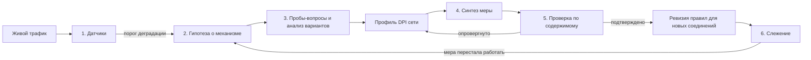
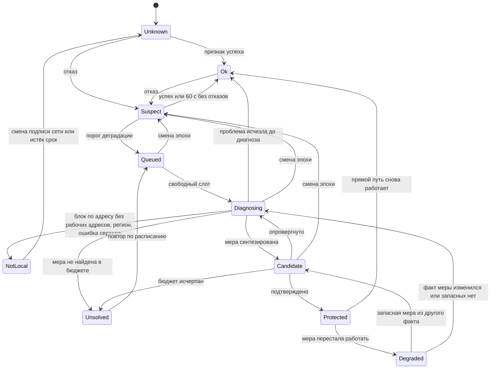

# Движок анализа и синтеза обхода

Весь документ - **[план]**, если не указано иное. Модуль - `:analysis` (чистый Kotlin), Android-действия выполняют адаптеры `:vpn` и `:engine`. Общая архитектура - [ARCHITECTURE.md](ARCHITECTURE.md), операции - [OPERATIONS.md](OPERATIONS.md), критерии приёмки - [TESTING.md](TESTING.md).

## 1. Принцип

DPI - чёрный ящик. Движок не перебирает готовые стратегии, а выясняет поведение DPI минимальным числом экспериментов и **выводит** меру из установленного механизма. Параметры меры вычисляются по конкретному соединению.

Почему не перебор:

- найденная перебором комбинация не объясняет, почему она работает, поэтому её нельзя перенести на соседний ресурс и нельзя понять, что сломалось, когда она перестанет работать;
- каждая проба может вызвать срабатывание DPI, а часть DPI «наказывает» адрес на время после срабатывания **[гипотеза]**; перебор максимизирует число срабатываний;
- перебор M операций × K параметров × повторы - десятки и сотни соединений на ресурс; дерево вопросов - единицы.

Перебора готовых стратегий нет ни в каком виде. Если гипотезы остались неразличимы, выбирается мера, общая для всех оставшихся (раздел 22, п. 5); если гипотез из каталога не осталось - путь неизвестного механизма (раздел 23). Пресеты byedpi используются только как начальные веса гипотез, а не как меры.

Сквозная логика - жизненный цикл ключа DPI - описана в разделе 13; поведение новых соединений во время подбора - в разделе 14.

**Главное правило, отличающее анализ от перебора** (раздел 22): каждая проба имеет тип, и для каждого типа определено, что она обязана различать. Различающая проба выполняется, только если хотя бы две живые гипотезы о механизме предсказывают для неё разный исход; параметрическая - только если хотя бы два значения параметра установленного механизма предсказывают разный исход; подтверждающая - только когда жива одна гипотеза. Проба, исход которой ничего не может исключить или подтвердить, запрещена.



## 2. Ключи

| Ключ | Состав | Для чего |
| --- | --- | --- |
| **Ключ DPI** | То, что видит DPI: открытый SNI; при ECH - внешний SNI; SNI из QUIC Initial; адрес и порт; протокол | Выбор меры и профиль |
| Ключ пользователя | Настоящее имя ресурса, если известно | Только интерфейс |
| Эпоха сети | Поколение текущей физической сети и её существенных параметров | Отмена устаревших результатов |
| Подпись сети | Пассивно: тип транспорта, оператор мобильной сети (MCC-MNC, если доступен без разрешений), шлюз и DNS-серверы сети ([ARCHITECTURE.md](ARCHITECTURE.md), Т8); лениво, при первом проблемном ключе: проверка ранее установленных фактов кандидатного профиля | Узнавание «той же сети» между запусками |

**Приложение - набор эндпоинтов.** Любое приложение обращается к ограниченному числу адресов и имён (API, CDN картинок, аналитика, push). Обычно проблемы только у части из них. Поэтому единица подбора и меры - ключ DPI, а не приложение: эндпоинты, которые работают, остаются на прямом пути (инвариант 12 [ARCHITECTURE.md](ARCHITECTURE.md)), мера применяется только к ключам с подтверждённой проблемой. Карточка приложения показывает его эндпоинты с состоянием каждого (раздел 13) и даёт сброс по каждому (раздел 26).

Почему ключ DPI, а не настоящее имя: DPI блокирует то, что видит. При ECH это внешнее имя фронта, и мера должна строиться для него. Почему подпись сети частично по поведению: важна не та же точка доступа, а тот же режим DPI. Пассивная часть выбирает кандидатный профиль без единой пробы; поведенческая проверяется только при первой проблеме, проверкой уже известного факта этого профиля. Так подпись не порождает проб без повода.

Уровни достоверности ключа:

| Уровень | Источник | Применение правил |
| --- | --- | --- |
| A | SNI из ClientHello или QUIC Initial этого соединения | Да |
| B | Адрес получен в этой эпохе ровно для одного имени: ответ совпал с запросом (ID, вопрос, сервер), адрес взят по цепочке CNAME от вопроса, срок связи - минимальный TTL цепочки ([ARCHITECTURE.md](ARCHITECTURE.md), Т3); до атрибуции UID (4.3) связь с конкретным приложением не установлена | Только меры уровня адреса и порта, не для TLS |
| C | Адрес соответствует нескольким именам (CDN) | Нет, только наблюдение |
| D | Только адрес | Только меры, не зависящие от имени |
| E | Протокол не распознан | Нет, прямой путь |

## 3. Датчики (пассивные, живой трафик)

Для каждого ключа DPI с мерой и без неё считаются исходы соединений. Активных проб на этом уровне нет.

| Признак отказа | Без root | Начальный порог |
| --- | --- | --- |
| Сброс в начале ответа | `ECONNRESET` при принятых ≤ 4096 байт | Взят из zapret2 (`inseq`) |
| Повторные передачи в начале потока | `TCP_INFO.tcpi_total_retrans` через нативную функцию (поле проверить по заголовкам ядра); без неё - отправлено ≤ 32 КБ и нет ответа до тайм-аута | 3 повторные передачи в первых 32 КБ (zapret2 `retrans`, `maxseq`) |
| Тишина после ClientHello | Нет данных от сервера дольше порога после отправки ClientHello | По телеметрии |
| Междоменный редирект в открытом HTTP | Ответ 302/307 с `Location` на другой зарегистрированный домен. **Слабое наблюдение, не отказ**: так же выглядят вход, переезд сайта и выбор региона. Отказом становится только вместе с другим признаком: переход не закончился содержимым, отклонение повторяется, контрольное сравнение (раздел 27) его подтверждает | Признак как `is_dpi_redirect` в zapret2; порога нет |
| UDP без ответа | ≥ 4 исходящих датаграммы при ≤ 1 входящей | zapret2 `udp_out`, `udp_in` |
| Обрыв на малом объёме | Обрыв или остановка после N байт при нормальном начале | Порог N измеряется на реальной сети (В6) |
| Клиент бросил соединение после ответа сервера | Клиент закрыл соединение в пределах ≈1 RTT после первой порции ответа. Релей видит только направление, размеры записей, время и закрытие: в TLS 1.3 рукопожатие, alert и прикладные данные снаружи имеют один тип записи, поэтому «клиент не отправил прикладных данных» пассивно не определяется. Признак записывается как профиль байтов и закрытий | Повод для П2-пробы (раздел 15), а не вывод о сертификате: причину устанавливает только активная проверка |
| Остановка приёма | Входящий поток стоит дольше порога, клиент ждёт (окно не закрыто) | Признак ограничения по объёму |
| Низкая скорость | Соединение принимает данные без обрывов, но скорость приёма заметно ниже обычной для этой эпохи сети: сравнение со скоростями других ключей и с нейтральным контролем (В9) | Порог не задан: измеряется в задаче 1.5 на реальной сети. До измерения признак только записывается, подбор по нему не запускается |

Признак успеха: соединение завершилось штатно (FIN от сервера или клиента после обмена прикладными данными в обе стороны) **или** принятый объём превысил порог ограничения по объёму, установленный для сети (до измерения - 64 КБ). Простое превышение 4 КБ успехом не считается: цепочка сертификатов заглушки и начало потока до «заморозки» тоже больше 4 КБ. Успех одного соединения не сбрасывает накопленные отказы ключа: у ресурса страница может загружаться, а видеопоток - нет. Отказы стареют по правилу порога деградации ниже. **Скорость:** принятый объём не отменяет признака низкой скорости. Соединение, принявшее больше порога объёма, но медленное, считается «медленным», а не успешным; пока порог скорости не измерен (раздел 21), медленные соединения только записываются.

Дополнительно у каждого исхода сохраняются: стадия, время до отказа относительно RTT установления TCP, принятые и отправленные байты, признак ECH, размер ClientHello и число TLS-записей в нём. Время до отказа различает вмешательство (сброс порядка одного RTT после ClientHello) и отбрасывание (тайм-аут).

**Внутренние отказы не являются отказами ключа.** `SESSION_LIMIT`, `SOCKET_LIMIT`, `WORKER_REJECTED`, `NO_PHYSICAL_NETWORK` и отмены по смене эпохи или остановке - ограничения самого приложения, а не признак DPI: в датчики они не идут и ключ в `Suspect` не переводят. Иначе лимит релея выглядел бы как блокировка.

**Порог деградации.** Ключ считается проблемным, если накоплено не меньше 3 отказов, и между соседними отказами прошло не больше 60 с (так устроен счётчик `automate_failure_counter` в zapret2: `time` - интервал от предыдущего отказа, а не фиксированное окно) и при этом нет признаков общей проблемы сети (ниже). Одиночный отказ ничего не запускает, но переводит ключ в `Suspect` (раздел 13).

**Общая проблема сети** устанавливается проверкой на текущей сети, а не справочником владельцев серверов: блокировки различаются даже между сетями одного оператора, поэтому вывод действителен только для текущей эпохи сети.

1. **Повод (пассивно, без проб):** отказы одновременно идут не меньше чем по 3 ключам с разными зарегистрированными доменами, или сменилась эпоха, или пропал маршрут. Повод ничего не решает, а только запускает проверку п. 2.
2. **Проверка (активно, только по поводу):** TCP-подключение без данных к контрольным точкам - по одному адресу каждого владельца из таблицы «DNS» [ARCHITECTURE.md](ARCHITECTURE.md), по очереди, до первого ответа; не меньше трёх точек, если никто не отвечает. Точки, помеченные в профиле сети как блокируемые, пропускаются. Проба класса P0 по правилам «Состояния сети», не чаще раза в минуту, в бюджете сети.
3. **Вывод:** не ответила ни одна из опрошенных (не меньше трёх) **и** живой трафик к другим ресурсам тоже отказывает - «общая проблема сети», подбор приостановлен. Не ответили контрольные точки, а другие ресурсы работают - «контрольные точки недоступны на этой сети» (факт профиля), а не потеря связи. Ответила хотя бы одна - достижима именно она; потери на других путях это не исключает, поэтому `network` исключается только для ключей, у которых отказ отличается от потерь (раздел 4).
4. Результат хранится только для текущей эпохи и не переносится на другие сети, в том числе того же оператора.

Отказы ключей одного сервиса (например, все адреса YouTube в режиме одного приложения) поводом не являются, если домены совпадают: `network` остаётся одной из гипотез и различается пробой. Если доступны только отдельные ресурсы, а остальные нет, пользователю показывается «доступны только отдельные ресурсы» - это не потеря связи.

Пороги - начальные значения; уточняются по телеметрии с реальной сети (см. [ROADMAP.md](ROADMAP.md)).

### Когда подбор не запускается

Ресурсы и батарея тратятся только там, где локальный обход может помочь.

| Ситуация | Признак | Действие |
| --- | --- | --- |
| Ресурс работает | Признак успеха из этого раздела | Прямой путь, ничего не делается |
| Региональное ограничение | Настоящий сервер (TLS с действительным сертификатом на имя) отвечает отказом: явный ответ о регионе, отказ сервиса для страны. HTTP 451 по RFC 7725 - юридическая причина отказа, о географии сам не говорит: это отказ сервера без вывода о регионе | Метка «ограничение на стороне сервера»; проб нет; повторная проверка только при смене сети |
| Ошибка сервера | Действительный TLS и ответ 5xx или сбой сервиса | Не DPI; проб нет |
| Блок по адресу (установлен) | Факт В2 в профиле **и** ни один альтернативный адрес ресурса (из ответов резолверов, «DNS» в [ARCHITECTURE.md](ARCHITECTURE.md)) не отвечает | Проб нет до смены подписи сети или истечения срока факта; объяснение пользователю. Если хоть один альтернативный адрес отвечает - это не блок ресурса, а мера «DNS» |
| Общая проблема сети | Отказы по всем ключам, смена эпохи, потеря маршрута | Анализ не запускается |
| Сеть не в норме | Авторизация в сети, нет интернета, плохая связь ([ARCHITECTURE.md](ARCHITECTURE.md), «Состояние сети») | Подбор приостановлен до возврата в норму; ключи не переходят в `Suspect` |
| Приложение исключено пользователем | Приоритет «не подбирать» (раздел 10) | Только прямой путь |
| Ресурс в списке «не трогать» | Раздел 26 | Только прямой путь |
| Проблема вызвана трафиком фонового приложения при выключенном экране | Экран выключен, устройство не заряжается | Задача откладывается до включения экрана или зарядки (раздел 19) |

Метки «на стороне сервера» и «блок по адресу» сами - результат, а не проблема: они сохраняются в профиле и показываются пользователю, чтобы он не ждал обхода.

## 4. Гипотеза о механизме

По признакам выбирается наиболее вероятный механизм и порядок вопросов:

| Признаки | Вероятный механизм | Первый вопрос |
| --- | --- | --- |
| Нет TCP-соединения или сброс сразу после него при любом содержимом | Блок по адресу | В2 |
| Сброс через ≈1 RTT после ClientHello, принято 0 байт | Срабатывание по содержимому первого пакета | В3 |
| Тишина после ClientHello | Отбрасывание по содержимому | В3 |
| Адрес из DNS отличается от адреса через DoH/DoT | Подмена DNS | В1 |
| Нормальное начало, обрыв на объёме | Ограничение по объёму | В6 |
| Нормальное начало, без обрывов, скорость ниже обычной по сети | Замедление по имени | В9 |
| Только UDP/443 без ответа | Блок QUIC | В7 |
| Признаки на всех ключах | Общая проблема сети | Анализ не запускается |
| Клиент бросает соединение сразу после ответа сервера (признак раздела 3) | Подмена ответа с чужим сертификатом или captive portal | П2-проба (раздел 15) различает: чужой сертификат - `inject-tls`; сертификат **никогда** не принимается и не считается «прошёл» |
| Открытый HTTP: междоменный редирект вместе с другим признаком отказа (раздел 3) | HTTP-заглушка провайдера | Контрольное сравнение; меры уровня HTTP (форма `Host`, границы сегментов запроса) - только после него |
| Немедленный TLS alert от сервера при обычном ClientHello приложения | Отказ сервера, не DPI | Подбор не запускается |

## 5. Пробы-вопросы

Каждая проба отвечает ровно на один вопрос, меняя один фактор относительно контрольного соединения. Внешний сервер проекта не нужен. Какой вопрос задавать следующим, решает выбор пробы из раздела 22; таблица ниже - каталог стандартных вопросов, а не фиксированный порядок.

| № | Вопрос | Проба | Различает |
| --- | --- | --- | --- |
| В1 | Подменяется ли DNS? | Системный резолв против DoH/DoT через защищённый сокет | Подмена или NXDOMAIN провайдера против настоящего ответа |
| В2 | Блокируется ли адрес? | TCP к адресу без данных; затем ClientHello с нейтральным SNI (раздел 16) на тот же адрес | Блок по адресу против блока по содержимому |
| В3 | Срабатывает ли DPI на имя? | ClientHello с целевым SNI на контрольный TLS-адрес (раздел 16); нейтральный SNI на целевой адрес | Срабатывание по имени независимо от адреса |
| В4 | Собирает ли DPI TLS-записи? | Тот же ClientHello, разбитый на две TLS-записи в одной отправке | Анализ только первой записи против сборки |
| В5 | Собирает ли DPI TCP-сегменты? | Одна TLS-запись в двух гарантированно разных сегментах, граница внутри SNI | Анализ одного пакета против сборки потока |
| В6 | Есть ли ограничение по объёму? | Чтение контрольного объёма до обрыва | Обрыв или остановка после N КБ |
| В7 | Проходит ли QUIC? | QUIC Initial с целевым SNI на UDP/443 | Отбрасывание UDP/443 для имени или для всех |
| В8 | Есть ли остаточная блокировка? | Нейтральная проба на тот же адрес сразу после срабатывания и через паузы | Наличие и длительность «наказания» |
| В9 | Замедляется ли ресурс по имени? **[после стенда]** | Сравнение скорости при одинаковых содержимом, протоколе и адресе. Нейтральный SNI для этого не годится: ответ на него - alert или чужой сертификат, сравнимого содержимого нет; скорость живых потоков зависит от CDN, адаптивного битрейта, кэшей и потерь. Пока стенд с моделью `throttle` не определил исходы, объём пробы, повторы и состояние «недостаточно данных», В9 не задаётся | Замедление по имени против медленного пути или слабого сервера |

Порядок - от дешёвых и безопасных к дорогим. Ответ на вопрос отменяет ненужные: при блоке по адресу (В2) вопросы В3-В5 не задаются.

### Инструмент: синтетический ClientHello

TLS-рукопожатие пробе завершать не нужно. Проба открывает защищённый TCP-сокет, отправляет байты ClientHello и классифицирует ответ:

| Ответ | Значение |
| --- | --- |
| ServerHello или любой TLS-ответ сервера | Вариант прошёл DPI |
| TLS alert | Получен alert. Отдельный исход `ALERT`: alert не аутентифицирован, его мог отправить и сервер, и узел на пути. Что он значит для механизма, решает `predict` модели, а не общее правило «прошёл» |
| Сброс через время порядка RTT | Вероятно вмешательство на пути |
| Тишина до тайм-аута | Отбрасывание на пути или потеря |

ClientHello пробы - **собственный**: его формирует `SSLEngine` нашего приложения с проверяемым именем. Байты ClientHello пользователя не копируются и не сохраняются: в них есть идентификаторы сессии и PSK, а инвариант 9 [ARCHITECTURE.md](ARCHITECTURE.md) запрещает хранить трафик. Чтобы проба была ближе к реальному клиенту, она подгоняется по признакам, снятым с живого трафика: размер, число записей, ALPN.

Классы изменений - как в [OPERATIONS.md](OPERATIONS.md), «Два класса изменений»: изменения вне handshake-сообщения (границы записей, заголовок записи, сегменты) допустимы и в пробах с П2; изменения содержимого (padding по RFC 7685, регистр имени, порядок расширений) - только в пробах-вопросах без П2.

Правило, найденное на собственном ClientHello, считается перенесённым на живой трафик только после П1 живых соединений с мерой (раздел 15): ClientHello Chrome отличается от нашего размером и расширениями, и правила DPI, зависящие от формы, могут не переноситься.

### Анализ вариантов: что прошло и в каком виде

Вариант описывается признаками, а не названием стратегии:

- имя: точное, другой регистр, точка в конце, другой поддомен, другой домен на том же адресе;
- положение SNI: смещение в записи, изменённое padding перед SNI;
- границы TLS-записей; границы TCP-сегментов (с гарантией через `TCP_INFO`);
- размер ClientHello, набор и порядок расширений, ALPN;
- адрес назначения: основной или другой адрес того же CDN.

Поиск правила:

1. **Минимальная пара:** блокируемый вариант (собственный ClientHello с проверяемым именем, подогнанный по признакам живого) и проходящий (тот же запрос с нейтральным именем на тот же адрес).
2. **Деление различий пополам:** признаки, которыми отличаются варианты, делятся пополам, промежуточный вариант проверяется. За log₂(N) шагов остаётся минимальный набор признаков, от которого зависит блокировка.
3. **Уточнение:** найденный признак исследуется точечно. Например, для имени: суффикс какого уровня, учёт регистра, положение в первом сегменте.
4. **Результат - правило DPI**, например: «срабатывает на суффикс `googlevideo.com` без учёта регистра, только в первом TCP-сегменте, вторую TLS-запись не разбирает».
5. **Проверка предсказанием:** для другого имени с тем же суффиксом исход должен совпасть без нового поиска. Несовпадение - правило неверно.

### Анализ живых проходов

Телеметрия реального тракта показывает, какие формы запросов приложений прошли, а какие закончились отказом. Сравнение по тем же признакам подтверждает или опровергает правило, найденное пробами. В постоянный журнал пишутся только признаки и исход, без имён.

## 6. Профиль DPI

Профиль - набор фактов о сети вида «механизм, ключ DPI или класс ключей, параметры правила, уверенность, число свидетельств за и против, дата и эпоха подтверждения, срок годности».

Модель уверенности - детерминированные счётчики и исключение гипотез, без статистических моделей (реализация - раздел 28). «Вес» гипотезы в разделе 22 - не вероятность, а порядок при равенстве, задаваемый начальными весами:

- факт установлен при минимуме N согласующихся проб без противоречий; N задаёт профиль качества («Экономный», «Сбалансированный», «Качество»);
- противоречие при одинаковых условиях делает факт «нестабильным» и запрещает выводить из него меру;
- шумный результат (DPI срабатывает непостоянно): проба повторяется до K раз, вариант считается «прошёл» или «не прошёл» по большинству, иначе - «нестабилен»; деление пополам на нестабильном признаке останавливается;
- факт стареет: после срока годности становится гипотезой до повторной проверки.

Почему без статистики и обучения на первом этапе: решения должны быть объяснимыми, воспроизводимыми в тестах и не оптимизировать шум. Это соответствует п. 5 AGENTS.md.

## 7. Синтез меры

1. **Требуемое свойство.** Из правила выводится свойство потока, которое DPI не должен увидеть. Пример: «имя не должно целиком попасть в первый сегмент, который анализирует DPI».
2. **Подбор примитивов.** Из [каталога операций](OPERATIONS.md) берутся примитивы, обеспечивающие это свойство, в порядке стоимости и риска: операции уровня приложения → разрез сегмента → TTL-зависимые → fake.
3. **Вычисление параметров** по конкретному соединению: место разреза - по смещению и длине SNI из классификатора; TTL - по измерению на этой сети; размеры - по форме ClientHello приложения.
4. **Каноническая форма.** Мера хранится как упорядоченный список операций с параметрами-правилами («внутри SNI, на середине»), а не с абсолютными смещениями. Абсолютные значения вычисляются для каждого соединения.
5. **Связь с фактом.** Мера хранит ссылку на факт профиля, из которого выведена.

| Механизм | Мера |
| --- | --- |
| Подмена DNS | Ответ приложению проверенными адресами из ответов публичных резолверов через релей |
| Срабатывание по имени, записи не собирает | Разбиение ClientHello на TLS-записи, граница внутри SNI |
| Записи собирает, сегменты нет | Гарантированный разрез TCP-сегмента внутри SNI |
| Собирает и записи, и сегменты | TTL-зависимые меры (disorder, fake), только после проверки на стенде |
| Блок по адресу | Мера «перенаправление» в релее и мера «DNS» с альтернативными работающими адресами, если они есть ([ARCHITECTURE.md](ARCHITECTURE.md), «DNS»); иначе локально не решается - сообщение пользователю |
| Блок QUIC | Отбрасывание UDP/443 для ключа, переход клиента на TCP проверяется |
| Ограничение по объёму, срабатывающее по имени | Та же мера, что для срабатывания по имени на установленном уровне разбора: DPI, не узнавший имя, не включает ограничение |
| Замедление по имени | Та же мера, что для срабатывания по имени на установленном уровне разбора **[гипотеза]**: проверяется на Pixel 7 в задаче 2.5, на стенде - моделью `throttle` |
| Ограничение по объёму по адресу | Локально не решается: «перенаправление» на другой адрес, если он есть; иначе сообщение пользователю |

## 8. Проверка

- Пары «прямой путь - мера» на одном адресе, семействе и сети; порядок и пауза - по разделу 15.
- Успех определяется по уровням подтверждения из раздела 15: для произвольного ресурса пользователя достаточно уровня П2 (подлинный сервер), для эталонных ресурсов - П3 (ожидаемое содержимое).
- **Отрицательный контроль** - по определению раздела 15. Если он дал успех - диагноз неверен, результат не принимается.
- Публикация: ревизия правил записывается одной транзакцией вместе со ссылкой на предыдущую, затем публикуется неизменяемый снимок для новых соединений.

## 9. Слежение за изменениями DPI

Наблюдение пользователя: ByeByeDPI на сети Билайн работает, но настройки приходится периодически менять. Движок должен замечать это сам.

1. **Датчики** из раздела 3 продолжают работать для ключей с мерой.
2. **При деградации сначала одна различающая проба** - перепроверка факта, из которого выведена мера (например, В4 для разбиения на записи). Изменился - ключ идёт в диагноз, и мера выводится заново из нового состояния профиля. Не изменился - проверяются соседние причины (В1, В2).
3. **Запасные меры** - не список «на всякий случай», а меры, выведенные из **других** фактов профиля для того же ключа, или та же мера с другой реализацией при сбое операции (раздел 19). Меры, выведенные из одного факта, отказывают вместе, когда факт меняется, поэтому перебор их запаса без перепроверки факта запрещён. Запасная мера после переключения проходит подтверждение (ключ в `Candidate`).
4. **Журнал изменений режима DPI:** дата, подпись сети, какой факт изменился, мера до и после. Через несколько недель он показывает, как часто и что меняется.
5. **Несколько режимов на одной сети.** Если деградация совпадает со сменой подписи сети, это разные узлы DPI, а не обновление. Тогда хранится несколько профилей и выбирается по подписи.

## 10. Очередь проб

### Классы задач

| Класс | Источник | Прерывает |
| --- | --- | --- |
| P0 - интерактивный | Действие пользователя, приоритетный режим | Все ниже |
| P1 - отказ живого трафика | Порог деградации | P2, P3 |
| P2 - перепроверка | Истёк срок факта, сменилась подпись сети | P3 |
| P3 - уточнение | Уточнение профиля после инцидента (например, длительность остаточной блокировки), только в пределах бюджета и не в спокойном состоянии без повода | Никого |

### Приоритеты приложений и слоты подбора

Подбор для разных ресурсов идёт параллельно, но число одновременных подборов ограничено **слотами** (начально 2 на сеть; раздел 21). Задача занимает слот на время активных проб: диагноза и проб подтверждения. Накопление живого подтверждения в состоянии `Candidate` слота не занимает - оно зависит от того, открывает ли пользователь ресурс, и не должно блокировать очередь.

| Приоритет приложения | Поведение |
| --- | --- |
| Высокий | Его задачи P1 встают в очередь первыми и получают слот первыми |
| Обычный (по умолчанию) | Очередь по времени появления проблемы |
| Низкий | Получает слот, когда нет задач с более высоким приоритетом |
| Не подбирать | Только прямой путь; движок только считает исходы |

Правила:

- Внутри приоритета - порядок появления проблемы.
- **Старение:** задача низкого приоритета, ждущая дольше порога, повышается на один уровень, чтобы не ждать бесконечно.
- Одна проблема одного ключа DPI, замеченная у нескольких приложений, - одна задача с наивысшим из их приоритетов (знание о DPI общее, раздел 2).
- Задача без свободного слота ждёт в очереди; при освобождении слота берётся следующая по правилам.
- Приоритет задаёт пользователь в списке приложений; по умолчанию все приложения - «Обычный».
- Приоритет приложения требует знать, какому приложению принадлежит соединение. В режиме одного приложения это известно; в режиме «все приложения» - только после атрибуции UID ([ARCHITECTURE.md](ARCHITECTURE.md), «Режимы захвата»). До неё задачи ставятся с приоритетом «Обычный».
- **«Не подбирать» и общая мера ключа.** Мера применяется по ключу DPI ко всем соединениям, кроме соединений приложений с приоритетом «Не подбирать» - им всегда прямой путь. До атрибуции UID «Не подбирать» в режиме «все приложения» реализуется исключением приложения из VPN (`addDisallowedApplication`).

### Приоритетный режим

Пользователь включает его для приложения или ресурса. Режим переводит задачи в P0, поднимает бюджет и параллельность в пределах жёстких верхних границ, приостанавливает P2 и P3 для других ресурсов этой сети, **сам выключается через несколько минут**, виден в интерфейсе и отменяется одной кнопкой.

Ограничение по времени обязательно: забытый режим тратит батарею и трафик (п. 7 AGENTS.md). Верхние границы не снимаются: частые срабатывания DPI могут закрыть ресурс для самого пользователя.

### Правила

1. **Объединение:** ключ задачи = эпоха сети + ключ DPI + вопрос или подтверждаемая мера.
2. **Граф зависимостей вопросов** хранится для каждого ключа; очередь - не плоский список.
3. **Вытеснение на границе стадии**, кроме P3 и смены эпохи (немедленная отмена).
4. **Смена эпохи** отменяет все задачи; поздние результаты не публикуются.
5. **Защита живого трафика:** при высокой нагрузке (больше 50 активных соединений или больше 1 МБ/с суммарно - начальные значения, раздел 21) P2 и P3 приостанавливаются.
6. **Учёт бюджета переживает перезапуск процесса.**
7. **Нарастающая пауза** после отказов, по ключу DPI.

### Параллельность

Понятие **домена помех** - множество проб, способных повлиять друг на друга.

| Ситуация | Параллельно |
| --- | --- |
| Разные ресурсы на разных адресах | Да, в пределах общего лимита сети |
| Вопросы об одном ресурсе | Нет, последовательно |
| Разные имена на одном адресе CDN | Нет, последовательно |
| Пробы и живой трафик одного ресурса | Минимальная параллельность проб |
| Живые соединения разных ресурсов с разными мерами | Да |

На первом этапе домен помех - адрес назначения; после измерения В8 может быть расширен до подсети.

### Бюджеты

Лимиты: одновременных проб на устройство, сеть, ресурс; попыток и байтов на ресурс в час; пауза после срабатывания. Пробы только к ресурсам, которые стали триггером или выбраны пользователем. При режиме энергосбережения и лимитной сети P2 и P3 не выполняются.

### Реализация

Один владелец состояния (корутина-актор с каналом команд), пул исполнителей фиксированного размера, семафоры по доменам помех. Ядро очереди - чистый Kotlin; часы, транспорт проб и хранилище - интерфейсы. Почему актор: решения о вытеснении, бюджете и отмене принимаются в одном месте последовательно, и гонки исключены по построению.

## 11. Модель данных

| Тип | Поля | Назначение |
| --- | --- | --- |
| `DpiKey` | видимое имя или `null`, признак ECH, адрес, порт, протокол, уровень достоверности | Ключ меры |
| `NetworkEpoch` | номер поколения, тип транспорта | Отмена устаревшего |
| `NetworkSignature` | пассивные признаки (тип транспорта, MCC-MNC, сеть внешнего адреса), подтверждённые при первой проблеме факты кандидатного профиля | Узнавание сети |
| `FlowOutcome` | ключ, стадия, `errno`, время до отказа относительно RTT, байты в обе стороны, повторные передачи, размер ClientHello, число записей, ревизия меры | Датчики |
| `Variant` | набор признаков из раздела 5 | Анализ вариантов |
| `ProbeOutcome` | вариант, класс ответа (прошёл, сброс, тишина, alert), время, байты, номер попытки, адрес | Пробы |
| `DpiFact` | механизм, область (ключ или класс ключей), параметры правила, свидетельства за и против, уверенность, дата, эпоха, срок годности | Профиль |
| `Measure` | упорядоченные операции с параметрами-правилами, ссылка на факт, дата подтверждения | Синтез |
| `RuleRevision` | номер, меры по ключам, ссылка на предыдущую | Публикация |
| `DpiChange` | дата, подпись сети, изменившийся факт, мера до и после | Журнал изменений |
| `KeyState` | ключ DPI, состояние из раздела 13, время перехода, текущая мера, запасные меры, причина `NotLocal` или `Unsolved`, время следующего повтора | Жизненный цикл |
| `Confirmation` | мера, ключ, достигнутый уровень (П1, П2, П3), пары A/B, отрицательный контроль, число живых соединений | Подтверждение |
| `DeviceCapabilities` | версия системы, результат проверки каждой операции каталога, дата | Синтез |
| `AppKeyOverride` | пакет приложения, ключ DPI, вид (прямой путь или отклонённая мера), отклонённая мера, кто установил (пользователь или автооткат), дата | Сброс для пары «приложение - эндпоинт» (раздел 26) |
| `Verdict` | ключ, диагноз, уровень доказанности (раздел 27), ссылки на пробы-свидетельства, предел диагностики | Карточка ресурса и отчёт |

Хранятся только эти данные. Содержимое трафика, пути, cookies и любые данные авторизации - никогда.

## 12. Что движок честно не умеет

| Ситуация | Почему | Что видит пользователь |
| --- | --- | --- |
| Блок по адресу, когда ни один альтернативный адрес ресурса не отвечает | Нужен другой внешний адрес | «Ресурс заблокирован по адресу, обход без сервера невозможен» |
| Региональное ограничение | Ответ сервера по стране | «Сервер ограничивает доступ из региона» |
| DPI реагирует на поведение потока, а не на ClientHello (статистика, тайминги) | Метод анализирует форму запроса | «Причина не определена», меры не применяются |
| Нестабильные результаты | Нельзя установить факт | «Недостаточно данных», повторная проверка позже |
| Другой активный VPN | Android допускает один VPN | Сообщение и инструкция |

## 13. Жизненный цикл ключа DPI

У каждого ключа DPI в профиле сети одно состояние. Переходы выполняет актор очереди (раздел 10), поэтому состояние меняется последовательно.



| Состояние | Что делает новое соединение | Пробы | Что видит пользователь |
| --- | --- | --- | --- |
| `Unknown` | Прямой путь | Нет | Ничего |
| `Ok` | Прямой путь | Нет | Ничего |
| `Suspect` | Прямой путь; если ключ входит в область факта уровня класса или сети - предсказанная мера (раздел 14) | Нет | Ничего |
| `Queued` | Прямой путь или предсказанная мера (раздел 14) | Нет | «Есть проблема с X, в очереди на подбор» |
| `Diagnosing` | Прямой путь или предсказанная мера | Да, в слоте | «Разбираемся с X» |
| `Candidate` | Кандидат применяется к новым соединениям ключа, не шире ключа (расширение - только по разделу 17); каждое соединение несёт номер ревизии правила, которая его обслуживала, чтобы исход относился к конкретной мере. В одной эпохе у одного приложения одновременно испытывается не больше одного кандидата: иначе отказ соседнего ключа не указывает виновную меру. Сравнение с прямым путём делают только пробы (раздел 15) | Пробы подтверждения - в слоте; живое подтверждение - без слота | «Проверяем обход для X» |
| `Protected` | Подтверждённая мера | Нет | «X: <механизм>, включено <мера>» |
| `Degraded` | Следующая запасная мера | Нет, пока есть запасные | «X: обход перестал работать, переключаемся» |
| `NotLocal` | Прямой путь | Нет | «X: блок по адресу / ограничение сервера, обход без сервера невозможен» |
| `Unsolved` | Прямой путь | Только по расписанию (раздел 19) | «X: причину установить не удалось, повторим позже» |

Переход `Protected → Ok`: раз в срок годности факта (раздел 21) одно новое соединение ключа в момент активного использования идёт прямым путём; если оно дало признак успеха и следующие тоже, мера снимается - DPI, вероятно, снял блок. Если прямое соединение отказало, мера остаётся, а срок факта продлевается. Устаревание факта само по себе меру не снимает: пока живой трафик с мерой даёт П1, мера действует, а факт продлевается (раздел 19).

Ключи в состоянии `Ok` и `Unknown` хранятся только как агрегаты в памяти текущего сеанса; в постоянный профиль попадают ключи, которые хотя бы раз были проблемными (раздел 20).

## 14. Новые соединения во время подбора

Пока ключ в очереди или в диагнозе, пользователь продолжает открывать ресурс. Профиль сети позволяет помочь ему раньше, чем закончится полный подбор.

1. **Предсказание по профилю.** Если для этой сети уже установлен факт, область которого включает ключ (например, правило «суффикс имени, только первая TLS-запись» с подходящим суффиксом или общий для сети механизм «записи не собирает»), то **с первого отказа** ключа (состояние `Suspect`) к его новым соединениям применяется выведенная из факта мера. Первое соединение идёт прямым путём, потому что до отказа проблемы нет (инвариант 12 [ARCHITECTURE.md](ARCHITECTURE.md)); помощь начинается со второго. Это гипотеза о мере, а не подтверждение: ключ продолжает обычный путь по жизненному циклу, а исходы этих соединений идут в проверку как живые наблюдения.
2. **Без предсказания** - прямой путь. Движок не применяет к живому трафику неподтверждённые меры, не выведенные из факта.
3. **Ошибка предсказания.** Если предсказанная мера не помогла, она исключается для ключа, а факт, из которого она выведена, получает свидетельство «против» в области этого ключа (раздел 17).

Почему так: на сети с установленным механизмом большинство новых проблемных ресурсов решается той же мерой; пользователь получает работающий ресурс за одно соединение, а полный подбор нужен только для исключений.

## 15. Уровни подтверждения

Для произвольного ресурса пользователя ожидаемого содержимого нет. Поэтому подтверждение разделено на уровни:

| Уровень | Что подтверждено | Как |
| --- | --- | --- |
| П1 - транспорт | Данные идут в обе стороны дальше начала | Признак успеха из раздела 3 на живом соединении |
| П2 - подлинный сервер | Ответил настоящий сервер этого имени, а не заглушка | Собственная проба с той же мерой и полным TLS-рукопожатием, проверка цепочки сертификатов платформой и соответствия имени (раздел 18) |
| П3 - содержимое | Получено ожидаемое содержимое | Только для эталонных ресурсов с известным контрактом ответа (структурный признак или хеш) |

Мера получает статус «подтверждена», если:

- П2 пройден в собственной пробе с мерой, а та же проба без меры (прямой путь) П2 не проходит. Порядок: сначала проба с мерой, проба прямого пути - последней, чтобы возможное «наказание» адреса после срабатывания DPI не сорвало пробу с мерой; второй порядок (прямой путь первым) выполняется только после паузы не меньше измеренной длительности наказания (В8);
- на живом трафике не меньше N соединений с мерой дали П1 без отказов (N - из профиля качества);
- отрицательный контроль П2 не прошёл. **Отрицательный контроль** - мера, которую установленная модель предсказывает как неуспешную, а ближайшая исключённая конкурирующая модель - как успешную. Если такой меры нет, контроль не проводится, и это записывается в журнал рассуждения.

**Живые соединения.** Отрицательный контроль и проба прямого пути могут вызвать срабатывание DPI и наказание адреса (В8), которое заденет соседние ресурсы того же CDN. Поэтому они запускаются, только если у адреса назначения нет живых соединений пользователя (то же правило, что для контрольного адреса В3, раздел 16). Иначе проба откладывается до их завершения, а если ждать нельзя - не проводится, и в журнал пишется предел «отрицательный контроль не проведён: адрес занят живым трафиком».

**Неразличимые модели** (раздел 28). Общая мера подтверждается теми же пробами, но результат - «мера помогла, механизм не установлен», а не установленный механизм. Отрицательный контроль - мера, которую все оставшиеся модели предсказывают неуспешной; если её нет, контроль не проводится с записью предела.

Если собственную пробу провести нельзя (ресурс не TLS, протокол неизвестен), подтверждение - только П1 на живом трафике, и в интерфейсе мера помечается как «подтверждена по трафику».

Проба П2 возможна только с изменениями вне handshake-сообщения ([OPERATIONS.md](OPERATIONS.md), «Два класса изменений»). Меры живого трафика всегда относятся к этому классу, поэтому подтверждение меры П2 всегда выполнимо.

П2 - это предел диагностики для ресурсов без контракта ответа: он доказывает, что ответил настоящий сервер, но не что сервер отдал нужное содержимое (например, при региональном ограничении). Этот предел указывается в интерфейсе (п. 12 AGENTS.md).

Подделать П2 без доверенного сертификата невозможно: DPI может оборвать соединение или подставить заглушку с чужим сертификатом, но не может предъявить действительный сертификат чужого имени. Поэтому П2 надёжно отличает обход от «соединение установилось, но не с тем сервером».

## 16. Контрольные адреса и нейтральные имена

Вопросам В2, В3 и анализу вариантов нужны точки сравнения. Собственного сервера у проекта нет, поэтому они выбираются из того, что уже известно движку:

- **Нейтральные имена** - из фиксированного публичного набора, а не из трафика пользователя: имена публичных резолверов из [ARCHITECTURE.md](ARCHITECTURE.md), «DNS» (`cloudflare-dns.com`, `dns.google`, `dns.quad9.net`). Так проверяемый сервер не узнаёт, какие ещё сайты посещал пользователь. Сервер проверяемого адреса, скорее всего, ответит на такое имя TLS alert или чужим сертификатом - для вопроса о DPI это транспортное наблюдение «ответ получен», а не подтверждение доступности.
- **Контрольный TLS-адрес** для В3 - адрес из того же фиксированного набора, но **не** адрес резолвера, который сейчас используется для меры «DNS», и не адрес, с которым у пользователя есть живые соединения. Иначе срабатывание DPI на контрольном адресе («наказание») сломало бы DNS-меру или работающие соединения пользователя.
- В3 отправляет имя проблемного ресурса на контрольный адрес (то есть его видит владелец этого адреса). На это нужно отдельное согласие, не то же, что на запросы к публичным резолверам ([ARCHITECTURE.md](ARCHITECTURE.md), «DNS», п. 6); без него В3 не задаётся. При отзыве согласия новые пробы В3 не выдаются.
- Контрольные адреса и нейтральные имена выбираются заново в каждой эпохе сети и не хранятся между сетями.
- Если подходящих точек сравнения нет, вопросы, которым они нужны, не задаются, а диагноз получает пометку «ограничен».

## 17. Область правил и конфликты

- **Область факта** - то, к чему он относится: один ключ, класс ключей (суффикс имени, установленный анализом вариантов) или вся сеть (механизм, подтверждённый на нескольких независимых ключах).
- **Расширение области** только через предсказание: правило с узкой областью расширяется, если предсказание подтвердилось на ключах вне исходной области не меньше N раз без противоречий. Обратно - сужается при противоречии.
- **Конфликт мер для ключа:** побеждает факт с более узкой областью (ключ → класс → сеть); при равной области - с более свежим подтверждением; при равенстве - с меньшей стоимостью меры.
- **Мера никогда не применяется к ключу вне области своего факта**, кроме предсказания из раздела 14.

## 18. Исполнитель проб

- **Собственный TLS-клиент на `SSLEngine`.** Проба формирует ClientHello через `SSLEngine` с SNI проверяемого имени, применяет к его байтам операции меры или изменения варианта и отправляет через защищённый сокет отдельного экземпляра `OutboundTransport`. Для П2 рукопожатие доводится до конца тем же `SSLEngine`, сертификат проверяется платформенным `TrustManager` и соответствием имени. Проверка сертификата не отключается и не ослабляется.
- **Без Java-тайм-аутов на чтении** - только тайм-ауты ядра или закрытие сокета владельцем (урок RelayWait, [TRANSPORT.md](TRANSPORT.md)).
- **Только допустимые адреса:** адреса из живого трафика пользователя, ответов DNS для проблемного имени и списка резолверов. Частные, link-local, loopback, служебные адреса - никогда. Проверяется **фактический адрес сокета** непосредственно перед `connect()` - после разрешения имени и после каждого разрешённого редиректа: ввод пользователя в «Проверить ресурс» и появление адреса в DNS-ответе разрешения не дают. Отказ - до открытия сокета. Локальные фикстуры тестов разрешаются отдельным тестовым параметром.
- **Сеть:** сокет привязан к физической сети текущей эпохи; семейство IP - то, которое реально получает приложение.

## 19. Неудача, сбой и повтор

- **Мера не найдена в бюджете** → `Unsolved`. Повтор по расписанию: при смене **подписи** сети (не эпохи) после того, как новая сеть стабильна дольше 5 минут, затем через 1 ч, 6 ч, 24 ч; после этого - только при смене подписи сети или по действию пользователя. Переключения Wi-Fi ↔ мобильная сеть десятки раз в день меняют эпоху, но не порождают повторов.
- **Срок годности факта** продлевается живым трафиком: пока соединения с мерой дают П1, факт считается подтверждённым. Пробы по истечении срока не выполняются - перепроверка только при деградации или при переходе `Protected → Ok` (раздел 13).
- **Экран выключен.** Задачи, вызванные трафиком фоновых приложений при выключенном экране и без зарядки, откладываются до включения экрана или подключения зарядки. Задачи от приложения на переднем плане и P0 не откладываются.
- **Сбой исполнителя меры на живом соединении** (операция недоступна, нативная функция вернула ошибку). До попытки первой записи - префикс отправляется как есть, соединение продолжается прямым путём. После начала первой записи, включая исключение из самого первого вызова `write`, прогресс неизвестен - закрывается только этот поток ([ARCHITECTURE.md](ARCHITECTURE.md), Т1, п. 6). Отказ классифицируется: отмена (Stop, смена эпохи) - не сбой операции; отказ на одном сокете - временный, операция остаётся доступной, частота перепроверки ограничена; системный запрет (`EPERM`, `ENOPROTOOPT` и подобные постоянные коды) - операция помечается недоступной в возможностях устройства (раздел 20) до следующего самотеста. Ключ переходит в `Degraded`.
- **Проба недоступна** (бюджет, отмена, смена эпохи, отказ `protect`) - это не исход: на гипотезы она не влияет и в журнал рассуждения пишется как «не выполнена» с причиной.
- **Сбой пробы** (отказ `protect`, потеря сети) → проба считается непригодной, а не отказом DPI; бюджет учтён.
- **Смена эпохи сети** во время любой фазы → задача отменяется, результаты не публикуются, ключ возвращается в `Suspect`.
- **Сбой самого движка** (исключение в классификаторе, акторе `:analysis` или при чтении снимка правил) → новые соединения идут прямым путём, релей продолжает работу, ошибка пишется в журнал (инвариант 13 [ARCHITECTURE.md](ARCHITECTURE.md)).

## 20. Возможности устройства и хранение

- **Возможности устройства** - результат **самотеста** при первом запуске, после обновления системы (`Build.FINGERPRINT`) и после обновления APK (`versionCode`: реализация операции могла измениться): какие операции из [каталога](OPERATIONS.md) принимает ядро этого устройства (`TCP_INFO`, `vmsplice`, BPF-фильтр, числовые опции сокета). Самотест работает на loopback-сокетах внутри приложения, без внешних адресов: он проверяет, что вызов разрешён и возвращает ожидаемую структуру, но не влияние на сегменты в сети - это проверяется на стенде и пробами. Синтез использует только доступные операции.
- **TTL для TTL-зависимых операций** подбирается параметрическими пробами, а не задаётся константой. TTL - свойство пути до адреса, поэтому факт хранится с областью «адрес или префикс», а не «сеть». Критерий для disorder - не П2 (ядро всё равно повторно передаст часть с нормальным TTL, и П2 пройдёт при любом TTL), а реакция DPI: вариант без разреза срабатывает, вариант с disorder при данном TTL проходит. Для fake - вариант с fake проходит, а сервер не получает ложные данные (П2 с мерой проходит). Можно ли без root измерить число хопов через `IP_RECVERR` на UDP-сокете (так работает `tracepath`) - **[гипотеза]**, проверяется самотестом.
- **Хранение профиля:** до 500 ключей на подпись сети; вытесняются давно не встречавшиеся ключи в состояниях `Ok`, `Unknown`, затем `NotLocal`; ключи `Protected` вытесняются последними. Профили не встречавшихся 30 дней сетей удаляются целиком. Общий предел - по разделу 21: при превышении вытесняется давно не встречавшийся профиль целиком, профиль текущей сети и пользовательские решения (`AppKeyOverride`, списки раздела 26) не вытесняются. Предел проверяется до записи, в том числе для результата импорта. Хранятся только данные из раздела 11.

## 21. Начальные числа

Все значения - стартовые; уточняются по телеметрии и записываются в [TRANSPORT.md](TRANSPORT.md) или сюда с измерением.

| Параметр | Значение |
| --- | --- |
| Порог деградации | 3 отказа, не больше 60 с между соседними |
| Слоты подбора на сеть | 2 (режим «Экономный» - 1, «Качество» - 3) |
| Одновременные пробы на адрес | 1 |
| Подключение пробы | 5 с |
| Ожидание ответа на ClientHello | max(3 × RTT установления, 2 с), не больше 5 с |
| Пауза после срабатывания DPI на адресе | 2 с, удваивается до 60 с при повторных срабатываниях (уточняется вопросом В8) |
| Бюджет на ключ в час | 30 проб, 1 МБ |
| Бюджет на сеть в час | 200 проб, 10 МБ |
| Профили качества: N согласующихся проб для факта | «Экономный» 2, «Сбалансированный» 2, «Качество» 3 |
| Профили качества: живых соединений для подтверждения меры | 3, 5, 8 |
| K - повторов одного варианта при шуме | 3 во всех профилях |
| Срок годности факта | 24 ч; факта «блок по адресу» и «ограничение сервера» - 7 дней |
| Приоритетный режим | 5 минут; бюджеты ×3 в пределах бюджета сети |
| Старение задачи в очереди | +1 уровень приоритета через 10 минут ожидания |
| Порог успеха по объёму до измерения В6 | 64 КБ или штатное завершение |
| Порог низкой скорости | Не задан. Измеряется в 1.5: распределение скоростей по ключам одной эпохи сети; значение записывается сюда с датой и сетью |
| Высокая нагрузка живого трафика | > 50 активных соединений или > 1 МБ/с. Пока лимит релея 32 (до задачи 4.0), порог по соединениям недостижим и действует только порог по скорости |
| Стабильность новой сети перед повторами | 5 минут |
| Общий предел хранилища анализа | 20 профилей сетей и 2 МБ файлов `noBackupFilesDir/analysis` (начальные значения, проверяются замером времени загрузки при старте VPN) |
| Проверка состояния сети (раздел 28, «Очередь и слоты») | Дедлайн 5 с, не чаще раза в минуту |
| Общая проблема сети | Повод - отказы ≥ 3 ключей с разными зарегистрированными доменами; вывод - не отвечает ни одна из опрошенных контрольных точек (не меньше трёх) на текущей сети |

## 22. Пространство гипотез и выбор пробы

Это ядро анализа. Оно превращает набор вопросов в целенаправленное исследование.

### Гипотезы

Для проблемного ключа движок держит множество **гипотез о механизме**. Список гипотез совпадает один к одному с каталогом моделей [TESTING.md](TESTING.md) («Каталог моделей DPI»), плюс `network` и `server`; `unknown` - не гипотеза (строка в таблице ниже). Шум (`flaky`) - не отдельная гипотеза, а свойство: любая модель может срабатывать с вероятностью p, это учитывается повторами (раздел 6). Основные группы:

| Гипотеза | Смысл |
| --- | --- |
| `network` | Общая проблема сети или потери (модель `loss` каталога) |
| `server` | Отказ или ошибка сервера, региональное ограничение (модель `server-region` каталога) |
| `ip-block` | Блок по адресу |
| `dns-spoof` | Подмена DNS |
| `sni-first-packet`, `sni-first-record`, `sni-stream`, `sni-suffix`, `sni-drop` | Срабатывание по имени с разной глубиной разбора и разным действием (сброс или отбрасывание) |
| `residual` | Наказание адреса после срабатывания |
| `inject-tls` | Подмена ответа с чужим сертификатом |
| `http-redirect` | HTTP-заглушка |
| `quic-block` | Блок QUIC |
| `volume` | Ограничение по объёму |
| `throttle` | Замедление по имени: скорость ответа ограничена, обрывов нет |
| `unknown` | Не гипотеза в `H`, а исход диагностики: все модели каталога исключены наблюдениями (раздел 23, реализация - раздел 28) |

Каждая гипотеза - не текст, а исполняемая **модель предсказания**: для любой пробы (вариант + адрес + протокол) она возвращает ожидаемый класс ответа (прошёл, сброс, тишина, alert, чужой сертификат, обрыв на объёме). Эти же модели используются в DPI-стенде и в JVM-тестах. Так «понимание» становится проверяемым: гипотеза либо предсказала исход, либо нет.

У гипотезы есть **вес** - начальная вероятность из профиля сети (механизм уже установлен на соседних ключах → высокий вес) и из признаков живого трафика (раздел 4), без профиля - равные веса.

### Типы проб

| Тип | Что различает | Когда допустима |
| --- | --- | --- |
| Различающая | Гипотезы о механизме | Хотя бы две живые гипотезы предсказывают разный исход |
| Параметрическая | Значения параметра установленного механизма: место разреза, суффикс какого уровня, TTL, порог объёма | Механизм установлен, и хотя бы два значения параметра предсказывают разный исход. Деление пополам в анализе вариантов и поиск TTL - параметрические пробы |
| Подтверждающая и контрольная | Работает ли выведенная мера; отрицательный контроль | Жива одна гипотеза и известна мера, **или** гипотезы неразличимы и есть общая мера (раздел 28) - тогда подтверждается польза меры, а не механизм (раздел 15); свой бюджет: не больше 2 × N проб на меру (N - из профиля качества) |

Проба без типа или вне условий своего типа не выполняется. Каждая проба в журнале рассуждения помечена типом, и тест в [TESTING.md](TESTING.md) проверяет условие по типу.

### Выбор пробы

Нормативное описание - раздел 28 («Выбор следующей пробы»); здесь - смысл.

1. Для каждой допустимой пробы (стандартные вопросы В1-В9, варианты из анализа вариантов, проверка меры) вычисляется, как живые гипотезы разделятся по её предсказанным исходам.
2. Пробы, которые не гарантируют исключения хотя бы одной гипотезы при **любом** возможном исходе, **отбрасываются**.
3. Из оставшихся выбирается проба с наименьшим весом гипотез, остающихся при худшем исходе; при равенстве - более дешёвая (соединения, байты, риск срабатывания DPI и наказания адреса).
4. После исхода гипотезы, предсказавшие другой исход, исключаются; при шуме (раздел 6) исключение требует повторов по большинству.
5. Остановка: осталась одна гипотеза (диагноз установлен), или остались только гипотезы, которые никакая доступная проба не различает (диагноз «неразличимы», выбирается мера, общая для всех оставшихся, если есть), или исчерпан бюджет.

Стандартный порядок «от дешёвых к дорогим» получается из этого правила сам: дешёвые пробы, хорошо делящие гипотезы (В1, В2), выбираются первыми, а пробы, которые после них ничего не различают, не выполняются.

### Журнал рассуждения

Для каждой пробы записывается: живые гипотезы до пробы, их предсказания, выбранная проба и почему, фактический исход, исключённые гипотезы. Это и есть объяснение диагноза (раздел 24) и материал для проверки движка на записанных данных.

## 23. Неизвестный механизм

Если все гипотезы из каталога исключены (исход не предсказала ни одна модель), остаётся `unknown`.

1. **Описание аномалии.** Движок фиксирует, какие пробы дали исход, не предсказанный ни одной моделью, и какими признаками различаются прошедшие и не прошедшие варианты (анализ вариантов из раздела 5 продолжает работать, он не зависит от каталога).
2. **Ограниченный поиск меры.** Только в этом случае допускается проверка мер, но не перебор: каждое свойство потока, которое может менять мера (граница записи, граница сегмента, TTL-доставка, порядок, OOB), должно быть заранее записано в каталоге как **параметрическая модель** «DPI чувствителен к этому свойству» с предсказаниями. Произвольные формулировки не допускаются. Проверяется не больше одной меры на каждое такое свойство, то есть число проверок ограничено числом свойств в каталоге, и бюджет - бюджетом ключа.
3. **Экспорт для разработки.** Обезличенный протокол аномалии (раздел 24) пользователь может выгрузить. По нему в каталог моделей добавляется новая модель, она проверяется на стенде, и следующая версия движка уже знает этот механизм.

Так каталог моделей растёт из реальных наблюдений, а не из догадок.

## 24. Инструменты понимания в приложении

Без них ни пользователь, ни разработчик не могут проверить, что движок действительно понимает, а не угадывает.

| Инструмент | Для кого | Что показывает или делает |
| --- | --- | --- |
| **Карточка ресурса** | Пользователь | Состояние (раздел 13), механизм простыми словами, применённая мера, уровень подтверждения (раздел 15) и его предел |
| **Профиль сети** | Пользователь, разработчик | Установленные факты, их область, свидетельства за и против, срок годности; журнал изменений DPI (раздел 9) |
| **Журнал рассуждения** | Разработчик | По каждой диагностике: гипотезы, предсказания, выбранные пробы и их исходы (раздел 22) |
| **Лента исходов ключа** | Разработчик | Исходы живых соединений по признакам раздела 3, без имён в экспорте |
| **Лаборатория** | Разработчик (раздел разработчика) | Ручной запуск вопроса или варианта к выбранному ресурсу; редактор признаков варианта; сравнение двух вариантов; пошаговое деление пополам с показом исходов. Ограничена теми же бюджетами |
| **Экспорт протокола** | Разработчик | Обезличенный протокол: признаки вариантов, исходы, тайминги, журнал рассуждения. Имена заменяются псевдонимами, назначенными заново для каждого экспорта (хеш с солью устройства не используется: он связывал бы разные выгрузки). Хешированные метки не позволяют заново вычислить зарегистрированный домен по PSL, поэтому в протокол пишутся уже вычисленные отношения: группа зарегистрированного домена, число меток публичного суффикса, версия PSL и классификатора. Адреса заменяются номерами с сохранением признака «один и тот же адрес» и «одна подсеть» |
| **Воспроизведение** | Разработчик, CI | JVM-тест, который подаёт записанный протокол в новую версию движка и сравнивает входные признаки, решения, диагноз и число проб с записанными. Регрессия движка на реальных данных без телефона |

Экспорт и воспроизведение замыкают цикл: реальная сеть → протокол → модель в каталоге → стенд и тесты → новая версия движка → реальная сеть.

## 25. Трафик, который движок не разбирает

| Трафик | Что доступно | Что нет |
| --- | --- | --- |
| TLS по TCP | Всё описанное выше | - |
| QUIC | Классификация SNI из Initial, политика UDP/443, fake для UDP | Меры внутри QUIC (кроме перевода на TCP) - исследуется |
| Открытый HTTP | Детектор заглушки, меры уровня HTTP | - |
| Нестандартные протоколы поверх TCP (мессенджеры со своим шифрованием, игры) | Ключ уровня адреса: DNS-мера, датчики П1 | Меры по содержимому - ключ получает `Unsolved` с пометкой «протокол не распознан» |
| UDP вне QUIC и DNS | Счётчики датаграмм, П1 | Меры по содержимому |

Это честная граница метода: движок понимает протоколы, в которых DPI ищет известные признаки (имя в TLS, QUIC, HTTP), и не притворяется, что понимает остальные.

## 26. Пользовательские списки и сброс

| Список или действие | Действие | Как сопоставляется |
| --- | --- | --- |
| «Не трогать ресурс» | Всегда прямой путь, подбора нет | По ключу пользователя (имени) и по видимому имени; при ECH - по внешнему имени |
| «Всегда подбирать» | Подбор запускается с первого отказа, без порога деградации | Так же |
| «Сбросить меру» в карточке ресурса | Мера снимается для всех приложений, ключ переходит в `Unknown`, факты с областью этого ключа удаляются; факты уровня класса и сети сохраняются | По ключу DPI |
| «Сбросить для эндпоинта» в карточке приложения | Для этого приложения на этом ключе мера отклоняется (`AppKeyOverride`); у других приложений мера остаётся | По паре «пакет - ключ DPI» |
| «Сбросить все правила приложения» | То же для всех ключей, по которым у приложения есть мера | По пакету |
| «Вернуть» | Отмена последнего сброса | По записи `AppKeyOverride` |
| Приоритет приложения | Раздел 10 | По UID |
| Приложения вне VPN | `addDisallowedApplication` | По пакету |

### Мера сломала приложение

Подбор идёт асинхронно: человек пользуется приложением, а для его проблемного эндпоинта в это время появляется мера и сразу применяется к новым соединениям (инвариант 1 [ARCHITECTURE.md](ARCHITECTURE.md); перезапуск VPN и приложения не нужен). Мера может сломать то, чего движок не видит: соединение установилось, но приложение показывает не то или часть экрана не грузится.

1. **Уведомление о новой мере.** Когда мера впервые применена к эндпоинту приложения на переднем плане, приходит тихое уведомление «Для <приложение>: обход для <эндпоинт>» с действием «Отменить». Действие - «Сбросить для эндпоинта». Уведомления группируются: не больше одного на приложение за 10 минут.
2. **Автооткат по видимым признакам.** Сравниваются только наблюдения одной эпохи сети, с ревизией правила из записи соединения (раздел 13). Если после применения меры доля отказов этого приложения на этом ключе стала выше, чем на прямом пути до меры в той же эпохе (по признакам раздела 3, не меньше 3 соединений), или стали отказывать другие ключи этого приложения, которые до меры работали, мера для пары «приложение - ключ» сначала **ставится на паузу** (прямой путь), это пишется в журнал и показывается в карточке. Пауза - не отклонение: три соединения - повод для осторожности, а не доказательство. Постоянное отклонение (`AppKeyOverride`) - только если на прямом пути в той же эпохе отказы пропали, а при возврате той же ревизии меры повторились. Если отказы остались и на прямом пути, это общая деградация, а не вина меры: пауза снимается, ключ разбирается по разделу 3.
3. **Что после сброса.** Для пары создаётся `AppKeyOverride` с отклонённой мерой. При следующем отказе этой пары диагноз переиспользует установленные факты, но синтез исключает отклонённую меру и её операции, ломающие приложение. Если другой меры нет - прямой путь и `Unsolved` для этой пары с пометкой «мера мешает приложению».
4. **Предел.** Поломку отображения, которая не проявляется в соединениях, движок не видит - её распознаёт только пользователь, поэтому сброс доступен в один шаг.

Приложения, которые могут работать некорректно при активном VPN, исключаются из VPN одним действием - из карточки приложения или из уведомления о проблеме. Список исключений по умолчанию и признаки таких приложений - **[гипотеза]**, собирается по обратной связи пользователей.

## 27. Доказательство диагноза

Карточка ресурса показывает не предположение, а диагноз с уровнем доказанности и экспериментами, на которых он основан. Пассивные признаки дают только «вероятно»; доказательство - это пара контрольных экспериментов, в которой меняется ровно один фактор.

| Уровень | Что требуется | Пример |
| --- | --- | --- |
| **Доказано** | Контрольная пара с одним изменённым фактором, исход воспроизведён N раз (раздел 21), отрицательный контроль не противоречит | Имя ресурса на контрольный адрес - сброс; нейтральное имя на адрес ресурса - проходит; без имени ресурса тот же адрес проходит → блокировка по имени на пути, не сервер и не адрес |
| **Подтверждено мерой** | Мера проходит П2, прямой путь в тех же условиях - нет (раздел 15) | Разбиение записей проходит, прямой путь - сброс → DPI не собирает записи |
| **Вероятно** | Только пассивные признаки живого трафика | Сброс через время меньше RTT сразу после ClientHello |
| **Не определено** | Модели не различаются в бюджете | Показываются оставшиеся гипотезы |

| Вывод | Контрольный эксперимент |
| --- | --- |
| Блок по имени, а не по адресу | Нейтральное имя на адрес ресурса проходит; имя ресурса на контрольный адрес - отказ (В2, В3) |
| Блок по адресу | Любое имя на адрес ресурса - отказ; тот же ресурс на другом своём адресе - проходит или тоже отказ (В2, раздел 3) |
| Подмена DNS | Ответ системного DNS отличается от согласованного ответа не меньше трёх независимых иностранных резолверов, адрес из DoH работает (В1) |
| Подмена ответа на пути | Сертификат не проходит проверку, а тот же адрес через другой путь (DoH-адрес, другой адрес ресурса) отдаёт подлинный (П2) |
| Региональное ограничение или сервер | Все пробы проходят TLS с подлинным сертификатом, а сервер отвечает отказом в доступе (HTTP 403, 451 или страница региона); DPI-признаков нет. Учитывается только фактически полученный код ответа, а не локальный отказ политики Android (1.3). 403 и 451 - «отказ сервера»; «регион» - только при явном ответе о регионе |
| Общая проблема сети | Ни одна из опрошенных контрольных точек (не меньше трёх) не отвечает на текущей сети (раздел 3) |

**Проверка содержимого.** Успешное TLS-рукопожатие - только транспортная проверка. Доступность ресурса подтверждается П3: через подлинный TLS получен ожидаемый ответ (контракт ответа известного ресурса: структурный признак или хеш; статус 200 и `text/html` недостаточны - заглушка отдаёт их же. Для видеосервиса доступность страницы не подтверждает воспроизведение). Где П3 невозможен (нестандартный протокол), карточка явно пишет предел: «соединение проходит, содержимое не проверено».

**Чего без root не доказать.** Без чтения сырых пакетов нельзя проверить, кто отправил RST (TTL и номер последовательности вставленного пакета не видны). Поэтому «на пути» доказывается только контрольными экспериментами из таблицы, а не по самому пакету. Это указывается в карточке.

**Инструмент «Проверить ресурс».** Пользователь вводит адрес или выбирает эндпоинт приложения; движок ставит задачу P0 (действие пользователя, раздел 10) в бюджете ключа и сети (при исчерпанном бюджете - отказ с объяснением), выполняет различающие и контрольные эксперименты в общем бюджете и выдаёт отчёт: диагноз, уровень, таблица экспериментов с исходами, предел. Отчёт можно экспортировать в обезличенном виде (раздел 24). Повторный запуск на другой сети (Wi-Fi и мобильная) показывает, зависит ли блокировка от сети.

## 28. Реализация алгоритмов

Описание - для исполнителя кода. Всё детерминировано: одинаковые входы и время дают одинаковые решения; случайность нигде не используется (тесты с виртуальным временем, п. 11 AGENTS.md).

### Исходы и варианты

```kotlin
enum class Outcome { PASS, ALERT, RESET, SILENCE, STUB, CERT_MISMATCH, VOLUME_STOP }
/** Признаки варианта (раздел 5) - значения, а не названия стратегий. */
data class Variant(
    val name: NameForm,           // EXACT, OTHER_CASE, TRAILING_DOT, OTHER_SUBDOMAIN, NEUTRAL, NONE
    val target: TargetAddress,    // RESOURCE, RESOURCE_ALT, CONTROL
    val records: List<Int>,       // границы TLS-записей в смещениях handshake; пусто - одна запись
    val segments: List<Int>,      // гарантированные границы сегментов; пусто - как ядро отправит
    val ttlSplit: Int?,           // TTL первой части для disorder; null - нет
    val paddingBeforeSni: Int,    // только пробы без П2
    val protocol: Protocol,       // TLS_TCP, QUIC, HTTP, DNS
)
```

`PASS` и `ALERT` - разные исходы: alert не аутентифицирован и не подтверждает ни источник, ни рукопожатие. `STUB` - ответ-заглушка на HTTP, `CERT_MISMATCH` - чужой сертификат, `VOLUME_STOP` - остановка приёма после N байт.

### Модели механизма

```kotlin
interface MechanismModel {
    val id: String                       // как в каталоге TESTING.md: "sni-first-record", ...
    val params: Map<String, Int>         // для параметрических: уровень суффикса, порог байт, ...
    /** Допустимые исходы варианта по этой модели. Пустое множество не допускается. */
    fun predict(v: Variant): Set<Outcome>
}
```

Модели и их предсказания - один файл данных каталога, общий для `:analysis` и стенда ([TESTING.md](TESTING.md), «Каталог моделей DPI»). `unknown` - не модель и в `H` не входит: это исход диагностики. Если принятые наблюдения исключили все модели каталога, диагноз - «неизвестный механизм» (раздел 23). Шум не модель: повторы и большинство (ниже).

### Исключение гипотез

1. Живые гипотезы `H` - модели каталога, совместимые со всеми принятыми наблюдениями. Начальный набор - весь каталог, упорядоченный по начальным весам: факты профиля этой сети, импортированные факты, затем пресеты как веса (раздел 1).
2. Вариант исполняется до K раз (раздел 21). Исход принят, если совпало большинство повторов: не меньше ⌊K/2⌋+1 (при K = 3 - два из трёх); иначе вариант помечается «нестабилен» и не исключает ничего.
3. Принятый исход `o` варианта `v` исключает каждую `h ∈ H`, у которой `o ∉ h.predict(v)`.
4. Повтор не нужен, если первый исход `PASS` у варианта, для которого все живые модели, кроме тех, что предсказывают `PASS`, уже исключены (повтор не изменит решения).

### Выбор следующей пробы

```text
кандидаты = стандартные вопросы В1-В9 с текущими целями
          + промежуточные варианты деления пополам между минимальной парой (раздел 5)
для каждого кандидата v:
    исходы(v) = объединение h.predict(v) по h ∈ H        // исходы вне предсказаний не перебираются
    для каждого o ∈ исходы(v): остаток(o) = { h ∈ H : o ∈ h.predict(v) }
    худший(v) = max по o ∈ исходы(v) суммы весов остаток(o)
    если худший(v) == сумма весов H -> v не гарантирует исключения, отбросить (инвариант 11)
    оценка(v) = (худший(v), стоимость(v))
выбрать v с наименьшей оценкой (лексикографически)
```

Стоимость: DNS-запрос 1; TCP без данных 2; ClientHello 3; гарантированный разрез 4; TTL-вариант 6; QUIC Initial 3. Вес гипотезы - целое от 1 до 10. Оценка по худшему исходу: модели с пересекающимися предсказаниями (`{PASS}` и `{PASS, RESET}`) при исходе `PASS` обе остаются, такая проба отбрасывается и в первой версии не выдаётся (односторонне информативные пробы не используются). Следствие: каждая выданная проба при любом исходе из предсказаний исключает хотя бы одну модель, поэтому повтора той же пробы без прогресса не бывает и диагноз завершается не больше чем за |H| шагов. Исход, которого не предсказала ни одна живая модель, исключает все - «неизвестный механизм». Повторы K одного варианта - не новые пробы, а способ принять один исход (выше).

**Остановка диагноза:**

- в `H` пусто → «неизвестный механизм» (раздел 23);
- в `H` одна модель → механизм установлен (с N согласующимися исходами, раздел 6);
- различающих кандидатов нет, а в `H` несколько моделей → «неразличимы». Синтезатор ищет меру, у которой `predict` **каждой** оставшейся модели равен `{PASS}` (ровно, а не «содержит `PASS`»: допустимый отказ - это риск, а не успех); есть - `Candidate` с результатом «мера помогла, механизм не установлен» (раздел 15), нет - `Unsolved`;
- бюджет ключа исчерпан → `Unsolved` с оставшимися гипотезами в журнале.

### Параметрические пробы

Упорядоченность значений не доказывает монотонность. Двоичный поиск допустим только для параметра, у которого в каталоге модели записано `monotone: true` с обоснованием (например, порог объёма `volume`: больше байтов - не меньше срабатываний). Иначе значения из списка `params` проверяются по одному, пока предсказания оставшихся значений различаются. Каждая точка - K повторов. Нестабильная точка останавливает поиск, параметр берётся с краю, где исход устойчив. Противоречие монотонности (успех между двумя устойчивыми отказами) - поиск прекращается, параметр «немонотонный», в журнал пишется предел. Для TTL: значения от 1 до 32; предикат - «DPI не сработал и сервер не получил ложную часть».

### Синтез меры

```text
свойство = требуемое_свойство(механизм)            // таблица раздела 7
операции = каталог.операции_для(свойство)
             .filter { it в DeviceCapabilities }
             .filter { it не отклонена для пары (приложение, ключ) }   // AppKeyOverride
             .sortedBy { стоимость, риск }
мера = первая операция + параметры-правила из установленных параметров
```

Сочетание операций допускается, только если у каждой есть свой установленный факт ([OPERATIONS.md](OPERATIONS.md), «Сочетания»).

### Жизненный цикл ключа

Состояние ключа - `sealed interface KeyState` по разделу 13. Переход - чистая функция без ввода-вывода:

```kotlin
fun transition(state: KeyState, event: KeyEvent, now: Long): Transition
data class Transition(val next: KeyState, val effects: List<Effect>)
// Effect: Enqueue(task), CancelTask, Publish(rule), Notify(kind), Persist
```

Тест перебирает все пары «состояние - событие» и сверяет с таблицей раздела 13; переход, которого нет в таблице, - ошибка теста.

### Очередь и слоты

- Очередь - список задач, упорядоченный по ключу `(класс P0-P3, приоритет приложения, время постановки с учётом старения)`; одна задача на ключ DPI.
- Слоты - счётчик на сеть. Задача подбора получает слот, если: свободен слот, нет задачи в том же домене помех (адрес и /24 для IPv4, /64 для IPv6), бюджеты ключа и сети не исчерпаны, состояние сети «Норма», нагрузка не высокая (раздел 21), процессор анализа в пределах ([ARCHITECTURE.md](ARCHITECTURE.md), «Ограничение ресурсов»).
- **Проверка состояния сети** (раздел 3, п. 2) - отдельный допуск, без требования «Норма»: иначе сеть без статуса «Норма» не получила бы пробу, которая этот статус устанавливает. Свой дедлайн и частота (раздел 21), проверка эпохи перед публикацией результата, бюджет сети. Меры она не подбирает.
- **Резерв бюджета до запуска.** До открытия сокета актор атомарно списывает с ключа и сети одну попытку и максимальный объём пробы (лимит чтения, который исполнитель соблюдает при чтении ответа) и записывает резерв в `budgets.json`. По завершении неиспользованный объём возвращается; отмена после начала передачи списывает фактически переданное. Гибель процесса с невозвращённым резервом считается полным расходом: так две пробы не получат один остаток, а сбой не вернёт потраченное. Считаются прикладные байты пробы в обе стороны.
- Бюджет - окно 60 минут: список меток времени и байтов на ключ и сеть в `budgets.json`, чтобы перезапуск процесса не обнулял бюджет. Внутри сеанса возраст метки считается по монотонным часам (`elapsedRealtime`); между перезапусками - по календарным. Метка «из будущего» (часы переведены назад) считается текущей и не удаляется раньше, чем через 60 минут монотонного времени. Перевод часов вперёд может освободить бюджет раньше часа - это допустимо: ошибка в сторону освобождения ограничена одним окном.

### Журнал рассуждения

Запись на каждую пробу: время, ключ (хеш), тип пробы, вариант, живые гипотезы до, предсказания по группам, исход каждого повтора, принятый исход, исключённые гипотезы. Хранится 50 последних диагностик в памяти и в экспорте протокола. Это и вход теста «анализ, а не перебор», и материал для воспроизведения ([TESTING.md](TESTING.md)).

### Что уточнить на реальном трафике

- Размер ClientHello современных браузеров с постквантовым обменом ключами может превышать один TCP-сегмент: тогда «имя в первом сегменте» зависит от положения SNI, а не от размера. Модели `sni-first-packet` проверяются по реальному журналу Pixel 7 (размер и число сегментов в `FlowOutcome`).
- Для QUIC ClientHello может занимать несколько Initial-пакетов; разборщик собирает CRYPTO-кадры из нескольких пакетов (RFC 9000, кадр CRYPTO; RFC 9001, раздел 5 - ключи Initial).

## Источники

- [RFC 8446, раздел 5.1](https://www.rfc-editor.org/rfc/rfc8446.html#section-5.1)
- [RFC 7685: TLS ClientHello Padding Extension](https://www.rfc-editor.org/rfc/rfc7685.html)
- [RFC 9001, раздел 5.2](https://www.rfc-editor.org/rfc/rfc9001.html#section-5.2)
- [bol-van/zapret2, lua/zapret-auto.lua @ da8abd3](https://github.com/bol-van/zapret2/blob/da8abd3/lua/zapret-auto.lua)
