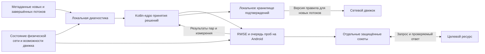

# Real-World Strategy Evaluator (RWSE)

RWSE проектируется как часть `experiments` внутри Android-приложения. Диагностика, генерация, планирование проб, сравнение, выбор и хранение выполняются на устройстве. Сетевые запросы идут к проверяемому ресурсу и при наличии к разрешённому контрольному ресурсу. Для работы RWSE достаточно сетевого доступа самого устройства. Сервер анализа, испытательный стенд и GitHub Pages в этом тракте отсутствуют.

Kotlin-ядро использует правила, наблюдения и локальную историю экспериментов. Ему не нужны облачные API и языковые модели. GitHub Actions и возможная сводка GitHub Pages относятся к проверкам проекта при разработке.

Каркас этапа 1 содержит проверочную службу Android VPN и контракты `PacketEngine`, `PacketEngineSession` и `SocketProtector`. Движок и RWSE ещё предстоит реализовать. Практические пробы подключаются после проверки исходящего тракта и изоляции стратегии на уровне нового потока. [Архитектура](ARCHITECTURE.md) · [План реализации](IMPLEMENTATION_PLAN.md)

## Взаимодействие компонентов

- Диагностика агрегирует повторяемые сбои по ресурсу, протоколу, семейству IP и наблюдаемому контексту сети. Учитывает стадию, число повторов, независимые признаки общей потери связи и достоверность атрибуции. Один тайм-аут, reset, TLS-сбой или HTTP 403 остаётся сигналом для классификации.
- Kotlin-ядро выделяет проверяемую гипотезу, формирует кандидатов и запрашивает опыт. RWSE сопоставляет запрос с разрешённым способом проверки и условиями очереди. Отсутствие допустимого способа даёт пассивную диагностику и результат «Недостаточно данных».
- Исполнитель открывает короткоживущие пробные сокеты с явно выбранной версией преобразований. В очереди живого трафика версия закрепляется за TCP-потоком или UDP-ассоциацией при создании. Пробы не меняют действующее правило, не читают пользовательский поток и не перезапускают движок. Если движок допускает выбор только через глобальную перенастройку, автоматическое применение его кандидатов остаётся недоступным.

## Shadow Optimization

Shadow Optimization ищет улучшения параллельно с живым трафиком. Триггер определяет момент запуска, область определяет допустимые события и ресурсы, режим определяет право на применение. Очередь, запуск сокета, запись результата и публикация правила используют один снимок этих условий.

| Настройка | Поведение |
| --- | --- |
| Ручной запуск | Сначала предлагаем выбрать приложение из обрабатываемых VPN. Пользователь может уточнить ресурс или выбрать анализ всех приложений VPN. Для нового ручного запуска предлагается режим «Только анализ». |
| Автоматический запуск | При включённой настройке повторяемое ухудшение текущей стратегии открывает задачу для подтверждённой области отказа. Требуются согласующиеся наблюдения по действующему правилу и исключение признаков общей потери связи. Одиночный тайм-аут, смена сети и неопределённый сбой сами по себе запуск не разрешают. |
| Все приложения VPN | Допускаются только подходящие наблюдения от приложений в текущей области VPN. Задачи формируются отдельно по точным ключам. Общая область расширяет охват поиска. Рабочие правила и история остаются раздельными. |
| Приложение | В очередь попадают только подтверждённые потоки выбранного приложения и профиля Android. Разные ресурсы этого приложения могут получить разные результаты и стратегии. |
| Ресурс приложения | Дополнительно проверяются достоверность ресурса и его точное соответствие выбору. Общий IP CDN и угадывание имени из IP для области ресурса недостаточны. |
| Только анализ | Кандидаты и сводки сохраняются локально. Даже выигравшая подтверждённая стратегия остаётся кандидатом до ручного применения. |
| Анализ с автоулучшением | Для рабочего правила допускается новая ревизия после отдельного подтверждения преимущества в той же области. Неполные и противоречивые результаты сохраняют действующее правило. |

Владелец TCP/UDP-соединения определяется через `ConnectivityManager.getConnectionOwnerUid()` по исходным локальному и удалённому адресам и портам до проксирования. Android предоставляет этот метод активному VPN и может вернуть неизвестный UID. UID связываем с `packageName` и профилем Android по доступным данным PackageManager. Учитываем разделяемые UID, видимость пакетов и повторное назначение UID. Один видимый пакет при неполной видимости не доказывает уникального владельца. При изменении состава приложений или сетевого поколения заново проверяем атрибуцию. Неуверенная атрибуция остаётся пассивным наблюдением и исключается из адресных проб и применения правил. [Определение владельца соединения](https://developer.android.com/reference/android/net/ConnectivityManager#getConnectionOwnerUid(int,java.net.InetSocketAddress,java.net.InetSocketAddress)) · [Видимость пакетов Android](https://developer.android.com/training/package-visibility)

Пробное соединение открывает сам RWSE с UID процесса приложения VPN. Принадлежность задачи выбранному приложению означает подтверждённый источник наблюдения и точный ключ результата. Она не гарантирует идентичность TLS-клиента, поведения приложения или маршрута. Если необходимые условия для сопоставления установить не удалось, результат остаётся недостаточным для правила этого приложения.

Очередь не меняет закреплённые версии рабочих потоков. Она снижает приоритет и приостанавливает пробы при ухудшении пользовательской задержки, частоты ошибок либо очередей обработки. При паузе закрываем сокеты проб и освобождаем слоты. Возобновление требует пригодной сети, действующего триггера и нового сравнения после ухудшения. Ручная остановка отменяет весь запуск, удаляет ожидающие пробы и отзывает право на публикацию у незавершённых результатов. Уже потраченные попытки, время и байты остаются учтёнными.

При ручном применении выбранная стратегия повторно проходит проверку актуальности доказательств, точного ключа, версии движка и действующей ревизии. Предыдущая рабочая ревизия сохраняется как вариант отката. Применение, автоматический откат при устойчивой деградации и ручной откат затрагивают только новые соединения соответствующей области.

## Модели данных

Названия ниже обозначают предлагаемые контракты. Kotlin-ядро принимает значения и результаты эффектов, а Android-адаптеры владеют сокетами, дескрипторами, `Network` и постоянным хранилищем.

| Модель | Состав и назначение |
| --- | --- |
| `AppKey`, `PolicyKey` | `AppKey` представляет профиль Android и `packageName` с проверенной атрибуцией UID для текущей сессии. `PolicyKey` связывает приложение, ресурс, протокол и семейство IP с сетевым контекстом. Сопоставление UID не используется как устойчивый идентификатор между запусками. |
| `AnalysisScope`, `OptimizationRun` | Область всех приложений VPN, одного приложения или его ресурса. Запуск фиксирует триггер, режим применения, бюджет, поколение сети и идентификатор отмены. Ревизию рабочего правила захватываем для точного ключа каждой задачи. |
| `ResourceKey`, `ProbeContract` | Ключ использует подтверждённый origin либо явно разрешённый адрес, порт, протокол и идентификатор контракта. Контракт хранит версию, допустимую операцию чтения, фиксированный запрос, ограничения ответа и критерий ожидаемого содержимого. Пользовательский URL и запрос в наблюдение не попадают. |
| `NetworkEpoch`, `NetworkScope` | `NetworkEpoch` — поколение текущей физической сети, привязки сокетов и существенных сетевых параметров, включая доступность семейств и настройки резолвинга. `NetworkScope` — минимальные устойчивые признаки или выбранный локальный профиль для восстановления между запусками. Тип транспорта сам по себе не даёт сильного совпадения. |
| `Observation`, `Diagnosis` | Протокол, семейство IP, стадия и тип сбоя, время и источник атрибуции. Диагноз содержит гипотезу, уверенность и признаки в её пользу. Причина и пригодность для активной пробы учитываются отдельно. |
| `EngineCapabilities`, `OperationSpec` | Версия движка, ABI, платформенные условия и проверенные операции. У каждой операции типизированные параметры, допустимая область, предпосылки, несовместимости и оценка стоимости. Признание операции программой и подтверждение на выбранной платформе отмечаются отдельно. |
| `StrategySpec`, `RuleRevision` | Условия применимости, семейства IP и протоколы, упорядоченные операции с параметрами и канонический идентификатор. Публикуемая ревизия связывает применимость, версию движка и подтверждающее решение. Прямой путь выполняется с пустым набором преобразований. |
| `ExperimentPlan`, `ProbeOutcome` | Роли прямого пути, текущей стратегии и кандидата, порядок пар, сетевое поколение, версия активного правила и контракта, лимиты. Исход хранит стадийные результаты DNS, транспорта, TLS и приложения, признак корректности содержимого, время, байты и причину отмены либо неудачи. |
| `ConfirmedDecision` | Точный `PolicyKey`, идентификаторы кандидата и сравниваемых правил, сводка сопоставимых пар, подтверждение содержимого, происхождение, срок применимости и ссылка на предыдущее подтверждённое правило. Режим запуска определяет запись в историю или допустимость новой рабочей ревизии. Для рабочей политики нужны подтверждения с этого устройства и по тому же ключу. |

## Допуск ресурса и независимые запросы

Ресурс выводится из доступных метаданных или явно заданного контракта. При скрытом имени, общем CDN-адресе или недостатке данных о протоколе динамически угадывать цель нельзя. Имя и путь не восстанавливаются из чужого зашифрованного потока. Наблюдение за пользовательским трафиком служит поводом для диагностики, а параметры тестового запроса задаёт контракт.

Новая проба использует свежий сокет и самостоятельное соединение. Для HTTPS устройство выступает обычным TLS-клиентом и проверяет сертификат и имя фактической цели. RWSE читает только ответ на собственный запрос. В тестовый сеанс не передаются перехваченные пакеты, зашифрованные HTTP-запросы, пользовательские заголовки, cookies, токены, содержимое форм и POST. MITM и подмена сертификатов отсутствуют.

Активная проверка допускается для известного публичного ресурса, где явно разрешена малозатратная операция чтения. Используем фиксированный безопасный запрос, верхний предел ответа и времени, исключаем передачу аутентификации и скрытые повторные запросы SDK. Выбранный пользователем адрес также проходит проверку применимости контракта. Редиректы по умолчанию ограничены допустимым origin и числом переходов. При выходе за контракт проба останавливается. Служебные, link-local и частные адреса исключены из автоматической диагностики публичных ресурсов. Стендовые адреса задаются отдельными тестовыми контрактами. HTTP `GET` и `HEAD` оцениваются по поведению конкретного ресурса. `HEAD` может подтвердить метаданные, но не корректность тела. [RFC 9110, безопасные методы](https://www.rfc-editor.org/rfc/rfc9110.html#section-9.2.1)

| Стадия | Исход проверки |
| --- | --- |
| DNS | Результат системного или заранее разрешённого резолвинга в выбранном сетевом контексте. Проверяем код ответа и применимые адреса. Для сравнения последующих стадий пары используют одинаковый применимый IP и семейство. Если проверяем резолвинг, его результат оцениваем отдельно от эффекта смены IP. |
| TCP и UDP | Для TCP фиксируем подключение и корректную передачу по контракту. Для UDP нужен поддерживаемый протокол с безопасным ограниченным запросом и проверяемым ответом. Успешная отправка UDP и запасной переход на TCP не подтверждают работу UDP. |
| TLS | Проверка цепочки и имени, результат рукопожатия и обрыв по стадии. Результат относится только к пробному соединению. |
| Приложение | Проверяем ожидаемый статус, допустимые перенаправления, лимит размера и независимый признак ответа. Для стабильного ресурса это может быть хеш или маркер, для динамического — согласованная структура и обязательные поля. HTTP 200 и успешный TLS сами по себе не подтверждают содержимое. При неизвестном контракте результат отмечается как недостаточный для выбора стратегии. |

## Сравнение и выбор

1. **Подготовка.** Проверяем сетевое поколение и доступность физической сети, версию движка, активную ревизию, контракт и бюджет. Все исходящие TCP/UDP-сокеты движка и проб проходят `protect()` до соединения или первой отправки. При явном выборе физического `Network` сокет привязывается до соединения. Для DNS используем разрешённый путь этой сети с учётом настроек резолвинга. Ошибка защиты или обязательной привязки прекращает пробу. Прямой эталон проходит сопоставимый тракт и отправляет обычные запросы без применения стратегии. [VpnService.protect](https://developer.android.com/reference/android/net/VpnService#protect(int)) · [Network.bindSocket](https://developer.android.com/reference/android/net/Network#bindSocket(java.io.FileDescriptor)) · [DnsResolver](https://developer.android.com/reference/android/net/DnsResolver)
2. **Пары.** Выполняем независимые пары «прямой путь — кандидат» и, если активно отдельное правило, «текущее правило — кандидат». Для каждой серии чередуем порядок A/B и B/A. Сохраняем один ресурс, физическую сеть, адрес назначения, семейство, протокол, профиль тайм-аутов и критерий содержимого, за исключением проверяемого фактора. Учитываем состояние DNS, повторное использование соединений и версию конфигурации. Смена поколения, несопоставимый адрес, нестабильный контроль или изменение ответа вне контракта делают пару непригодной для подтверждения. Отсутствие дополнительного контрольного сайта ограничивает выводы при неоднозначном фоне.
3. **Отбор.** Отдельно считаем сопоставимые, непригодные, отменённые и неудачные попытки. Сначала оцениваем корректность содержимого и стабильность, включая частоту отказов. Затем сравниваем задержку, скорость в пределах разрешённого объёма чтения и стоимость по байтам и доступным измерениям CPU. Оценка CPU может относиться к окну эксперимента, если нагрузку конкретного потока невозможно надёжно отделить. Кандидат с ухудшением корректности или стабильности не проходит за счёт экономии ресурсов.
4. **Подтверждение.** История ранжирует рабочую очередь и может подсказать кандидата. Лучший кандидат поисковой серии проходит отдельную серию сопоставимых пар в обоих порядках с подтверждением содержимого по контракту. Профиль задаёт минимум таких пар, порог стабильности и величину выигрыша. При равной корректности и стабильности преимущество может дать подтверждённая экономия ресурсов. Пороговые значения предстоит определить по базовым измерениям. При исчерпании бюджета или неопределённом результате сохраняется доступная действующая политика.

## Генератор и причины сбоев

Генератор выбирает область поиска по наблюдениям и зарегистрированным возможностям движка. Формирует параметры внутри допустимых диапазонов для ресурса и протокола, сначала меняет один параметр или операцию и составляет совместимые комбинации в пределах установленной глубины. Проверяет предусловия, зависимости порядка, взаимные исключения и доступность операции в данной сборке Android. Каноническое представление нормализует параметры по умолчанию, сохраняя значимый порядок операций. Два равнозначных описания сливаются до постановки в очередь. Пресеты используются как возможные исходные значения. Генератор может создать новый допустимый вариант при пустом наборе пресетов.

Приоритет следующей пробы зависит от гипотезы, предыдущих экспериментов по точному `PolicyKey`, давности результатов и стоимости. По мере поступления подтверждений и отказов ядро уточняет приоритеты, начинает от наиболее перспективных допустимых комбинаций и сохраняет возможность проверить новые. Для равных оценок используем стабильный порядок. Ограничения на размер очереди и повторные попытки входят в политику поиска. Каталог не включает операции, требующие системного доступа к физическому интерфейсу или привилегированных сетевых правил. Доступность обычных сокетных операций проверяется отдельно на Android. [Ограничения платформы](ARCHITECTURE.md#границы-на-android-без-root)

| Гипотеза | Интерпретация |
| --- | --- |
| Вероятна DPI-фильтрация | Повторяемый отказ на определённой стадии и устойчивый дифференциальный эффект при сопоставимых условиях могут повысить уверенность. Выигрыш кандидата сам по себе не устанавливает причину. |
| Общая проблема сети | Согласующиеся сбои на контрольных соединениях, признаки потери маршрута либо captive portal ограничивают эксперимент. Изолируем попавшие в такое окно результаты. |
| Вероятно региональное ограничение | Явный прикладной ответ от проверенного ресурса о регионе служит отдельным признаком. Внешний IP сохраняется, поэтому локальная стратегия не обещает изменить географию. |
| Причина не определена | Данные неполны, противоречат друг другу или допускают несколько объяснений. UI отдельно показывает исход доступных стадий и объём доказательств. |

## Бюджеты, публикация и восстановление

- Пробы ставятся в ограниченную очередь по правилам триггера Shadow Optimization. Схожие события объединяются в пределах ключа. Перед стартом резервируем слот, квоту попыток и предельный объём, ограничиваем число одновременных проб на устройство, сеть, приложение и ресурс. Учитываем обе стороны передачи и фактический объём даже для отменённых попыток. Длительность ограничивается монотонными дедлайнами. При недоступном бюджете очередь откладывается или завершается по политике профиля.
- Дозируем работу по режиму энергосбережения, лимитности сети, недавним сбоям и нагрузке живого трафика. Используем паузы после отказов и прекращаем эксперименты при превышении доступного окна CPU или времени. Измеряемая стоимость служит ограничителем вместе с трафиком и параллелизмом. Постоянного фонового сканирования и проб в спокойном состоянии нет. [PowerManager Android](https://developer.android.com/reference/android/os/PowerManager#isPowerSaveMode())
- Очередь связана с жизненным циклом VPN и поколением сети. Отмена закрывает только принадлежащие пробе сокеты и освобождает слот. Учёт потраченных попыток и байтов сохраняется. Перед публикацией проверяем активность запуска, право на применение, точный ключ, поколение, ревизию действующего правила и совместимость движка. Поздний исход учитывается в статистике и не активирует правило.
- Записываем решение и ссылку на предыдущую подтверждённую версию одной локальной транзакцией. После записи публикуем неизменяемый снимок для новых потоков через владельца текущей сессии. Сбой между записью и публикацией обрабатывается восстановлением по завершённой записи и повторной проверкой её области. Повторная публикация той же ревизии безопасна. При устойчивом ухудшении на новых потоках, истечении срока или несовместимости возвращаем последнее применимое подтверждённое правило либо прямой путь. Действующие TCP-потоки и UDP-ассоциации сохраняют первоначальную версию.
- Между запусками храним ограниченные агрегаты, версию контракта и движка, область применимости, подтверждения и сроки. Слабое совпадение сети позволяет использовать историю для порядка будущих проб. Автоматическое восстановление правила требует сильного совпадения и совместимой версии. Сырые пакеты, тела запросов и ответов и данные авторизации не сохраняются.

Контрольные сценарии для ядра, стенда и Android описаны в [стратегии испытаний](TESTING_STRATEGY.md). Перед подключением RWSE предстоит выбрать разрешённые контракты ресурсов, проверить движок на выборах стратегии по потоку и определить бюджеты и пороги подтверждения для начальных профилей.
