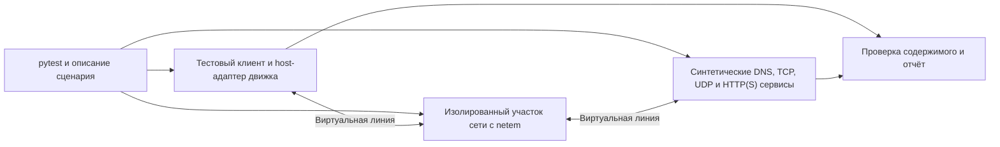

# Стратегия испытаний

Каркас этапа 1 уже собирается, и состояния службы проверяются модульными тестами. Матрица ниже задаёт будущие проверки. Каждую ячейку закрываем результатом из указанной среды с привязкой к ревизии. Симуляция подтверждает логику решений на заданных входах. Сбой, внесённый стендом, подтверждает реакцию на известную причину. Для выводов о вероятной DPI-фильтрации нужны отдельные наблюдения и контрольные сравнения в соответствующей сети на устройстве. [Архитектура диагностики](ARCHITECTURE.md) · [RWSE](RWSE_DESIGN.md) · [Порядок внедрения](IMPLEMENTATION_PLAN.md)

## Уровни испытаний

| Уровень | Среда | Что проверяем |
| --- | --- | --- |
| Модульные | JVM с JUnit, `kotlinx-coroutines-test` и при необходимости MockK. Для C — host-сборка отдельными целями CMake. | Состояния VPN, классификацию событий, синтез кандидатов, порядок событий, виртуальное время, бюджеты, транзакции на тестовых реализациях контрактов. В C — кодеки, границы буферов, состояния потоков, владение ресурсами. |
| Симуляция | JVM-модуль `:adaptive-simulator` с зависимостью от общего Kotlin-ядра | Последовательности событий, проверок и решений с управляемым временем и заранее заданными исходами. |
| Интеграционные | Linux, pytest и синтетические сервисы. Для условий передачи — Docker, network namespaces и `tc/netem`. | Совместную работу реальных компонентов на тестовых соединениях, точную причину отказа, протокольное поведение, подтверждение содержимого и изоляцию проб. Host-адаптер C используется для переносимой логики. |
| Инструментальные | Android Emulator, ADB, AndroidJUnitRunner и Compose UI Test, затем выбранные физические устройства. | Android API, `VpnService`, JNI, UID и маршруты, доступность интерфейса, пересоздание экрана, переходы службы, уведомления и восстановление процесса. Compose UI Test работает с UI приложения. Прогоны системного диалога согласия и отзыва выполняются отдельно, при необходимости вручную. |
| Реальные сетевые | Физические Android-устройства, Wi-Fi и мобильные сети. Тестовые клиенты работают с собственными либо разрешёнными контрольными ресурсами. | Совместимость матрицы устройство × сеть, смену сети, длительные соединения, практические бюджеты и повторяемость прикладного результата. В отчёте указываем условия и степень уверенности в причине сбоя. |

`runTest` с виртуальным временем проверяет дедлайны и порядок отмены. Конкурентный ввод-вывод, JNI и реальную сетевую задержку проверяем в соответствующих средах. В инструментальных проверках подготавливаем известные разрешения и данные приложения, а результаты прогона с заранее выданным разрешением учитываем отдельно от проверки системного согласия. [Тестирование корутин](https://kotlinlang.org/api/kotlinx.coroutines/kotlinx-coroutines-test/) · [Тестирование Compose](https://developer.android.com/develop/ui/compose/testing) · [ADB](https://developer.android.com/tools/adb)

## Проверка каркаса VPN

Локальные тесты состояния проверяют устаревшие результаты согласия и команды службы, остановку до создания TUN, повторные остановки, ошибку при остановке и отзыв текущего сеанса. Инструментальные тесты собираются командой `:app:assembleDebugAndroidTest` и запускаются командой `:app:connectedDebugAndroidTest` на тестовом Android. Сценарий активного сеанса требует предварительного системного согласия и видимого уведомления. Начните и остановите сеанс из приложения, разрешите уведомления на API 33+ и оставьте VPN выключенным перед тестом.

| Проверка Android | Ожидаемый результат |
| --- | --- |
| Пересоздание Activity при выключенном и активном VPN | UI отражает состояние текущего процесса. Пересоздание не создаёт лишнего TUN и не останавливает активный сеанс. |
| Смена Activity во время диалога и гибель процесса | Доставленный Android результат относится только к своему запросу. При завершении процесса с активным TUN новый процесс показывает выключенный VPN. Старый запуск и старая команда остановки не активируют и не завершают новый сеанс. |
| Системный отзыв через настройки VPN или переключение на другой тестовый VPN | Android вызывает `onRevoke()`. Служба снимает уведомление, закрывает TUN и переходит в «Разрешение отозвано». Повторный пользовательский запуск снова запрашивает согласие при необходимости. |
| Повторная остановка и ошибка запуска | Остановка из UI и уведомления действует на свой сеанс. Foreground-уведомление удаляется, TUN закрывается и можно повторить запуск. |
| Минимальная и целевая платформы | На API 29–33 проверить обычный foreground-вызов, на API 34–36 проверить допуск `systemExempted` после согласия. На API 33+ проверить отдельно отказ в разрешении уведомлений и остановку через UI. Тестовый TUN ограничен пакетом проекта и создаётся без маршрутов по умолчанию. |

Системное согласие, отзыв и принудительную остановку процесса проверяем на выделенном устройстве или эмуляторе отдельно от тестов с заранее выданным согласием. Успешная компиляция пакета Android-тестов подтверждает наличие исполняемого набора. Результат исполнения фиксируется только после прогона на Android. [Жизненный цикл VPN](https://developer.android.com/develop/connectivity/vpn) · [Типы foreground-служб](https://developer.android.com/develop/background-work/services/fgs/service-types)

## Проверка отказов и отчётов

Модульные тесты проверяют оценку сигнала движка при недоступной сети, критическую остановку и повторное ручное включение, ограничения журнала, аварийный слот, восстановление записи и исключение секретов из отчёта. Подготовка диагностического файла, отдельный канал, переход по уведомлению и отказ в уведомлениях имеют инструментальные проверки.

| Сценарий на тестовом Android | Проверка |
| --- | --- |
| Высокий приоритет и переход | Включить уведомления приложения и канал критических ошибок. Запустить `DiagnosticsInstrumentedTest`. У события одно уведомление со ссылкой на свою запись. |
| Запрет уведомлений на API 33+ | Запретить уведомления приложения и повторить `DiagnosticsInstrumentedTest`. Ошибка остаётся непрочитанной в журнале, системное уведомление отсутствует. Сценарии для другой настройки помечаются пропуском. |
| Авария и восстановление | На выделенном Android запустить проверочный сеанс, выполнить `adb shell am crash org.adaptivedpi.android` и запустить метод `anAbortedVpnProcessIsReportedAfterTheNextLaunch` с параметром инструментации `-e recoveredVpnError AppCrash`. При полном прекращении процесса без вызова обработчика проверять аналогично с `VpnInterrupted`. Ожидаются выключенный VPN и доступный отчёт. |
| Отчёт и доступ к файлу | Инструментальный тест проверяет action SAF, содержимое URI отчёта, временное разрешение чтения и отклонение пути вне выделенного каталога. На устройстве отдельно выбрать место сохранения и открыть отчёт в совместимом приложении через Sharesheet. |
| Lockdown | На устройстве с поддерживаемым VPN и включённой блокировкой проверить системное поведение после остановки. Проверочный VPN каркаса исключён из Always-on. Его предупреждение формулирует ограничение и оставляет изменение системных настроек пользователю. |

Инструментальные проверки сборки запускаются через `:app:assembleDebugAndroidTest`, исполнение на Android — через `:app:connectedDebugAndroidTest`. Проверка живого зависания и аварийного освобождения TUN движка остаётся за этапом подключения реального движка.

## Приёмка этапа 1 на Pixel 7

Локально и в GitHub Actions выполняются `testDebugUnitTest`, `:engine:test`, `assembleDebug`, `:app:lintDebug` и `:app:assembleDebugAndroidTest`. Они покрывают переходы состояний, повторные команды остановки, разделение сигнала движка и доступности сети, запись причины, восстановление, срок хранения и подавление повторных уведомлений. APK инструментальных тестов проверяется в сборке. Для выполнения инструментальных тестов нужен подключённый Android.

Перед публикацией GitHub Actions запускает `BuildAndDiagnosticsUiTest` на эмуляторе Pixel 7 с API 34. Тесты открывают реальный экран диагностики, проверяют видимость экспорта и журнала VPN, открывают отчёт и прокручивают экран до журнала ошибок. Отдельно сверяются коммит и номер сборки на экране «О приложении». Шаг проверки APK сверяет ресурсы диагностики, коммит и номер запуска с параметрами workflow, проверяет подпись и сохраняет SHA-256 файла.

На Pixel 7 записать установленную версию Android и тип подключения. Установить собранный debug APK, например командой `adb install -r app/build/outputs/apk/debug/app-debug.apk`, и запустить приложение. Затем пройти матрицу.

| Сценарий | Что проверить |
| --- | --- |
| Установка и «О приложении» | Приложение открывается. Версия и номер сборки совпадают с APK. На экране ниже в настройках доступны ссылки на GitHub и лицензии. |
| Согласие и системный отзыв | Сначала отказать в согласии, затем запустить снова и выдать его. Дождаться статуса проверочного сеанса. Отключить VPN в системных настройках или переключить его на другой тестовый VPN. Проверить освобождение интерфейса, состояние и отсутствие самопроизвольного перезапуска. |
| Остановка и повторный запуск | Запустить проверочный VPN и нажать «Остановить VPN» в приложении. Запустить снова и остановить кнопкой в foreground-уведомлении. Повторить запуск после обеих остановок. Уведомление предыдущего сеанса не влияет на новый. Системное предупреждение об ошибке при штатной остановке отсутствует. |
| Пересоздание Activity и гибель процесса | Повернуть экран на этапе согласия и при работающем TUN. Статус относится к текущему сеансу. На тестовом устройстве отдельно завершить процесс во время сеанса и открыть приложение снова. VPN выключен, причина прерывания доступна в журнале, если сохранилась отметка или ошибка. |
| Другие приложения | На том же Wi-Fi, а при наличии также на мобильной сети, открыть контрольный ресурс в другом приложении до запуска, во время проверочного сеанса и после остановки. Тестовый TUN не меняет путь чужого трафика. Общесистемные сетевые ограничения учитывать отдельно. |
| Сохранение и отправка отчёта | По сценарию из раздела «Проверка отказов и отчётов» получить запись. Просмотреть её состав. Сохранить TXT через системный выбор места и открыть его. Через «Поделиться» открыть файл в совместимом тестовом приложении. Проверить совпадение содержания и временный доступ. |
| Отказ в уведомлениях | Запретить уведомления системными настройками. Запустить и остановить VPN из приложения. Проверить доступ к журналу и отсутствие падений. Повторить проверку диагностического события с запретом уведомлений. |
| Системная блокировка и запасной путь | Проверить инструкцию и кнопку «Открыть настройки VPN». Для отдельного совместимого тестового VPN проверить системную блокировку после остановки и убедиться, что настройки не менялись приложением. Каркас исключён из Always-on. Если Pixel не даёт включить этот режим для каркаса, отметить это в протоколе и использовать отдельную тестовую конфигурацию для проверки системного ограничения. |

Проверка на Pixel считается пройденной после фактического прогона. Сценарии пересоздания Activity, прежнего уведомления и экспортного URI также входят в инструментальные тесты. [USB-отладка Android](https://developer.android.com/studio/debug/dev-options) · [Управление VPN на Android](https://support.google.com/android/answer/9089766)

### Журнал событий и экспорт на Pixel 7

1. Установить свежий debug APK. Открыть диагностику и проверить пустое состояние после подтверждённой очистки журнала. Если системное разрешение VPN уже выдано, сначала удалить профиль приложения в настройках Android. Запустить VPN и отменить диалог. Проверить запрос и результат без записи о создании TUN. Повторить с выдачей разрешения и проверить запуск и создание TUN с одинаковым идентификатором сеанса.
2. Остановить сеанс из приложения. В следующем сеансе использовать кнопку в постоянном уведомлении. Проверить источник и ровно одну запись о завершении для каждого сеанса. Повторное нажатие и устаревшее уведомление не должны останавливать следующий сеанс.
3. Отключить активный VPN в системных настройках и проверить событие отзыва. Снова запустить VPN и убедиться, что новый сеанс получил отдельный идентификатор.
4. Повернуть экран во время работы TUN. Проверить запись о пересоздании Activity без дополнительной записи о запуске. Уйти на главный экран Android и вернуться в существующую Activity без пересоздания. Счётчик запусков VPN должен остаться прежним.
5. На тестовой установке с активным VPN принудительно остановить приложение через системные настройки. После открытия VPN должен быть выключен. Если отметка сеанса успела сохраниться, ожидается запись об обнаружении прерывания. Для проверки восстановления экрана в новом процессе свернуть приложение с выключенным VPN, выполнить `adb shell am kill org.adaptivedpi.android` и вернуть сохранённую задачу из списка недавних. Ожидать запись о восстановлении только если Android передал сохранённое состояние.
6. Открыть детали записи. В общем отчёте проверить оба журнала, версию приложения и Android, модель, состояние VPN и движка. Сохранить TXT через системный выбор файла и сверить текст с предпросмотром. Повторить через «Поделиться». Проверить, что в отчёте отсутствуют адреса, учётные данные и содержимое трафика.
7. Отменить очистку, убедиться, что записи остались, затем подтвердить её. После открытия приложения журнал событий должен оставаться пустым до следующего фактического события. Журнал ошибок проверяется отдельно.

## Симулятор адаптивного алгоритма

Предлагаемый JVM-модуль `:adaptive-simulator` вызывает `:adaptive-core`, тот же Kotlin-код, который будет вызывать Android-приложение. Часы, состояние сети, исходы проб и репозиторий подменяются средствами симулятора. Эффекты ядра исполняет тестовый драйвер, поэтому JUnit может проверить и запрошенное действие, и итоговую ревизию политики.

- Сценарий задаёт версию ядра, каталог возможностей движка, ресурс и профиль, начальное состояние, seed и при необходимости фиксированную последовательность событий с виртуальными отметками времени. Генератор сценариев выдаёт повторяемые этапы DNS/TCP/UDP/TLS и приложения, потери сети, регрессии и запоздавшие ответы. При совпадении времени порядок событий задаётся сценарием. При ошибке сохраняем seed и последовательность, достаточную для повторного запуска.
- Вместо сетевых сокетов драйвер выдаёт результаты, заданные сценарием. Он может задержать исход, завершить его после отмены, исчерпать квоту либо разыграть остановку процесса. Симуляция перезапуска создаёт новый экземпляр ядра из снимка тестового репозитория. Для настоящих транзакций и остановки Android-процесса остаются инструментальные проверки.
- Модельные публикации допускаются в пределах теста, чтобы проверить той же логикой успешный выбор, откат и восстановление. Отчёты помечаются как `simulation`. Они не загружаются в Android-хранилище и не служат подтверждением сети или DPI. Android-публикация принимает локальные результаты RWSE из применимого сетевого контекста. Linux-стенд, эмулятор и физические испытания имеют свои обозначения среды.

Предусматриваем тысячи сценариев из фиксированного диапазона seed. Варьируем нестабильность сети, случайные успехи, общие сбои с похожими признаками DPI, противоречивые пары и деградацию ранее успешного правила. Генератор сценариев смешивает события разных приложений и ресурсов, смены UID, отмену, смену сети и поздние результаты. Помимо итогового правила проверяем отсутствие эффектов вне области запуска, соблюдение бюджетов и воспроизводимость сбоя по seed. Для PR подходит быстрый репрезентативный набор, для отдельного задания — полный прогон.

## Структура испытательного стенда

Это предлагаемая структура файлов. В Gradle-модулях JVM-тесты размещаются в `src/test`, Android-тесты — в `src/androidTest`. Linux-стенд живёт отдельно от Gradle-сборки приложения.

```text
testing/network/
├── pyproject.toml          # Настройки pytest и зависимости стенда
├── Dockerfile              # Среда синтетических сервисов
├── conftest.py             # Создание и освобождение ресурсов прогона
├── topology/               # Пространства имён, виртуальные линии и профили netem
├── fixtures/               # Синтетические TCP, UDP, DNS и HTTP(S) сервисы
├── scenarios/              # Описания нагрузки, причин сбоя и ожидаемых исходов
├── tests/                  # Прогоны pytest и клиентские проверки
└── reports/                # Генерируемые JUnit XML и обезличенные сводки
```



- **Изоляция.** Клиент, участок внесения сбоя и сервисы получают отдельные network namespaces. Виртуальные интерфейсы соединяют только участников сценария. Docker фиксирует пользовательскую среду сервисов, ядро и `netem` предоставляет Linux-host. Стендовая сеть по умолчанию замкнута на тестовые адреса. Для топологии используем выделенный Linux-host либо VM с выданными правами на настройку сети. Профили `netem` применяются на виртуальном интерфейсе стенда. [Пространства имён iproute2](https://man7.org/linux/man-pages/man8/ip-netns.8.html) · [Сетевые возможности Docker](https://docs.docker.com/engine/containers/run/) · [Режим none в Docker](https://docs.docker.com/engine/network/drivers/none/)
- **Внесение сбоя.** `tc/netem` моделирует задержку, джиттер, потери и переупорядочение на выбранном направлении. Точные DNS-ответы, намеренное закрытие соединения, неверный TLS-сертификат, таймаут приложения и ответы с чужим содержимым задаются синтетическими сервисами. Сценарий проверяет, что возмущение действительно произошло. Фиксируем профиль, направление и seed, где он поддерживается, и оцениваем случайные профили по серии прогонов. [Руководство tc-netem](https://man7.org/linux/man-pages/man8/tc-netem.8.html)
- **Повторяемость.** Для каждого прогона создаём собственные имена пространств, контейнеров и адреса. Фиксируем ревизию, версии зависимостей и образа, ядро, параметры сценария, семейства IP, тайм-ауты и ожидаемый результат. Очистка выполняется при успехе, ошибке и отмене. Контрольный прогон подтверждает, что одновременные сценарии не затронули друг друга.
- **Тестовые данные.** Фикстуры создают запросы, DNS-зоны и полезную нагрузку сами. Реальные пользовательские запросы, cookies, заголовки авторизации и учётные данные в испытаниях не используются. TLS-фикстуры доверяют тестовому CA только в тестовом клиенте или тестовом варианте приложения. Обычная проверка сертификата и имени сохраняется. В отчёты идут идентификатор сценария, стадии, измерения и итог сверки содержимого. Сырые запросы, секреты и захваты реального трафика в артефакты не попадают.

## Матрица испытаний

Здесь перечислены критерии, которые слои стенда должны проверять после реализации соответствующих функций. Набор расширяем тестами регрессий. Для транспортных сценариев отдельно записываем семейство адресов в TUN и исходящем сокете, режим сети и путь обработки.

| ID и сценарий | Где проверять | Приёмка |
| --- | --- | --- |
| VPN-01. Согласие, запуск, остановка и отзыв | JVM для переходов, эмулятор и устройство для службы | Отказ не запускает службу. Старт, уведомление, повторный старт, уход в фон, остановка и отзыв приводят к ожидаемому состоянию. Тестовый TUN ограничен заданным пакетом. Дескрипторы освобождаются после завершения. |
| TCP-4 и TCP-6. Передача по IPv4 и IPv6 | Стенд, эмулятор, затем устройство | Обе ячейки дают ожидаемую длину и хеш потока. При частичных чтениях и половинном закрытии данные доставляются по контракту. После таймаута, reset и ошибки защиты сокета ресурсы освобождаются. Повторные открытия не создают петлю TUN и рост числа дескрипторов. |
| UDP-4 и UDP-6. Передача по IPv4 и IPv6 | Стенд, эмулятор, затем устройство | Обе ячейки сохраняют границы и содержимое дейтаграмм. Ответы попадают в правильную ассоциацию. Отдельно проверяем тайм-аут ассоциации, размеры около MTU, потери и переупорядочение. |
| IP-01. Dual-stack, IPv6-only и DNS64/NAT64 | Стенд при наличии профиля, Android и устройство в соответствующей сети | Различимы семейства на входе и выходе. Подтверждается доставка либо явно предусмотренное ограничение маршрута. DNS64/NAT64 оценивается как отдельная ячейка. |
| DNS-01. Корректный ответ, отказ и переход на TCP | Стенд, эмулятор, при необходимости устройство | Контрольная зона выдаёт заданные A и AAAA. Усечённый ответ по UDP ведёт к ожидаемому обработчику TCP там, где этот переход предусмотрен. NXDOMAIN, SERVFAIL и отсутствие ответа различаются. |
| TLS-01. Корректный TLS и отрицательные сценарии | Стенд и Android-инструментальные | Доверенный сертификат и верное имя дают успех TLS. Ошибка имени, недоверенный сертификат и обрыв рукопожатия фиксируются на своей стадии. Результат TLS записывается отдельно от исхода проверяемого запроса. |
| CONTENT-01. Содержимое после успешного TLS | Стенд, эмулятор, контрольные внешние ресурсы на устройстве | Сверяются ожидаемый статус, допустимые перенаправления, размер и контрольная строка или хеш. HTTP 200 с заменённой страницей и неожиданный redirect дают отрицательный или неопределённый результат по контракту. При непроверяемом теле остаётся статус «Недостаточно данных». |
| CLASS-01. Отказ сервера, captive portal, ошибки транспорта и региональный ответ | JVM, стенд, затем реальные сети | Классификатор объясняет доступные признаки и при неоднозначности возвращает неопределённую причину. Явный региональный ответ отмечается отдельно. Ни таймаут, ни HTTP 403, ни искусственная потеря связи сами по себе не подтверждают DPI. |
| RWSE-01. Допустимость запроса | JVM, стенд и Android-инструментальные | Неизвестное имя, отсутствие контракта, выход редиректа за контракт и запрещённый адрес не дают неразрешённой отправки. Свежая проба использует только параметры контракта и отдельный сокет. TLS остаётся валидируемым. |
| RWSE-02. Контрольные пары | Стенд, Android-инструментальные и устройство | Прямой путь, текущее правило и кандидат проверяются отдельными сокетами с сопоставимыми настройками в порядке A/B и B/A. Смена IP или сетевого поколения и нестабильный фон исключают пару из подтверждения. Для UDP переход на TCP записывается отдельно. |
| EXP-01. Контрольная пара и синтез | JVM и стенд | Сравниваем базовый путь и кандидат на одном ресурсе при одинаковых условиях. Передаём генератору наблюдения и схему возможностей, сначала с пустым списком пресетов, затем с известными пресетами. Проверяем наличие нового канонического кандидата, соблюдение диапазонов и совместимости, предел числа вариантов и отсутствие дубликатов. Ранжирование повторяемо при одинаковых входах. |
| EXP-02. Работающие потоки во время проб | Стенд, Android-инструментальные и устройство | Длительный TCP-поток сохраняет идентификатор сессии и хеш данных без переподключения. Активная UDP-ассоциация сохраняет идентификатор, а номера и содержимое дейтаграмм соответствуют заданному режиму потерь. Диагностика, отмена и смена политики не нарушают этих критериев при стабильном маршруте. |
| EXP-03. Отмена, откат и устаревший результат | JVM, стенд и Android-инструментальные | Отмена по тайм-ауту, запросу пользователя или смене сети освобождает сокеты, квоту и задачи. Результат предыдущего поколения сети не публикует правило. При неудаче сохраняется прежняя версия. Успешное обновление и откат меняют выбор только для новых потоков. |
| SIM-01. Воспроизводимость, генерация и ранжирование | Kotlin-симулятор и JUnit | Одинаковые входы и seed дают одинаковые решения. Пустой список пресетов допускает генерацию нового варианта. Невыполнимые операции и дубликаты отбрасываются. При равных условиях правильное содержимое и стабильная передача имеют преимущество перед более быстрым ошибочным ответом. |
| SIM-02. Недостаточные данные и нестабильная сеть | Kotlin-симулятор и JUnit | Перемежающиеся отказы, смена контекста, правильный TLS с подменённым телом и удачная одиночная попытка не активируют кандидата. При неубедительных признаках сохраняется «Причина не определена». Подтверждённая модельная серия обновляет только тестовую политику. |
| SIM-03. Отмена, бюджеты и восстановление | Kotlin-симулятор и JUnit | Повтор событий не превышает лимит очереди, числа попыток, объёма, времени и параллелизма. Снятие слота не возвращает потраченные байты. Запоздавший исход отменённой пробы игнорируется при публикации. После восстановления допускаются только совместимые подтверждённые ревизии, а ухудшение вызывает откат. |
| SHADOW-01. Только выбранное приложение или его ресурс | Симулятор и Android-инструментальные | Смешать потоки двух пакетов, несколько ресурсов одного пакета и потоки с неизвестным или общим UID. В адресной области никаких проб и рабочих обновлений для других приложений, чужих ресурсов или неизвестного владельца. В общей области история остаётся раздельной. |
| SHADOW-02. Изоляция рабочего и пробного трафика | Стенд, Android и устройство | На стабильном маршруте длительный TCP и действующая UDP-ассоциация сохраняют ревизию, идентификатор и целостность при пробах, ручном применении и откате. Пауза при росте ошибок или задержки рабочего трафика закрывает только пробные сокеты. |
| SHADOW-03. Ручная остановка | Симулятор, стенд и Android | Проверить отмену очереди и активной пробы, освобождение слота, сохранение учёта потраченных ресурсов и отказ в публикации позднего результата. Действующая ревизия сохраняется. |
| SHADOW-04. Автоматический запуск | Симулятор и стенд | Выключенная настройка, разовый тайм-аут, неопределённость и общий сетевой сбой сохраняют ноль запусков. Подтверждённое ухудшение действующего правила при включённой настройке создаёт одну задачу с точным ключом и заданным бюджетом. |
| SHADOW-05. Только анализ, применение и откат | Симулятор и Android | Подтверждённый кандидат в режиме «Только анализ» остаётся в истории. При ручном применении или автоулучшении кандидат проходит проверку доказательств. Случайный успех и сопоставимые результаты без преимущества сохраняют текущую стратегию. При устойчивой регрессии откат затрагивает только новые потоки точной области. |
| STORE-01. Прерывание записи и перезапуск | JVM для правил восстановления, Android-инструментальные с реальным хранилищем | Прерывание перед фиксацией и после неё оставляет согласованные данные. Восстанавливаются завершённые совместимые результаты. Устаревшие версии, слабое совпадение контекста и незавершённые пробы обрабатываются по правилам архитектуры. |
| BUDGET-01. CPU, память, трафик и параллелизм | JVM для жёстких лимитов, стенд и Android для измерений, физическое устройство для приёмки | При отсутствии триггеров число активных проб равно нулю. При шквале ошибок соблюдаются лимиты очереди, параллелизма, времени и диагностических байтов, включая отмену. Под постоянной нагрузкой CPU и память укладываются в согласованные пределы, а после остановки отсутствует устойчивый рост ресурсов. |
| REAL-01. Wi-Fi, мобильная сеть и переключение | Физические устройства | Сохраняем идентификаторы среды и контрольные результаты по каждой функции. При исчезновении маршрута отдельно проверяем корректную отмену и последующее восстановление. Заявления о поддержке ограничиваем успешно пройденными ячейками. |

### Контроль, повторения и бюджеты

- У контрольной пары фиксируем физическую сеть, IP назначения, семейство, запрос и ожидаемый ответ, кроме проверяемого параметра. Чередуем порядок проверок и сравниваем повторы. При изменении маршрута, ответа контрольного сервиса или нестабильном фоне опыт даёт неопределённый результат. Для отказа сервера и общей потери связи проверяем, что кандидат не назначается только по совпадению ошибок.
- Для ресурсов сравниваем выключенный сервис, прямой путь и путь с диагностикой при одной длительности, профиле и нагрузке. Измеряем процессорное время за окно, пиковые и устойчивые RSS/PSS в подходящей среде, число дескрипторов, p50/p95 задержки, диагностические байты и пик активных задач. Разделяем абсолютное потребление и прирост к базовому пути. Байты проб учитываем в обе стороны, а сетевые накладные расходы фиксируем отдельно, если они измеримы. Лимиты чисел, байтов и времени подставляем из тестового профиля. Численные пределы CPU и памяти фиксируем после базовых измерений и до приёмки соответствующего профиля. Данные с CI-эмулятора используются для выявления регрессий, а оценка батареи выполняется на физическом устройстве.
- Для отчётов используем состояния «Пройдено», «Провалено», «Пропущено с причиной» и «Не проверено». Отдельно указываем успешность передачи, подтверждение содержимого и эффективность стратегии. Допуск к заявлению о поддержке требует успешной ячейки для заявленной среды и режима. Успех лабораторного сценария подтверждает поведение в заданных условиях.

## GitHub Actions

Существующая конфигурация запускает модульные тесты и собирает debug APK. Расширение ниже предлагается к внедрению после утверждения плана. [Текущий workflow](../.github/workflows/android-build.yml)

| Когда | Автоматизация | Отчёты и артефакты |
| --- | --- | --- |
| Pull request и push в main | Gradle unit-тесты, Android lint и debug-сборка. По мере добавления модулей — `:adaptive-core:test`, `:adaptive-simulator:test`, host-тесты C с CTest и быстрый изолированный набор pytest на доступном Linux-runner. | JUnit XML Gradle/pytest, результаты lint и сводка по тестам C. Отчёт симулятора содержит seed и идентификатор сценария. Debug APK публикуется после успешного завершения необходимых проверок. |
| Отдельное задание на подготовленном runner, вручную или по расписанию | Тысячи JVM-сценариев. Отдельно — эмуляторный smoke-набор, Compose UI Test, инструментальная матрица и интеграционные проверки через Linux namespaces и `netem`. Для системных заданий проверяем доступ к KVM и возможности ядра. | Результаты с типом среды, seed симуляции, стендовые JUnit XML. Если обязательный набор недоступен, отмечаем ошибку среды. Для опционального задания фиксируем явный пропуск с причиной. |
| По запросу на физическом устройстве | Повторяемые ADB-прогоны и сбор метрик можно автоматизировать на выделенном оборудовании. Сеть, модели и операторы выбираются для конкретной проверки. | Отдельные протоколы по устройствам и сетям. Данные сетей и устройств, которые не участвовали в прогоне, остаются без подтверждения. |

Отчёты загружаются отдельным шагом, который выполняется и при провале тестов, например с условием `!cancelled()`. Шаг самих тестов сохраняет ошибочный статус. Публикация APK зависит от успеха необходимых проверок и наличия файла. Сетевые тесты с расширенными правами выполняются в изолированной среде. Для доверенного физического или self-hosted стенда используем отдельный запуск проверенного исходного кода. [Вывод JUnit XML в pytest](https://docs.pytest.org/en/stable/how-to/output.html) · [Условия шагов GitHub Actions](https://docs.github.com/en/actions/reference/workflows-and-actions/expressions#status-check-functions) · [Артефакты GitHub Actions](https://docs.github.com/en/actions/concepts/workflows-and-actions/workflow-artifacts)

## Публичная сводка испытаний

В будущем GitHub Actions может собрать статическую страницу GitHub Pages из обезличенной сводки тестов разработки. В публичную сводку допускаем ревизию, тип среды, ID сценария, число успешных и неуспешных проверок, агрегаты и категорию пропуска. Для каждой строки указываем, была ли это симуляция, стенд, эмулятор или физическое испытание. Сырые журналы, адреса и домены, имена сетей, идентификаторы устройств и материалы устройства пользователя из источников страницы исключены.

Сводка формируется отдельным процессом из разрешённых артефактов разработки. Android-приложение не отправляет на страницу наблюдения, не читает с неё конфигурацию и не использует её для принятия решений. Сбой публикации страницы не блокирует сборку и работу APK. [GitHub Pages](https://docs.github.com/en/pages/getting-started-with-github-pages/what-is-github-pages)
